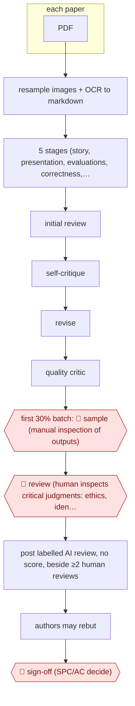

# Added AI review

`PRO › RES › PEER` · sampled · evidence A · **draft: needs a reference example** ([how to add one](../../../../../CONTRIBUTING.md#1-add-an-example-run))

**Shape:** `each paper: PDF → resample images + OCR to markdown → 5 stages (story, presentation, evaluations, correctness, significance) → initial review → self-critique → revise → quality critic → first 30% batch: 🛑 sample (manual inspection of outputs) → 🛑 review (human inspects critical judgments: ethics, identity leaks, missing structure) → post labelled AI review, no score, beside ≥2 human reviews → authors may rebut → 🛑 sign-off (SPC/AC decide)`
**How it differs:** AWF-0046 Review-of-review feedback sends private feedback to a human reviewer about their review. AWF-0106 Submission intake screen does integrity checks before peer review. Here the AI writes a full review that the authors and the decision-makers see. The deliverable is a review of the paper itself, with scale-up sampling and pre-post inspection checkpoints.
**Variants:** `aaai-26-review-system`

<!-- shape diagram: generated by scripts/build_diagrams.py from `shape`; don't edit -->

<!-- end shape diagram -->

## Background

Peer review is short of reviewers and getting shorter, and the shortage lands hardest on the papers nobody wants to read: the incremental result, the badly written submission, the one whose author has been waiting four months for a first opinion. An AI review cannot replace a reviewer's judgement, but it can make sure every paper has at least one detailed reading, written in a fixed format, before a human decides. That is the design here, and its constraints are what make it acceptable rather than what make it good: the AI review is clearly labelled, carries no score and no recommendation, and sits beside at least two human reviews rather than in place of one. Authors can rebut it, and the decision stays with the senior programme committee and area chairs. The engineering is a pipeline — convert the PDF, read the figures, review in stages, criticise its own draft, then score itself — and the governance is a set of inspections at exactly the points where a plausible-sounding review could do damage: before scaling past a first batch, and whenever a draft touches ethics, reveals an author's identity, or asserts something the paper does not say.

**Terms:**
- **SPC / AC**: senior programme committee and area chair, the people who decide acceptance.
- **full review**: a paper that has passed desk screening into review with assigned reviewers.
- **OCR**: optical character recognition, converting figure and scan text into text the model can read.
- **self-critique**: a stage where the model attacks its own draft before a reviewer sees it.
- **quality critic**: a scoring stage that rates the review's own quality, used to filter, not to decide.
- **labelled**: visibly marked as AI-generated, so no reader mistakes it for a human review.
- **rebuttal**: the authors' written response to reviews.
- **identity leak**: an AI review that reveals an author's name, breaking double-blind review.

## Build it with an agent

**Form:** `service`. It runs over a conference's entire intake — tens of thousands of papers — with nobody starting each run, on a schedule that has to finish before reviewers do, and people appear only at the sampling and inspection gates. That is a service: unattended batch work at a scale no person could supervise per item.

**You need:** every submission in a machine-readable form, which means OCR for figure-heavy PDFs and a check for the formats that break conversion; a fixed review template, because a review whose sections vary cannot be compared or rebutted; the paper's own text as retrieval context, so the review can be held to what the paper says rather than to the literature; a first-batch gate before scale, with somebody actually reading the outputs rather than checking that they exist; an inspection step for ethics, identity leaks and missing structure, run before posting; and the conference's policy on what an AI review may say — no score, no recommendation, labelled, rebuttable — encoded in the pipeline rather than left to prompt wording. The agent must not score, must not recommend, and must not post anything a person has not inspected.

| Step | Built as |
|---|---|
| each paper: PDF → resample images + OCR to markdown | A deterministic conversion stage that records failures instead of skipping them, since a paper that converted badly produces a review of the wrong thing. |
| 5 stages (story, presentation, evaluations, correctness, significance) | Five separate passes with their own output, combined into one review in a fixed format, so a weak section is visible rather than averaged away. |
| initial review → self-critique → revise → quality critic | The draft is attacked by a critique pass, revised, then scored for its own quality; the score filters which reviews need a human look rather than deciding anything. |
| first 30% batch: 🛑 sample (manual inspection of outputs) | A first batch is inspected by people before the rest runs, which is the only way to catch a systemic error while it is still cheap to fix. |
| 🛑 review (human inspects critical judgments: ethics, identity leaks, missing structure) | A person reads each review's judgements on ethics, anonymity and structure before it is posted, and papers that broke conversion are reprocessed by hand. |
| post labelled AI review, no score, beside ≥2 human reviews | The review is posted with a label, without a score or recommendation, and never replaces a human review — the pipeline has no path to a decision. |
| authors may rebut → 🛑 sign-off (SPC/AC decide) | Authors can respond, and the decision is taken by people reading both; the AI review is one more input, not a vote. |

**Checkpoints:** `sample`: the first 30% batch is read by a person before scale-up, because a pipeline error found after 22,977 papers costs a retraction of the reviews rather than a fix. `review`: ethics, identity and structure are inspected per review, which is where a fluent review becomes a confidentiality problem or an anonymity breach. `sign-off`: acceptance stays with the SPC and AC, and the build has no scoring or recommendation field at all, so it cannot drift into voting.

**Since the sources:** Sources date from 2026-01 and 2026-04: the pilot report and the follow-up paper. Both were read when the entry was collected and neither was re-opened on this pass. What has changed since: the field split into three designs, and this entry is now one of them rather than the obvious next step. NeurIPS 2026 is running the opposite arrangement — a voluntary, IRB-reviewed experiment in which reviewers, on papers whose authors opted in, are randomised between no LLM, open-ended assistance and structured assistance through OpenReview, with area chairs blind to the condition and no data retained; assistance is given to the reviewer, and nothing is posted to authors. Enforcement moved too: ICML 2026 injected hidden instructions into submitted papers and [desk-rejected just under 500 papers, about 2% of submissions, over LLM review-policy violations](https://www.thetransmitter.org/publishing/scientists-decry-conferences-use-of-hidden-prompts-to-snare-ai-peer-reviews), identifying hundreds of reviewers in the process; the NeurIPS position paper track used a detector to desk-reject 178 papers, 18.4% of its intake, and asked another 12.7% for evidence of human authorship. Two things follow for this build. First, the consent question is now asked out loud: an AI review posted on a confidential submission, visible to authors, is a disclosure the authors did not choose, and the venues moving in 2026 either ask for opt-in or keep assistance away from authors entirely — a design decision this entry should name rather than leave implicit. Second, the enforcement numbers set the alternative cost: if a venue's problem is AI-written human reviews, an added labelled review is not the fix, and the entry is honest to say so.

*A design based on this entry's steps and the tool documentation as of 2026-11, not a reported run.*

## Steps

*As reported by the sources.*

1. Each submission that enters full review: resample all images to 250 DPI and convert the PDF to markdown with olmOCR. Later stages get both the PDF and the markdown [[1]](#sources).
2. Five core review stages assess the story, presentation, evaluations, correctness and significance. Their findings are compiled into an initial review in a fixed format [[1]](#sources).
3. A self-critique stage checks for unsupported claims, missing details and inconsistencies with the paper. A final stage revises the review to address them [[1]](#sources).
4. A quality-checking critic scores the final review. 🛑 **Sample**: an initial batch of 30% of papers ran through the core stages and the outputs were inspected manually before the rest were processed [[1]](#sources).
5. 🛑 **Review**: a human inspects the critical judgments for ethical concerns, revealed author identities or missing structural elements. A few papers were reprocessed after manual PDF conversion. Logs and checkpoints from every stage are kept for audit [[1]](#sources).
6. Post one clearly labelled AI review with no score or recommendation in Phase 1, alongside at least two human reviews. No human reviewer is replaced [[1]](#sources).
7. 🛑 **Sign-off**: SPCs and ACs read the AI and human reviews when deciding promotion to Phase 2. Authors can rebut the AI review, and final decisions stay with humans [[1]](#sources).

**Output:** One labelled AI review per paper, posted in the review system for authors, reviewers, SPCs and ACs, and used as extra input to human decisions.
**Failure modes → guards:** Misreads equations and tables, overemphasises minor issues, overly long → self-critique stage plus human decision-makers. Survey: respondents saw AI reviews 'more likely to overemphasize minor issues' [1]. Exceptional graphics formats break conversion → manual PDF conversion and reprocessing [1]. Identity or ethics leaks → human inspection before posting [1].

## Public runs

Coverage as of 2026-11-13: **Strong**: a first-hand, detailed run that matches most of the shape. Collected and re-checked in [Third collection pass](../../../../../research/2026-11-third-pass.md).

- [Biswas et al., AAAI-26 AI Review Pilot](https://arxiv.org/html/2604.13940) (2026-04-15). Every AAAI-26 main-track full-review paper got one AI review; 5,834 survey responses. "generate reviews for all 22,977 full-review papers in less than a day". *First-hand: yes; confidence: high.*

## Sources

1. Biswas J. et al., AI-Assisted Peer Review at Scale: The AAAI-26 AI Review Pilot, arXiv 2604.13940, 2026-04-15. https://arxiv.org/html/2604.13940
2. AAAI, Report: AAAI-2026 AI-Assisted Peer Review Pilot Program, 2026-01. https://aaai.org/wp-content/uploads/2026/01/The-AAAI-2026-AI-Assisted-Peer-Review-Pilot-Program.pdf
3. NeurIPS 2026, AI-Assisted Reviewing Experiment. https://neurips.cc/Conferences/2026/ai-reviewing-experiment
4. Dalmeet Singh Chawla, The Transmitter, Pushback on use of hidden prompts to snare AI peer reviews, 2026. https://www.thetransmitter.org/publishing/scientists-decry-conferences-use-of-hidden-prompts-to-snare-ai-peer-reviews
