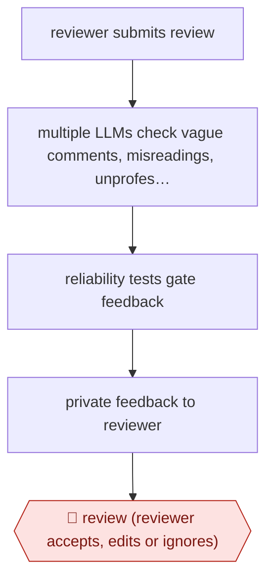

# Review-of-review feedback

`PRO › RES › PEER` · checkpointed · evidence A · **draft: needs a reference example** ([how to add one](../../../../../CONTRIBUTING.md#1-add-an-example-run))

**Shape:** `reviewer submits review → multiple LLMs check vague comments, misreadings, unprofessional remarks → reliability tests gate feedback → private feedback to reviewer → 🛑 review (reviewer accepts, edits or ignores)`
**How it differs:** AWF-0010 Reviewer-response revision (WRITE) helps authors answer reviews. This improves the reviewers' own reviews before release.
**Variants:** `review-feedback-agent`

<!-- shape diagram: generated by scripts/build_diagrams.py from `shape`; don't edit -->

<!-- end shape diagram -->

## Background

A review that says "the experiments are insufficient" or "this has been done before" costs the authors a rebuttal they cannot write and the area chair a decision they cannot justify. Reviewers mostly know this; what they lack is a reader. Feedback on the review itself is the cheapest intervention in peer review — cheaper than adding another reviewer, cheaper than an AI review posted beside theirs — because it does not add an opinion to the pile, it asks the person who already has one to be specific. The design constraints are what keep it acceptable. The feedback is private, going to the reviewer and the programme chairs rather than to authors or area chairs; it is optional, so a reviewer can ignore it without penalty; it makes no change to the review itself; and every item has to pass a reliability check before it is sent, because feedback that is itself wrong teaches reviewers to distrust the channel. The honest limitation is the one the study reports: most reviewers do not update, and acceptance outcomes did not differ between the group that received feedback and the group that did not. So this is a quality intervention on the reviews that were going to be written anyway, not a lever on decisions.

**Terms:**
- **review-of-review**: feedback on a submitted review, addressed to the reviewer rather than the authors.
- **vague comment**: a criticism that names no specific defect and gives the authors nothing to answer.
- **misreading**: feedback that identifies a claim in the review that the paper does not make.
- **reliability test**: an automated check on a feedback item before it may be sent.
- **private channel**: feedback visible only to the reviewer and the programme chairs.
- **update rate**: the share of reviewers who revise their review after receiving feedback.
- **programme chair (PC)**: the organiser who runs review and sees the private channel.
- **acceptance outcome**: whether the paper was accepted, the measure used to test whether feedback changed decisions.

## Build it with an agent

**Form:** `service`. It runs on every review the moment it is submitted, for a whole conference, with nobody starting it and no per-review human in the loop; the reviewer is the only person who acts, and only if they choose to. That is a service — a pipeline that must keep up with submissions in real time, not a skill someone runs and not a project with a standing corpus.

**You need:** the submitted review with the paper it refers to, because "unsupported claim" cannot be checked without both; multiple models disagreeing, since a single model's complaint about vagueness is itself an opinion; reliability tests per feedback item, run before sending, because a false accusation of misreading is worse than no feedback; the private channel wired correctly, since sending this to authors or ACs changes its meaning entirely; no edits to the review by the pipeline, because the reviewer's name is on it; and a record of what was sent, so the effect can be measured rather than assumed. The agent must not require a response, must not score the reviewer, and must not tell the PC that a review was poor.

| Step | Built as |
|---|---|
| reviewer submits review | The trigger is submission, and feedback has to arrive within hours while the reviewer still remembers the paper. |
| multiple LLMs check vague comments, misreadings, unprofessional remarks | Parallel passes, each producing candidate items with the specific sentence they refer to; disagreement between passes is a filter, not a vote. |
| reliability tests gate feedback | Each candidate is checked for whether the criticism is grounded in the review's text and in the paper; ungrounded items are dropped before they reach a person. |
| private feedback to reviewer | Delivery is to the reviewer and the PCs only, with the channel enforced by the platform rather than by wording in the message. |
| 🛑 review (reviewer accepts, edits or ignores) | The reviewer decides; the pipeline has no write access to the review, so accepting means the reviewer edits it themselves. |

**Checkpoints:** `review`: the reviewer is the only actor, and the feedback is advisory — the build cannot edit a review, cannot escalate to an area chair, and cannot mark a reviewer as non-compliant, which is what keeps a quality nudge from becoming surveillance.

**Since the sources:** Sources date from 2024-10 to 2026-02: the ICLR pilot blog, the arXiv preprint and the peer-reviewed study in Nature Machine Intelligence. None was re-opened on this pass. What has changed since: the channel's operational detail is now documented, and the field has moved toward two alternatives that bracket it. On the detail: feedback goes only to the reviewer and the programme chairs, never to area chairs or authors, arrives within a few hours of submission, and there is no second round — from the earlier ICLR blog, and unchanged since. On the alternatives: NeurIPS 2026 chose live assistance instead of after-the-fact feedback, giving volunteer reviewers an LLM inside OpenReview under three randomised conditions with area chairs blind to the condition, author opt-in and no data retention; and several venues chose enforcement instead, with ICML 2026 injecting hidden prompts into submissions and desk-rejecting close to 500 papers, about 2% of its intake, over review-policy violations. That is the honest position of this workflow in 2026: it improves reviews without changing decisions, while the venues that wanted a decision-level effect went for assistance before the review or enforcement after it. A caution from the same period applies to the tempting upgrade — an argument paper on policy-conditioned AI-use detection notes that at plausible violation rates a detector at a strong operating point still flags more compliant authors than violating ones, which is a reason to keep this pipeline advisory and private rather than turning it into a compliance screen.

*A design based on this entry's steps and the tool documentation as of 2026-11, not a reported run.*

## Steps

*As reported by the sources.*

1. After a reviewer submits, a pipeline of several LLMs drafts feedback on vague comments, content misunderstandings and unprofessional remarks [[1]](#sources).
2. LLM-based reliability tests check attributes of each feedback item. Only feedback that passes is posted [[1]](#sources).
3. Feedback goes privately to the reviewer. The system makes no direct changes to the review [[1]](#sources).
4. 🛑 **Review**: The reviewer chooses to ignore the feedback or revise their own review before it is released [[1]](#sources).

**Output:** A clearer, more actionable peer review written by the human reviewer, entering normal rebuttal and decision steps.
**Failure modes → guards:** Hallucinated or low-quality feedback → multi-LLM pipeline with reliability-test guardrails [[1]](#sources). Most reviewers do not update → feedback stays optional; acceptance outcomes did not differ between groups [[1]](#sources).

## Public runs

Coverage as of 2026-11-06: **Strong**: a first-hand, detailed run that matches most of the shape. Collected and re-checked in [New workflows for empty categories](../../../../../research/2026-11-new-workflows.md). More runs added in [Third collection pass](../../../../../research/2026-11-third-pass.md).

- [ICLR Blog, LLM feedback at ICLR 2025](https://blog.iclr.cc/2025/04/15/leveraging-llm-feedback-to-enhance-review-quality/) (2025-04-15). Randomized study across ~45k reviews; reviewers optionally revised after AI feedback. "26.6% of reviewers who received feedback updated their reviews". *First-hand: yes; confidence: high.*
- [Thakkar et al., Nature Machine Intelligence](https://www.nature.com/articles/s42256-026-01188-x) (2026-02-23). Peer-reviewed publication of the ICLR 2025 randomized Review Feedback Agent study. "27% of reviewers who received automated feedback updated their reviews, incorporating over 12,000 suggestions". *First-hand: yes; confidence: high.*

## Sources

1. Zou J., Thakkar N. (via ICLR Blog), Leveraging LLM feedback to enhance review quality, 2025-04-15. https://blog.iclr.cc/2025/04/15/leveraging-llm-feedback-to-enhance-review-quality/
2. Thakkar N., Yuksekgonul M., Silberg J., Garg A., Peng N. et al., A large-scale randomized study of large language model feedback in peer review, Nature Machine Intelligence, 2026-02-23. https://www.nature.com/articles/s42256-026-01188-x
3. Thakkar N. et al., Can LLM feedback enhance review quality? A randomized study of 20K reviews at ICLR 2025, arXiv 2504.09737, 2025-04-13. https://arxiv.org/abs/2504.09737
4. Carl Vondrick, Assisting ICLR 2025 reviewers with feedback, ICLR Blog, 2024-10-09. https://blog.iclr.cc/2024/10/09/iclr2025-assisting-reviewers/
5. NeurIPS 2026, AI-Assisted Reviewing Experiment. https://neurips.cc/Conferences/2026/ai-reviewing-experiment
6. Jairo Diaz-Rodriguez, Mumin Jia, Policy-Conditioned AI-Use Detection: An Evidentiary Framework for Academic Publishing, arXiv 2609.38427, 2026. https://arxiv.org/html/2609.38427v2
