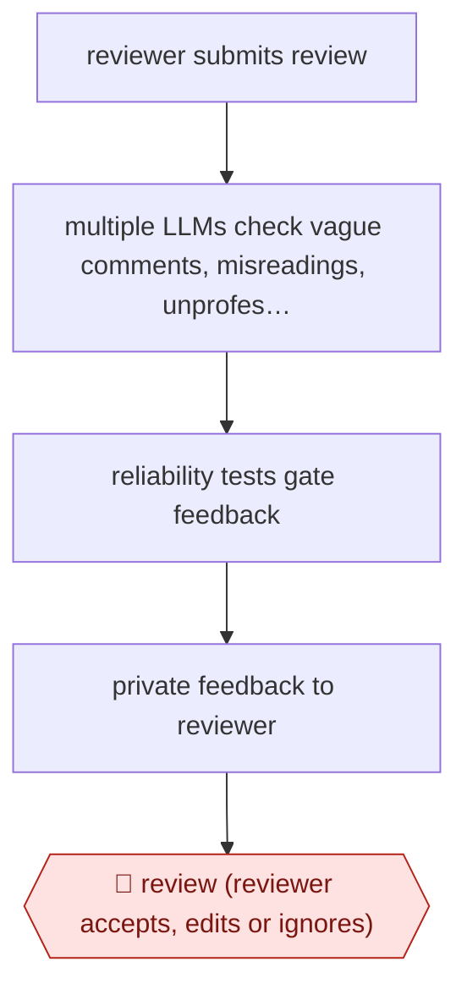

# Review-of-review feedback

`PRO › RES › PEER` · checkpointed · evidence A · **draft: needs a reference example** ([how to add one](../../../../../CONTRIBUTING.md#1-add-an-example-run))

**Shape:** `reviewer submits review → multiple LLMs check vague comments, misreadings, unprofessional remarks → reliability tests gate feedback → private feedback to reviewer → 🛑 review (reviewer accepts, edits or ignores)`
**How it differs:** AWF-0010 Reviewer-response revision (WRITE) helps authors answer reviews. This improves the reviewers' own reviews before release.
**Variants:** `review-feedback-agent`

<!-- shape diagram: generated by scripts/build_diagrams.py from `shape`; don't edit -->

<!-- end shape diagram -->

## Steps
1. After a reviewer submits, a pipeline of several LLMs drafts feedback on vague comments, content misunderstandings and unprofessional remarks [[1]](#sources).
2. LLM-based reliability tests check attributes of each feedback item. Only feedback that passes is posted [[1]](#sources).
3. Feedback goes privately to the reviewer. The system makes no direct changes to the review [[1]](#sources).
4. 🛑 **Review**: The reviewer chooses to ignore the feedback or revise their own review before it is released [[1]](#sources).

**Output:** A clearer, more actionable peer review written by the human reviewer, entering normal rebuttal and decision steps.
**Failure modes → guards:** Hallucinated or low-quality feedback → multi-LLM pipeline with reliability-test guardrails [[1]](#sources). Most reviewers do not update → feedback stays optional; acceptance outcomes did not differ between groups [[1]](#sources).

## Public runs

Coverage as of 2026-11-06: **Strong**: a first-hand, detailed run that matches most of the shape. Collected and re-checked in [New workflows for empty categories](../../../../../research/2026-11-new-workflows.md).

- [ICLR Blog, LLM feedback at ICLR 2025](https://blog.iclr.cc/2025/04/15/leveraging-llm-feedback-to-enhance-review-quality/) (2025-04-15). Randomized study across ~45k reviews; reviewers optionally revised after AI feedback. "26.6% of reviewers who received feedback updated their reviews". *First-hand: yes; confidence: high.*

## Sources

1. Zou J., Thakkar N. (via ICLR Blog), Leveraging LLM feedback to enhance review quality, 2025-04-15. https://blog.iclr.cc/2025/04/15/leveraging-llm-feedback-to-enhance-review-quality/
