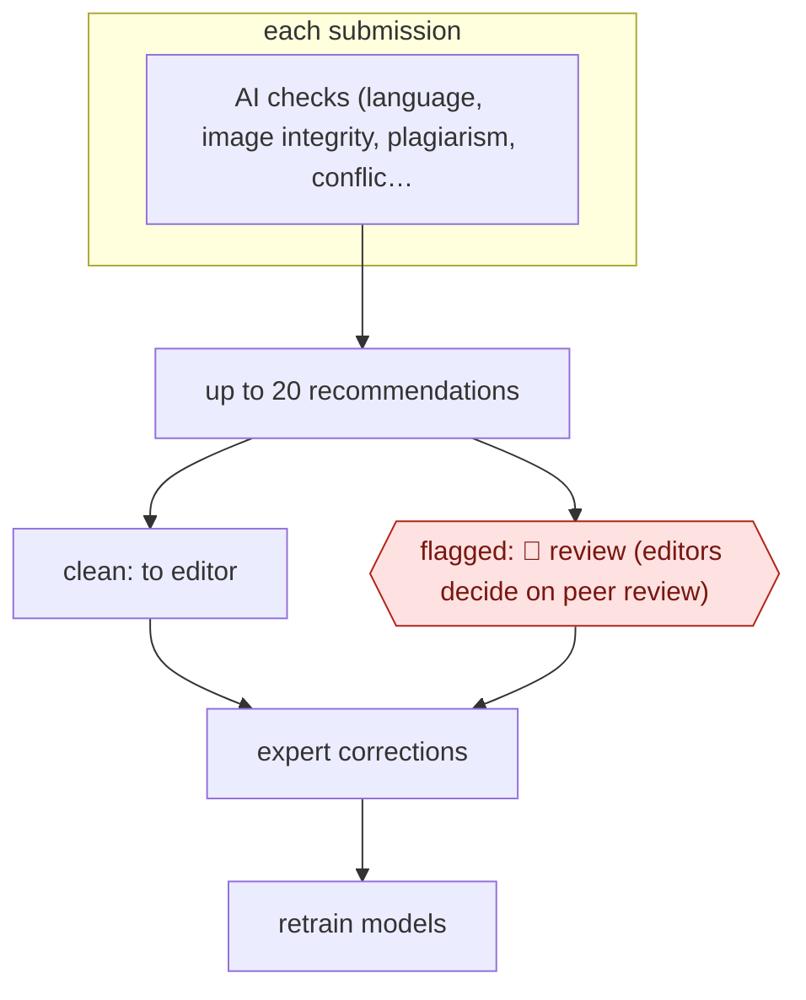

# Submission intake screen

`PRO › RES › PEER` · sampled · evidence A · **draft: needs a reference example** ([how to add one](../../../../../CONTRIBUTING.md#1-add-an-example-run))

**Shape:** `each submission: AI checks (language, image integrity, plagiarism, conflicts of interest, papermill signals) → up to 20 recommendations → clean: to editor | flagged: 🛑 review (editors decide on peer review) → expert corrections → retrain models`
**How it differs:** Closest is AWF-0046 Review-of-review feedback (PEER), which checks a reviewer's written review and gives private feedback to the reviewer. This one screens the manuscript itself at intake, for the editorial office, before review starts. Deliverable and checkpoint owner differ.
**Variants:** `frontiers-aira`

<!-- shape diagram: generated by scripts/build_diagrams.py from `shape`; don't edit -->

<!-- end shape diagram -->

## Steps
1. Every incoming manuscript is checked automatically on arrival by AIRA, which is built into the publisher's peer-review platform [[1]](#sources).
2. Checks cover language quality, figure and image integrity, plagiarism and conflicts of interest, at 'up to 20 checks a second' [[1]](#sources)[[2]](#sources).
3. AIRA makes up to 20 recommendations and flags issues; it also suggests editors and reviewers [[1]](#sources).
4. 🛑 **Review**: editors and reviewers use the results to decide whether a paper goes to peer review; AI flags concerns and people decide [[1]](#sources)[[2]](#sources).
5. Expert feedback, including corrected errors, becomes training data, and the models are retrained regularly [[1]](#sources).

**Output:** Each submission arrives at the handling editor with integrity and quality flags attached, before peer review starts.
**Failure modes → guards:** False flags on images, where only about 10% of flagged images have a real problem → human decision on every flag [[1]](#sources). Model drift as fraud tactics change → retraining on expert corrections [[1]](#sources).

## Public runs

Coverage as of 2026-11-06: **Partial**: first-hand runs that cover part of the shape or put checkpoints elsewhere. Collected and re-checked in [Second collection pass](../../../../../research/2026-11-second-pass.md).

- [IEEE Spectrum, Peer Review of Scholarly Research Gets an AI Boost](https://spectrum.ieee.org/peer-review-of-scholarly-research-gets-an-ai-boost) (2020-07-27). Frontiers runs AIRA on every submission; executives quoted on flag precision. "About 10 percent of our flagged images have some sort of problem". *First-hand: interview; confidence: med.*

## Sources

1. Payal Dhar, IEEE Spectrum, Peer Review of Scholarly Research Gets an AI Boost, 2020-07-27. https://spectrum.ieee.org/peer-review-of-scholarly-research-gets-an-ai-boost
2. Frontiers Science Communications, Science for all with compatible AI, 2023-06-08. https://www.frontiersin.org/news/2023/06/08/science-for-all-with-compatible-ai
