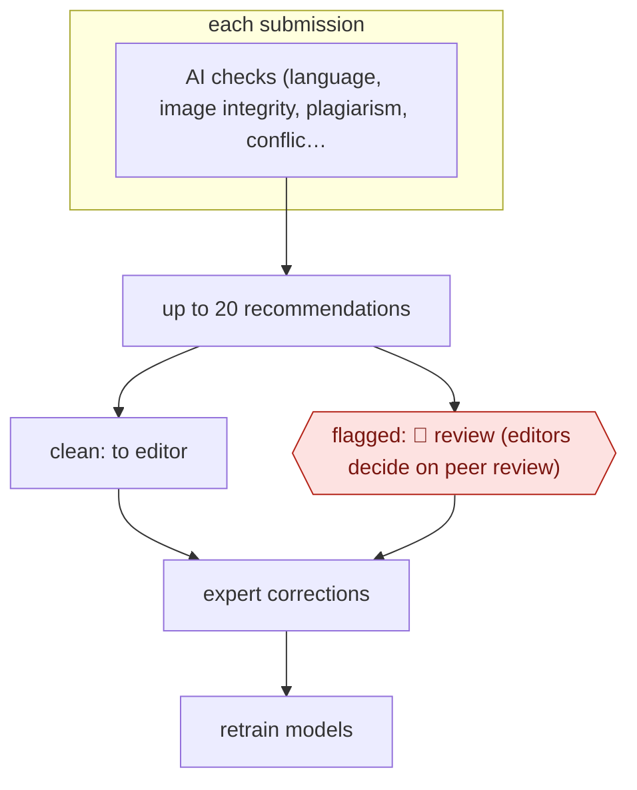

# Submission intake screen

`PRO › RES › PEER` · sampled · evidence A · **draft: needs a reference example** ([how to add one](../../../../../CONTRIBUTING.md#1-add-an-example-run))

**Shape:** `each submission: AI checks (language, image integrity, plagiarism, conflicts of interest, papermill signals) → up to 20 recommendations → clean: to editor | flagged: 🛑 review (editors decide on peer review) → expert corrections → retrain models`
**How it differs:** Closest is AWF-0046 Review-of-review feedback (PEER), which checks a reviewer's written review and gives private feedback to the reviewer. This one screens the manuscript itself at intake, for the editorial office, before review starts. Deliverable and checkpoint owner differ.
**Variants:** `frontiers-aira`

<!-- shape diagram: generated by scripts/build_diagrams.py from `shape`; don't edit -->

<!-- end shape diagram -->

## Background

A journal's editorial office sees every submission before a reviewer does, and it is the only place where a paper can be stopped cheaply. After review, stopping a paper costs reviewers' unpaid time, an editor's decision letter and an appeal; before review, it costs a check. What the checks are looking for has changed faster than the checks themselves: a decade ago the problem was duplicate text, now it is a manuscript assembled to order, with plausible figures, a reference list of real papers cited for things they do not say, and authors who may not exist. The signals are individually weak — a suspiciously uniform blot, a citation that does not support its sentence, a corresponding address shared with six other submissions — which is why the design is many cheap checks rather than one strong one, and why the output is a list of concerns with a recommendation rather than a decision. An editor reads the flags and decides whether the paper goes to peer review at all. The part that keeps improving is the loop: when an editor overrides a flag, that correction is training data, so the next version is measured against expert judgement rather than against the vendor's benchmark.

**Terms:**
- **intake**: the step between submission and assignment to an editor or reviewer.
- **image integrity**: checking figures for duplication, splicing or manipulation.
- **papermill**: an operation that manufactures papers and sells authorship.
- **plagiarism check**: comparison against published text and preprints, usually a similarity score.
- **conflict of interest**: a relationship between author and editor or reviewer that disqualifies them.
- **flag precision**: of the items flagged, the share that turn out to be real problems.
- **false flag**: a flagged item that an expert clears, the main cost of screening at volume.
- **network signal**: a pattern across submissions rather than within one, such as shared authorship or infrastructure.

## Build it with an agent

**Form:** `service`. Every submission is screened on arrival, unattended, for a publisher's whole intake; editors see flags rather than running anything; and corrections feed a retraining loop. That is a service in the plain sense — continuous intake, no per-item human trigger, and a queue that routes.

**You need:** the manuscript and its figure files in a form the checks can read, including the original images rather than the compiled PDF; the similarity service, the retraction and papermill databases, and the citation index, since a check is only as good as the data it queries; a flag taxonomy with a severity per type, because "20 checks" that all shout equally is noise; an editor-facing view that shows the evidence behind each flag, not just its name; the override recorded as a labelled example, which is what makes retraining possible; and a retention policy for manuscript data, since screening means holding other people's unpublished work. The agent must not reject a submission and must not contact authors about a flag: rejection is the editor's decision and the allegation is defamatory until it is not.

| Step | Built as |
|---|---|
| each submission: AI checks | A queue triggered on submission, running the check set in parallel and storing each result with the artefact it examined, because an editor needs to look at the blot, not at a score. |
| up to 20 recommendations | A ranked list with severity and evidence links, capped so the editor's attention goes to the top items rather than spread evenly over twenty. |
| clean: to editor | The clean path is automatic and silent, which is what makes the volume affordable; a paper that passes should cost the editor no time at all. |
| 🛑 flagged: review (editors decide on peer review) | The editor sees the flags, opens the evidence and decides whether to send for review, ask the authors, or decline; the build cannot decline on its own. |
| expert corrections → retrain models | Every override is stored with the editor's reason and becomes a labelled example; the retraining is evaluated against those judgements before it ships. |

**Checkpoints:** `review`: every flag is a question for an editor, never a decision, and the build has no decline path — which matters legally as well as editorially, since a false accusation of misconduct is the expensive failure here.

**Since the sources:** Sources date from 2020-07 and 2023-06, which makes this entry's evidence the oldest in the peer-review group: an IEEE Spectrum interview and a publisher blog. Neither was re-opened on this pass; the publisher's current research-integrity page and 2026 reporting on the integrity market were opened. What has changed since: the check count, the false-flag rate and the unit of analysis. AIRA now runs 40+ checks in seconds, against the 20 this entry's shape records, and the publisher's own account says the integrity team blocks and rejects around 32% of manuscripts before they reach a handling editor — a far higher intervention rate than the 2020 interview implies. The industry infrastructure arrived too: the STM Integrity Hub screens more than 125,000 manuscripts a month across participating publishers and flags roughly 1,000 suspected papermill cases, and the publisher has since layered third-party tools onto its own. The prevalence numbers explain the investment: 2026 estimates put papermill involvement at around 10% of recent cancer research papers, over 20% in some cancer types, and a Lancet audit found fabricated references in 1 in 277 PubMed papers, with no action taken in 98% of them. Two lessons for this build, both of them shape-level. First, the unit of analysis has moved from the manuscript to the network: shared authorship, addresses and submission patterns across papers catch what no single-manuscript check can, so the pipeline should retain those fields and support cross-submission queries — an addition this entry's shape does not have. Second, a high intervention rate makes false flags the dominant cost, and the only defence is the one already in the design: an editor sees the evidence and decides, with the override recorded. What has not changed is that a flag is not a finding.

*A design based on this entry's steps and the tool documentation as of 2026-11, not a reported run.*

## Steps

*As reported by the sources.*

1. Every incoming manuscript is checked automatically on arrival by AIRA, which is built into the publisher's peer-review platform [[1]](#sources).
2. Checks cover language quality, figure and image integrity, plagiarism and conflicts of interest, at 'up to 20 checks a second' [[1]](#sources)[[2]](#sources).
3. AIRA makes up to 20 recommendations and flags issues; it also suggests editors and reviewers [[1]](#sources).
4. 🛑 **Review**: editors and reviewers use the results to decide whether a paper goes to peer review; AI flags concerns and people decide [[1]](#sources)[[2]](#sources).
5. Expert feedback, including corrected errors, becomes training data, and the models are retrained regularly [[1]](#sources).

**Output:** Each submission arrives at the handling editor with integrity and quality flags attached, before peer review starts.
**Failure modes → guards:** False flags on images, where only about 10% of flagged images have a real problem → human decision on every flag [[1]](#sources). Model drift as fraud tactics change → retraining on expert corrections [[1]](#sources).

## Public runs

Coverage as of 2026-11-06: **Partial**: first-hand runs that cover part of the shape or put checkpoints elsewhere. Collected and re-checked in [Second collection pass](../../../../../research/2026-11-second-pass.md).

- [IEEE Spectrum, Peer Review of Scholarly Research Gets an AI Boost](https://spectrum.ieee.org/peer-review-of-scholarly-research-gets-an-ai-boost) (2020-07-27). Frontiers runs AIRA on every submission; executives quoted on flag precision. "About 10 percent of our flagged images have some sort of problem". *First-hand: interview; confidence: med.*

## Sources

1. Payal Dhar, IEEE Spectrum, Peer Review of Scholarly Research Gets an AI Boost, 2020-07-27. https://spectrum.ieee.org/peer-review-of-scholarly-research-gets-an-ai-boost
2. Frontiers Science Communications, Science for all with compatible AI, 2023-06-08. https://www.frontiersin.org/news/2023/06/08/science-for-all-with-compatible-ai
3. Frontiers, Research integrity (AIRA runs 40+ checks; the team blocks and rejects around 32% of manuscripts before peer review). https://www.frontiersin.org/about/research-integrity
4. AcademicJobs, Paper mills threaten academic publishing integrity, 2026, covering the STM Integrity Hub's monthly screening volume and prevalence estimates. https://www.academicjobs.com/en-cn/research-publication-news/paper-mills-threaten-academic-publishing-integrity-academicjobs-26176
5. CASRAI, 1 in 277 PubMed papers now cite fake references, 2026, reporting the Lancet audit and publisher responses. https://casrai.org/news/fabricated-citations-1-in-277-pubmed-lancet-audit
