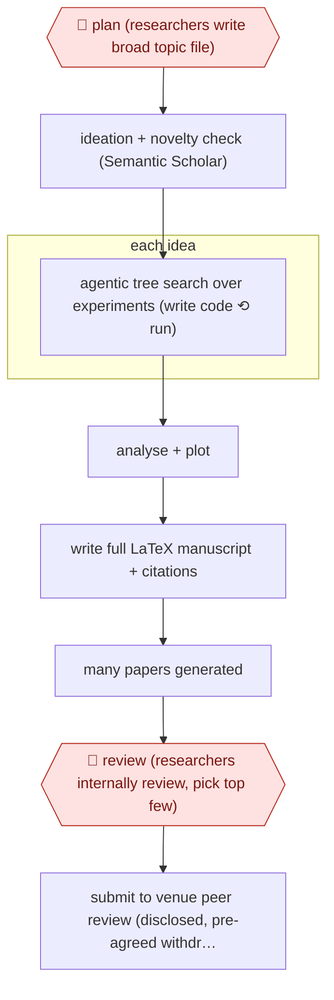

# End-to-end AI paper

`PRO › RES › WRITE` · sampled · evidence A · **draft: needs a reference example** ([how to add one](../../../../../CONTRIBUTING.md#1-add-an-example-run))

**Shape:** `🛑 plan (researchers write broad topic file) → ideation + novelty check (Semantic Scholar) → each idea: agentic tree search over experiments (write code ⟲ run) → analyse + plot → write full LaTeX manuscript + citations → many papers generated → 🛑 review (researchers internally review, pick top few) → submit to venue peer review (disclosed, pre-agreed withdrawal)`
**How it differs:** AWF-0010 Reviewer-response revision: a person owns the paper and approves the plan and each revision. Here the agent writes the whole paper from a broad topic, and humans step in only at topic setting and when choosing which outputs to submit (sampled). The deliverable is a new manuscript, not a revision.
**Variants:** `ai-scientist-v2`

<!-- shape diagram: generated by scripts/build_diagrams.py from `shape`; don't edit -->

<!-- end shape diagram -->

## Steps
1. 🛑 **Plan**: researchers write a topic description file (Title, Keywords, TL;DR, Abstract) that sets the scope, for example a workshop theme [[1]](#sources)[[2]](#sources).
2. The ideation script brainstorms and refines research ideas from the topic and checks novelty against Semantic Scholar [[2]](#sources).
3. Each idea: an experiment-manager agent runs a progressive agentic tree search. It writes and refines code, runs experiments, analyses the data and produces figures. LLM-written code runs, so a sandbox (e.g. Docker) is required [[2]](#sources).
4. Write every word of the manuscript, from the title to the final reference, including figures and formatting, with no human edits [[1]](#sources).
5. 🛑 **Review**: researchers read the generated papers, run their own detailed internal review, and pick the top ones to submit, weighing diversity and quality. In the ICLR 2025 run they submitted 3 [[1]](#sources).
6. Submit to double-blind peer review only with venue organisers' agreement, IRB approval and disclosure to reviewers, and withdraw before publication as pre-agreed [[1]](#sources).

**Output:** A complete manuscript (code, figures, LaTeX) that is submitted to peer review as a disclosed experiment, not published as normal research.
**Failure modes → guards:** Low success rate on open-ended topics (v2 'takes a broader, more exploratory approach with lower success rates') → generate many, humans select a few [2]. Workshop bar only: none of the 3 met the authors' internal bar for the main conference [1]. Dangerous code execution → sandboxed container [2]. Polluting the literature → organiser consent, IRB approval and pre-committed withdrawal [1].

## Public runs

Coverage as of 2026-11-13: **Strong**: a first-hand, detailed run that matches most of the shape. Collected and re-checked in [Third collection pass](../../../../../research/2026-11-third-pass.md).

- [Sakana AI, first peer-reviewed publication](https://sakana.ai/ai-scientist-first-publication/) (2025-03-12). 3 fully AI-generated papers submitted to an ICLR 2025 workshop; one scored above threshold. "One paper received an average score of 6.33, ranking approximately 45% of all submissions.". *First-hand: yes; confidence: high.*

## Sources

1. Sakana AI, The AI Scientist Generates its First Peer-Reviewed Scientific Publication, 2025-03-12 (updated 2025-04-07). https://sakana.ai/ai-scientist-first-publication/
2. SakanaAI, AI-Scientist-v2 README, GitHub, 2025. https://github.com/SakanaAI/AI-Scientist-v2
