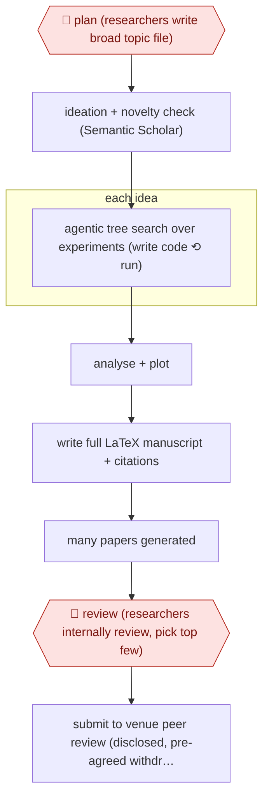

# End-to-end AI paper

`PRO › RES › WRITE` · sampled · evidence A · **draft: needs a reference example** ([how to add one](../../../../../CONTRIBUTING.md#1-add-an-example-run))

**Shape:** `🛑 plan (researchers write broad topic file) → ideation + novelty check (Semantic Scholar) → each idea: agentic tree search over experiments (write code ⟲ run) → analyse + plot → write full LaTeX manuscript + citations → many papers generated → 🛑 review (researchers internally review, pick top few) → submit to venue peer review (disclosed, pre-agreed withdrawal)`
**How it differs:** AWF-0010 Reviewer-response revision: a person owns the paper and approves the plan and each revision. Here the agent writes the whole paper from a broad topic, and humans step in only at topic setting and when choosing which outputs to submit (sampled). The deliverable is a new manuscript, not a revision.
**Variants:** `ai-scientist-v2`

<!-- shape diagram: generated by scripts/build_diagrams.py from `shape`; don't edit -->

<!-- end shape diagram -->

## Background

Most of a machine-learning paper is work that can be described: pick a direction, check nobody has done it, write code, run the experiment, plot the result, write it up in the venue's format. What cannot be described is the judgement about whether any of it is worth doing, and that is the part the humans keep here. The system is given a topic file — a title, keywords, a one-paragraph abstract of the area — and from that it proposes ideas, filters them against the literature, searches over experiment trees, and writes complete LaTeX manuscripts with figures and citations. It runs many times, and people read the outputs and submit the few that survive their own internal review. Two things about this design are easy to miss. The first is that the interesting number is not the best paper it produced but the distribution: a system that generates a hundred manuscripts and one that passes review has demonstrated something about volume, not about science. The second is that the run executes model-written code, which means the sandbox is not a detail of the implementation but a precondition of running it at all.

**Terms:**
- **topic file**: the seed document — title, keywords, TL;DR, abstract — that bounds what the system may work on.
- **ideation**: generating candidate research ideas, then discarding the ones already published.
- **novelty check**: a literature search against a scholarly index before an idea is pursued.
- **agentic tree search**: exploring several experiment branches, keeping the promising ones and pruning the rest.
- **sandbox**: an isolated container the generated code runs in, so a bad script cannot damage the host.
- **LaTeX manuscript**: the full paper source, including figures and bibliography.
- **automated reviewer**: a model that scores generated papers, used to triage at volume and never as the venue's decision.
- **disclosed experiment**: a submission whose organisers know it is AI-generated, with withdrawal agreed in advance.

## Build it with an agent

**Form:** `project`. The harness has to persist across a long unattended run and across many papers: the topic file, the idea tree, the experiment branches, the generated code, the figures, the LaTeX sources and the review scores all live in one repository, and a re-run resumes from it. That is a project, not a skill one researcher runs and not a service that answers on demand.

**You need:** a container to run generated code in, with no network egress and no credentials, because the code is model-written and the failure mode is not a crash; a topic file narrow enough to be checkable, since a broad topic produces plausible work on a question nobody asked; a literature index for the novelty check, and a rule that an idea which cannot be checked is dropped rather than assumed novel; a fixed manuscript template with the venue's section structure, because the system writes to format; a compute budget per idea, since the tree search will otherwise widen until it stops; and a review step staffed by people who will read the papers rather than the scores. The agent must not contact a venue, must not submit, and must not decide that a paper is novel enough to send: the disclosure agreement is a human arrangement made before the run.

| Step | Built as |
|---|---|
| 🛑 plan (researchers write broad topic file) | The topic file is the run's entire scope and is written by the researchers; everything downstream inherits its narrowness or its vagueness, which is why this is the first checkpoint. |
| ideation + novelty check (Semantic Scholar) | Candidate ideas are generated, then each is searched against a scholarly index; an idea whose nearest neighbours cannot be retrieved is dropped rather than assumed new. |
| each idea: agentic tree search over experiments (write code ⟲ run) | Parallel workers explore branches, each writing code, running it in the sandbox and keeping the result only if the run completes and the metric improves. |
| analyse + plot | Results are turned into figures from the run artefacts, not from a description of them, so a figure cannot disagree with the experiment log. |
| write full LaTeX manuscript + citations | The manuscript is generated into a template with citations drawn from the retrieved literature; every reference is resolved, and unresolvable ones are dropped rather than invented. |
| many papers generated | The run produces a batch, not a paper; the repository holds all of them with their scores, which is what makes the selection step meaningful. |
| 🛑 review (researchers internally review, pick top few) | Researchers read the batch, score it against their own bar and pick what to submit; the automated reviewer's score is triage, and the sources are explicit that none of the submitted papers met the main-conference bar. |
| submit to venue peer review (disclosed, pre-agreed withdrawal) | Submission is a human action under a prior agreement with the organisers, with withdrawal before publication committed in advance. |

**Checkpoints:** `plan`: the topic file is the only place a person constrains the science, and a vague one produces a hundred manuscripts about nothing in particular. `review`: researchers read and select, and the sources are blunt that the output clears a workshop bar rather than a main-conference one — the checkpoint exists to keep a batch from becoming a submission pipeline.

**Since the sources:** Sources date from 2025-03 and a 2025 GitHub README, and the public run is the ICLR 2025 workshop submission. The system paper has since been published in *Nature* (Lu et al., 2026) and was opened this month; the earlier blog and README were not re-opened. What has changed since: the peer-reviewed version is more cautious than the announcement, and a controlled test has appeared that bounds the claim. In *Nature* the authors report the same workshop result — three submissions, one accepted with scores of 6, 7 and 6 — and describe the automated reviewer reaching about 69% balanced accuracy against the roughly 65% to 70% that human reviewers achieve against each other. They also list the failures plainly: hallucinated references, figures duplicated across sections, underdeveloped ideas and code that fails on hard cases, and they temper the earlier framing by saying human oversight is still needed to filter and refine outputs. The bounding result is a 2026 study from several university and government labs, [reported in August](https://www.news.cn/liangzi/20260825/0a21ffa0182b484eb3e2d2cb01fe2238/c.html), that gave frontier agents full internet access, dedicated compute and a model budget of about $3,000 for six days of autonomous work on two unpublished papers; both outputs were rejected, at 2/6 and 1/6, with reviewers describing the experimental design as odd and the conclusions as decided after the fact. Read together, the two results say the same thing from opposite directions: the pipeline can produce a passable workshop paper at around $15 a copy, and it does not yet do open-ended research. That is why this entry's checkpoint stays where it is — selection by people, on a batch, with the disclosure agreement made in advance. The venue picture has also hardened: main conferences now bar purely AI-written submissions and require disclosure, and the ICLR 2026 workshop chair is quoted saying AI-written papers will make the review load worse, with detection tools not up to enforcing the rules.

*A design based on this entry's steps and the tool documentation as of 2026-11, not a reported run.*

## Steps

*As reported by the sources.*

1. 🛑 **Plan**: researchers write a topic description file (Title, Keywords, TL;DR, Abstract) that sets the scope, for example a workshop theme [[1]](#sources)[[2]](#sources).
2. The ideation script brainstorms and refines research ideas from the topic and checks novelty against Semantic Scholar [[2]](#sources).
3. Each idea: an experiment-manager agent runs a progressive agentic tree search. It writes and refines code, runs experiments, analyses the data and produces figures. LLM-written code runs, so a sandbox (e.g. Docker) is required [[2]](#sources).
4. Write every word of the manuscript, from the title to the final reference, including figures and formatting, with no human edits [[1]](#sources).
5. 🛑 **Review**: researchers read the generated papers, run their own detailed internal review, and pick the top ones to submit, weighing diversity and quality. In the ICLR 2025 run they submitted 3 [[1]](#sources).
6. Submit to double-blind peer review only with venue organisers' agreement, IRB approval and disclosure to reviewers, and withdraw before publication as pre-agreed [[1]](#sources).

**Output:** A complete manuscript (code, figures, LaTeX) that is submitted to peer review as a disclosed experiment, not published as normal research.
**Failure modes → guards:** Low success rate on open-ended topics (v2 'takes a broader, more exploratory approach with lower success rates') → generate many, humans select a few [2]. Workshop bar only: none of the 3 met the authors' internal bar for the main conference [1]. Dangerous code execution → sandboxed container [2]. Polluting the literature → organiser consent, IRB approval and pre-committed withdrawal [1].

## Public runs

Coverage as of 2026-11-13: **Strong**: a first-hand, detailed run that matches most of the shape. Collected and re-checked in [Third collection pass](../../../../../research/2026-11-third-pass.md).

- [Sakana AI, first peer-reviewed publication](https://sakana.ai/ai-scientist-first-publication/) (2025-03-12). 3 fully AI-generated papers submitted to an ICLR 2025 workshop; one scored above threshold. "One paper received an average score of 6.33, ranking approximately 45% of all submissions.". *First-hand: yes; confidence: high.*

## Sources

1. Sakana AI, The AI Scientist Generates its First Peer-Reviewed Scientific Publication, 2025-03-12 (updated 2025-04-07). https://sakana.ai/ai-scientist-first-publication/
2. SakanaAI, AI-Scientist-v2 README, GitHub, 2025. https://github.com/SakanaAI/AI-Scientist-v2
3. Chris Lu et al., Towards end-to-end automation of AI research, Nature, 2026. https://doi.org/10.1038/s41586-026-10265-5
4. Phys.org, AI writes a research paper that passes peer review (reporting the Nature paper, with the automated reviewer's accuracy and the withdrawal), 2026-03-30. https://phys.org/news/2026-03-ai-paper-peer.html
5. Xinhua, reporting an arXiv preprint that tested frontier agents on open-ended research and had both outputs rejected, 2026-08-25. https://www.news.cn/liangzi/20260825/0a21ffa0182b484eb3e2d2cb01fe2238/c.html
6. Scientific American, An AI-authored paper just passed peer review. The scientific community isn't ready, 2026, quoting the ICLR 2026 workshop chair on venue rules. https://www.scientificamerican.com/article/ai-wrote-a-scientific-paper-that-passed-peer-review/
