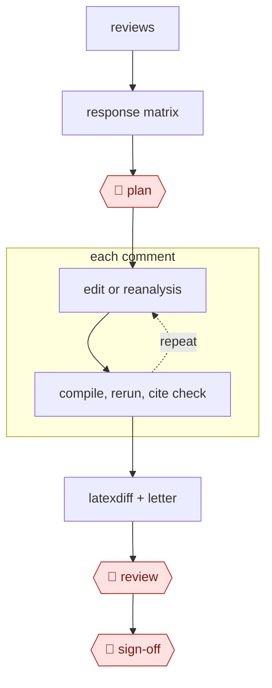

# Reviewer-response revision

`PRO › RES › WRITE` · assist · evidence A · **draft: needs a reference example** ([how to add one](../../../../../CONTRIBUTING.md#1-add-an-example-run))

**Shape:** `reviews → response matrix → 🛑 plan → each comment: (edit or reanalysis ⟲ compile, rerun, cite check) → latexdiff + letter → 🛑 review → 🛑 sign-off`

<!-- shape diagram: generated by scripts/build_diagrams.py from `shape`; don't edit -->

<!-- end shape diagram -->

## Background

A revise-and-resubmit is the best news a paper gets and the worst fortnight its authors have. Three reviewers have produced forty comments, some of which contradict each other, and every one needs three things: a decision (accept, rebut, or partly concede), a change in the manuscript, and a sentence in the letter that says what changed and where. The work is mechanical until it is not: an edit moves a number that appears in four places, a new analysis regenerates a figure the text describes, a concession invalidates a sentence in the discussion, and a reference added to answer a comment has to resolve. Models are good at the mechanical part and dangerous at the boundary, because a revision must be internally consistent — every number matching the regenerated output, every claim matching what the paper now says — and a plausible-sounding response letter is not the same as a true one. So the person keeps three decisions: what to concede, how the rebuttal reads, and whether the final package is what they are willing to put their name on.

**Terms:**
- **revise and resubmit**: the decision that invites a revised manuscript and a point-by-point response.
- **response matrix**: one row per reviewer comment, with the planned change and where it lands.
- **rebut**: to answer a comment without changing the paper, with reasons.
- **reanalysis**: re-running an analysis because a reviewer questioned the method or the statistics.
- **latexdiff**: a marked-up version of the manuscript showing every change, generated from the two compiles.
- **response letter**: the document answering each comment in turn, submitted with the revision.
- **disclosure**: the statement of how AI was used in preparing the work, which many journals now require in the manuscript itself.

## Build it with an agent

**Form:** `skill`. One corresponding author, one manuscript, one set of reviews, handled in a conversation with files for the matrix, the diff and the letter. The paper itself is the persistent artefact and it lives in the authors' repository; the agent works on a copy, and the authors' names are on the result.

**You need:** the reviews as text, so the matrix can be built rather than summarised; the manuscript source and its build, because the check that matters is a recompile; the analysis code and data, which is what makes reanalysis possible instead of described; a comment-to-change mapping that survives review, since the letter is only credible if the diff supports it; the target journal's AI policy, because the revision now has to carry a disclosure statement and policies differ on where it goes; and a named person who reads every section the agent touched. The agent must not decide to concede a point, must not write the letter in a voice the authors would not use, and must not certify that the numbers match — that check is the point of having a person at the end.

| Step | Built as |
|---|---|
| reviews → response matrix | Each comment becomes a row with the reviewer's words, the decision, the planned change and its location; a comment that cannot be located stays open rather than being quietly dropped. |
| 🛑 plan | The authors set accept, rebut or partial per row before any edit runs, which is the only step where the paper's argument is at stake rather than its text. |
| each comment: (edit or reanalysis ⟲ compile, rerun, cite check) | Sub-agents work per comment: text edits, re-running analyses and regenerating figures, adding citations. The loop closes on a clean compile and a rerun that reproduces the reported numbers. |
| latexdiff + letter | The diff is generated from the two builds so it cannot omit a change, and the letter is drafted against the matrix so every entry points at a real edit. |
| 🛑 review | The authors edit the rebuttals for tone and substance, which is where a concession gets softened or a disagreement gets stated plainly. |
| 🛑 sign-off | The corresponding author approves the manuscript, the diff and the letter together; the build has no submission path. |

**Checkpoints:** `plan`: the accept/rebut/partial decision is the authors' and it is made before the work starts, because a revision assembled first and justified afterwards argues the model's case rather than the paper's. `review`: the rebuttals are edited by people for tone and substance — the letter is a persuasive document and its register is not delegable. `sign-off`: one person approves manuscript, diff and letter as a set, which is also the point at which the AI-use disclosure has to be true.

**Since the sources:** This entry has no cited sources: its steps carry no citations and its public runs are a template repository with no recorded revision. What has changed since it was written matters more than usual for that reason. The ICMJE updated its recommendations in January 2026 with a new section devoted to AI in publishing, and two of its requirements land on exactly this workflow: authors must disclose AI use **in the submitted work itself**, not only in the cover letter, and AI tools cannot appear in the reference list as sources. Non-disclosure may be treated as misconduct, and journals differ on the section the statement belongs in, so the disclosure has to be written per target journal rather than once. The practical consequence is a build requirement that this entry's shape does not show: the revision output includes a disclosure statement naming the tool and what it was used for — drafting, language editing, reanalysis — and the named person at sign-off is verifying that statement as well as the numbers. The other change is the one this entry has always been exposed to: with the response letter now a document that must also be true about how it was produced, an agent that drafts persuasive rebuttals needs its output checked for claims the diff does not support, which is the same check as before but with a second reason to run it.

*A design based on this entry's steps and the tool documentation as of 2026-11, not a reported run.*

## Steps

*The steps below are this entry's original description. No source documents them; see **Since the sources**.*

1. Parse the reviewer comments into `response.md` (comment → planned change → location).
2. 🛑 **Plan**: the authors decide accept, rebut, or partial for each comment.
3. Run sub-agents per comment: text edits, re-run analyses and regenerate figures, add citations.
4. Compile and produce a `latexdiff` version.
5. Verify that every number matches the regenerated outputs and every citation key resolves.
6. Draft the response letter.
7. 🛑 **Review**: the authors edit rebuttals for tone and substance.
8. 🛑 **Sign-off**: the corresponding author approves the revised manuscript, the `latexdiff` and the letter before resubmission.

## Public runs

Coverage as of 2026-11-06: **None found**: no public first-hand run yet. A real example run would be the first. From [Where are the real runs?](../../../../../research/2026-11-real-runs.md); every number was re-checked against its page.

- [Pedro Sant'Anna, claude-code-my-workflow](https://github.com/pedrohcgs/claude-code-my-workflow). Has a `/respond-to-referees` skill, but no real revision run is shown. "18 agents, 61 skills". *First-hand: no (template); confidence: low.*

## Sources

1. ICMJE, Recommendations for the Conduct, Reporting, Editing, and Publication of Scholarly Work in Medical Journals — Use of AI by Authors (Section V.A, January 2026 revision). https://www.icmje.org/recommendations/browse/artificial-intelligence/ai-use-by-authors.html
2. Editage, AI model and tool updates: what researchers need to know, 2026, on recording tool, version and request for the disclosure statement. https://www.editage.com/blog?p=2209
