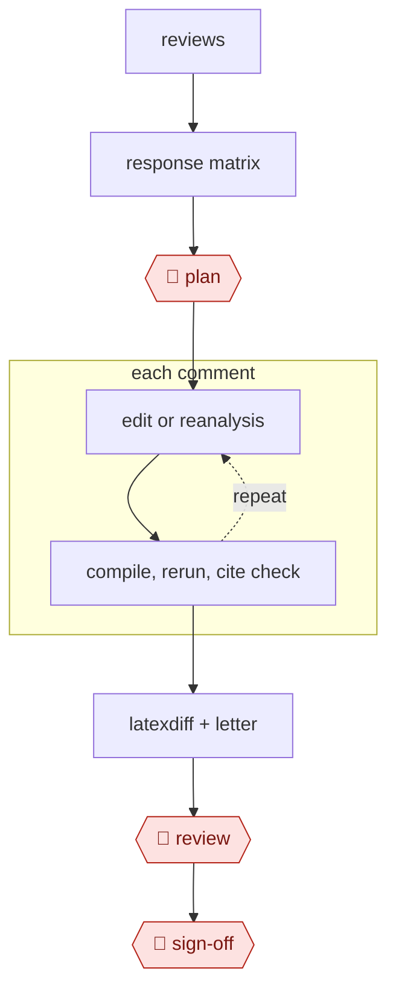

# Reviewer-response revision

`PRO › RES › WRITE` · assist · evidence A · **draft: needs a reference example** ([how to add one](../../../../../CONTRIBUTING.md#1-add-an-example-run))

**Shape:** `reviews → response matrix → 🛑 plan → each comment: (edit or reanalysis ⟲ compile, rerun, cite check) → latexdiff + letter → 🛑 review → 🛑 sign-off`

<!-- shape diagram: generated by scripts/build_diagrams.py from `shape`; don't edit -->

<!-- end shape diagram -->

## Steps
1. Parse the reviewer comments into `response.md` (comment → planned change → location).
2. 🛑 **Plan**: the authors decide accept, rebut, or partial for each comment.
3. Run sub-agents per comment: text edits, re-run analyses and regenerate figures, add citations.
4. Compile and produce a `latexdiff` version.
5. Verify that every number matches the regenerated outputs and every citation key resolves.
6. Draft the response letter.
7. 🛑 **Review**: the authors edit rebuttals for tone and substance.
8. 🛑 **Sign-off**: the corresponding author approves the revised manuscript, the `latexdiff` and the letter before resubmission.

## Public runs

Coverage as of 2026-11-06: **None found**: no public first-hand run yet. A real example run would be the first. From [Where are the real runs?](../../../../../research/2026-11-real-runs.md); every number was re-checked against its page.

- [Pedro Sant'Anna, claude-code-my-workflow](https://github.com/pedrohcgs/claude-code-my-workflow). Has a `/respond-to-referees` skill, but no real revision run is shown. "18 agents, 61 skills". *First-hand: no (template); confidence: low.*

