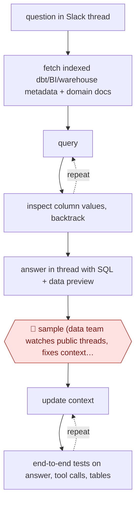

# Context-tested Slack analyst

`TEC › DAT › ANALYTICS` · sampled · evidence A · **draft: needs a reference example** ([how to add one](../../../../../CONTRIBUTING.md#1-add-an-example-run))

**Shape:** `question in Slack thread → fetch indexed dbt/BI/warehouse metadata + domain docs → (query ⟲ inspect column values, backtrack) → answer in thread with SQL + data preview → 🛑 sample (data team watches public threads, fixes context gaps) → (update context ⟲ end-to-end tests on answer, tool calls, tables)`
**Variants:** `slack` · `dbt` · `looker` · `snowflake` · `snowflake-cortex-analyst` · `bigquery`

<!-- shape diagram: generated by scripts/build_diagrams.py from `shape`; don't edit -->

<!-- end shape diagram -->

## Background

Staff across a company keep needing numbers: how many users used a feature today, which version a customer is on. These quick questions normally go to the data team, whose analysts write a query in SQL (the language for asking a database questions), check it and paste the result back, which interrupts their deeper work. Here an agent answers in the Slack conversation where the question was asked and shows the query it ran. Nobody approves each answer, so the data team's job becomes reading a sample of the public threads and keeping the written knowledge about the company's tables correct and tested. A person has to stay in that role because an answer from a wrong or retired table reads just as confidently as a right one, and people make decisions on the numbers.

**Terms:**
- **SQL**: the language used to ask a database for figures; the query is the evidence behind an answer.
- **Data warehouse**: the central database where the company's tables live.
- **dbt**: a tool that builds tables from SQL files and records what each table and column means.
- **BI tool**: software for dashboards and charts built on the warehouse tables.
- **Semantic view**: a curated, named set of tables and measures that a data scientist has endorsed for answering questions.
- **Context layer**: the written descriptions of tables, columns and business rules that the agent reads before it queries.
- **Domain owner**: the person responsible for one area's data, such as sales or product.
- **End-to-end test**: a test that asks the agent a fixed question and checks the final answer and the steps it took.
- **@mention**: tagging a user or bot by name in Slack to address it; a **thread** is the chain of replies under one message.

## Build it with an agent

**Form:** `service`. Questions arrive from many people through Slack, nobody runs the agent from a keyboard, and the data team sees only a sample of the answers.

**You need:** read-only access to the warehouse through a role that cannot write; the table metadata and the domain owners' documentation as files the agent can read (exports from dbt and the BI tool); a Slack connection that delivers @mentions and public-channel questions to the program and posts replies in the thread; a log of every answer, query and tool call; for each domain, a list of high-priority questions with the answers and tables expected, for the tests. Keep tables that hold personal customer data out of the readable set unless the data team has approved them for this use.

| Step | Built as |
|---|---|
| question in Slack thread | A program using the Agent SDK, started by each Slack event, passes the question and the earlier messages of the thread to the agent. |
| fetch indexed dbt/BI/warehouse metadata + domain docs | A skill points the agent to the metadata and documentation files and lists which tables to use for which kind of question. |
| (query ⟲ inspect column values, backtrack) | The agent runs queries through a warehouse MCP server (connector), looks at column values and tries another table or filter when the result looks wrong. Permission rules allow only the read tools. |
| answer in thread with SQL + data preview | The skill requires every answer to carry its SQL and a short preview; the program posts it in the thread. |
| 🛑 sample | See Checkpoints. |
| (update context ⟲ end-to-end tests on answer, tool calls, tables) | The data team edits the skill and reference files. A test script reruns the agent on the listed questions and compares the answer, and the tools and tables recorded in the log, with what was expected, until all pass. |

**Checkpoints:** `sample`: answers go out without approval, so the stop is a sample. The program copies a fixed share of answers, with their SQL, to a review channel the data team reads, and the team fixes gaps by changing the files the agent reads. The agent has no write tool on the warehouse, and a permission rule denies any other tool, so a wrong answer cannot change data.

**Since the sources:** Sources date from 2025 to 2026-02. Source 1 is undated; its page header, the only part that loaded, shows 2025-09-18. Source 3 (2026-02-06) opened in this check and confirms an answer with its SQL, read-only access and review of answers instead of answering them by hand; it uses one prompt of rules that is extended after each mistake, not a test suite. Source 2 (2026-01-29) refused the automated reader, and the text of source 1 did not load, so steps 1, 4 and 6 and the Whatnot quote rest on the entry text alone. The sources built bots on their own stacks (source 3 names a cloud function, a Gemini model and a Slack app); this build uses a general agent instead and does not need those. The context-layer tests come from source 1 and are offered here as a design, not as something shown to work. No search for newer accounts was needed: the newest source is under 12 months old.

*A design based on this entry's steps and the tool documentation as of 2026-11, not a reported run.*

## Steps

*As reported by the sources.*

1. A data team aggregates and indexes metadata from dbt, the BI tool and the warehouse; domain owners write documentation for their areas, stored as files the agent can read [[1]](#sources). Whatnot instead limited the agent to data-scientist-endorsed semantic views, "accepting that we’d miss around 30% of questions" [[2]](#sources).
2. Staff @mention the agent in Slack (or ask in a public channel). It explores tables, inspects column values, branches and backtracks, and answers in-thread [[1]](#sources).
3. The agent attaches its evidence to every answer: in-thread CSV previews [[1]](#sources) or the underlying SQL [[3]](#sources) so the asker can check it.
4. No person approves individual questions: Ramp first pinged domain owners for every in-domain question and dropped it because it "didn’t scale" [[1]](#sources).
5. 🛑 **Sample**: data experts review questions and answers in public channels and fix gaps by updating the agent's access or context [[2]](#sources); Sourcegraph reviews answers "the way we review PRs: glance at the SQL, confirm the logic, and move on" [[3]](#sources).
6. The data team evaluates the context layer instead of each answer: with domain experts, it lists high-priority concepts per domain and writes end-to-end tests that assert on the final answer and on intermediate steps (expected tool calls, table references, query shape); it updates context, reruns and confirms [[1]](#sources).

**Output:** Answers posted in Slack threads with SQL/data previews; a tested, versioned context layer maintained by the data team.
**Failure modes → guards:** Confident wrong answer from a wrong or deprecated table → restrict to endorsed datasets [2], show SQL [3], context-layer tests [1]. Per-question human review re-creates the bottleneck → move review to sampled threads plus tests [1].
**How it differs:** AWF-0006 Governed query has a 🛑 review and 🛑 sign-off on each query before publishing. Here answers go out with no per-answer approval; people audit public threads and the team tests the context layer, so autonomy is sampled and the deliverable is a chat answer, not a signed-off published chart. AWF-0123 is scheduled commentary, not question-driven.

## Public runs

Coverage as of 2026-11-13: **Strong**: a first-hand, detailed run that matches most of the shape. Collected and re-checked in [Third collection pass](../../../../../research/2026-11-third-pass.md).

- [Ramp, Building Ramp Research](https://engineering.ramp.com/post/meet-ramp-research) (n.d.). In-house Slack analyst; per-question human review dropped for context-layer tests. "In the last 4 weeks, Ramp Research answered 1,476 questions in #ramp-research-beta, compared to 66 answered in #help-data.". *First-hand: yes; confidence: high.*
- [Whatnot, Lessons learned from scaling data scientists with AI](https://www.whatnot.com/engineering/lessons-learned-from-scaling-data-scientists-with-ai) (2026-01-29). Slack bot on endorsed semantic views; data experts monitor public Q&A and close gaps. "over ten thousand data questions answered by AI systems". *First-hand: yes; confidence: high.*
- [Sourcegraph, Building DataBot](https://sourcegraph.com/blog/building-databot-our-always-on-data-assistant) (2026-02-06). Answers include SQL; data team audits instead of answering. "Each question may only take 5-10 minutes" (baseline before DataBot). *First-hand: yes; confidence: med.*

## Sources

1. Ramp Engineering, Building Ramp Research, n.d. (launched early August; 2025). https://engineering.ramp.com/post/meet-ramp-research
2. Alice Leach et al., Whatnot Engineering, Lessons learned from scaling data scientists with AI, 2026-01-29. https://www.whatnot.com/engineering/lessons-learned-from-scaling-data-scientists-with-ai
3. Aditya Kalia, Sourcegraph, Building DataBot: Our always-on data assistant, 2026-02-06. https://sourcegraph.com/blog/building-databot-our-always-on-data-assistant
