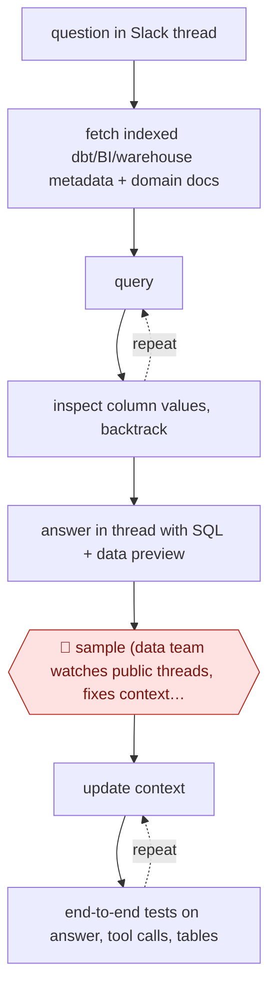

# Context-tested Slack analyst

`TEC › DAT › ANALYTICS` · sampled · evidence A · **draft: needs a reference example** ([how to add one](../../../../../CONTRIBUTING.md#1-add-an-example-run))

**Shape:** `question in Slack thread → fetch indexed dbt/BI/warehouse metadata + domain docs → (query ⟲ inspect column values, backtrack) → answer in thread with SQL + data preview → 🛑 sample (data team watches public threads, fixes context gaps) → (update context ⟲ end-to-end tests on answer, tool calls, tables)`
**How it differs:** AWF-0006 Governed query has a 🛑 review and 🛑 sign-off on each query before publishing. Here answers go out with no per-answer approval; people audit public threads and the team tests the context layer, so autonomy is sampled and the deliverable is a chat answer, not a signed-off published chart. AWF-0123 is scheduled commentary, not question-driven.
**Variants:** `slack` · `dbt` · `looker` · `snowflake` · `snowflake-cortex-analyst` · `bigquery`

<!-- shape diagram: generated by scripts/build_diagrams.py from `shape`; don't edit -->

<!-- end shape diagram -->

## Steps
1. Aggregate and index metadata from dbt, BI and the warehouse; domain owners write documentation for their areas, stored as files the agent can read [[1]](#sources). Whatnot instead limited the agent to data-scientist-endorsed semantic views, "accepting that we’d miss around 30% of questions" [[2]](#sources).
2. Users @mention the agent in Slack (or ask in a public channel). It explores tables, inspects column values, branches and backtracks, and answers in-thread [[1]](#sources).
3. Every answer carries its evidence: in-thread CSV previews [[1]](#sources) or the underlying SQL [[3]](#sources) so the asker can check it.
4. No per-question approval: Ramp first pinged domain owners for every in-domain question and dropped it because it "didn’t scale" [[1]](#sources).
5. 🛑 **Sample**: data experts review questions and answers in public channels and fix gaps by updating the agent's access or context [[2]](#sources); Sourcegraph reviews answers "the way we review PRs: glance at the SQL, confirm the logic, and move on" [[3]](#sources).
6. Evaluate the context layer instead of each answer: with domain experts, list high-priority concepts per domain and write end-to-end tests that assert on the final answer and on intermediate steps (expected tool calls, table references, query shape); update context, rerun, confirm [[1]](#sources).

**Output:** Answers posted in Slack threads with SQL/data previews; a tested, versioned context layer maintained by the data team.
**Failure modes → guards:** Confident wrong answer from a wrong or deprecated table → restrict to endorsed datasets [2], show SQL [3], context-layer tests [1]. Per-question human review re-creates the bottleneck → move review to sampled threads plus tests [1].

## Public runs

Coverage as of 2026-11-13: **Strong**: a first-hand, detailed run that matches most of the shape. Collected and re-checked in [Third collection pass](../../../../../research/2026-11-third-pass.md).

- [Ramp, Building Ramp Research](https://engineering.ramp.com/post/meet-ramp-research) (n.d.). In-house Slack analyst; per-question human review dropped for context-layer tests. "In the last 4 weeks, Ramp Research answered 1,476 questions in #ramp-research-beta, compared to 66 answered in #help-data.". *First-hand: yes; confidence: high.*
- [Whatnot, Lessons learned from scaling data scientists with AI](https://www.whatnot.com/engineering/lessons-learned-from-scaling-data-scientists-with-ai) (2026-01-29). Slack bot on endorsed semantic views; data experts monitor public Q&A and close gaps. "over ten thousand data questions answered by AI systems". *First-hand: yes; confidence: high.*
- [Sourcegraph, Building DataBot](https://sourcegraph.com/blog/building-databot-our-always-on-data-assistant) (2026-02-06). Answers include SQL; data team audits instead of answering. "Each question may only take 5-10 minutes" (baseline before DataBot). *First-hand: yes; confidence: med.*

## Sources

1. Ramp Engineering, Building Ramp Research, n.d. (launched early August; 2025). https://engineering.ramp.com/post/meet-ramp-research
2. Alice Leach et al., Whatnot Engineering, Lessons learned from scaling data scientists with AI, 2026-01-29. https://www.whatnot.com/engineering/lessons-learned-from-scaling-data-scientists-with-ai
3. Aditya Kalia, Sourcegraph, Building DataBot: Our always-on data assistant, 2026-02-06. https://sourcegraph.com/blog/building-databot-our-always-on-data-assistant
