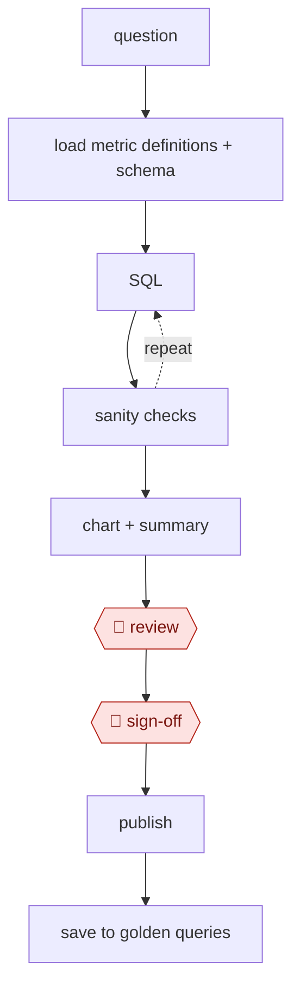

# Governed query

`TEC › DAT › ANALYTICS` · checkpointed · evidence B · **draft: needs a reference example** ([how to add one](../../../../../CONTRIBUTING.md#1-add-an-example-run))

**Shape:** `question → load metric definitions + schema → (SQL ⟲ sanity checks) → chart + summary → 🛑 review → 🛑 sign-off → publish → save to golden queries`

<!-- shape diagram: generated by scripts/build_diagrams.py from `shape`; don't edit -->

<!-- end shape diagram -->

## Background

A business question such as "how did revenue change last quarter?" is answered from the company's database with a query written in SQL, the language for asking a database for figures. The risk is not the query itself but the meaning: "revenue" may have an official definition, and a query that joins tables carelessly can silently inflate the figure. An analyst normally writes the query, checks it against a dashboard everyone trusts and presents the result, which takes skill and time. Here the agent drafts the query from the official definitions, checks it and charts the result. An analyst still reviews the logic, and someone with the authority to sign off must do so before executives see it, because executives act on the figure and the company is answerable for what it reports.

**Terms:**
- **SQL**: the language used to ask a database for figures.
- **Governed metric**: a measure such as revenue or active users that has one official, written definition everyone must use.
- **Semantic layer**: a place where governed metrics are defined once so queries reuse them instead of rewriting them.
- **Schema**: the list of tables and columns in the database and what they hold.
- **Join fan-out**: a join that matches one row to many and so multiplies the row count and inflates totals.
- **Canonical dashboard**: the existing dashboard whose totals are accepted as correct, used to check a new query.
- **Golden queries (golden set)**: verified queries kept for reuse.
- **Exec**: a senior manager who receives the result.

## Build it with an agent

**Form:** `skill`. One analyst asks one question at a time and stays in the conversation to review the answer, so one skill with reference files is the smallest form that works.

**You need:** read-only access to the warehouse; a file of governed metric definitions, or a connection to the semantic layer; the total from the canonical dashboard for each metric, as a figure or a query; a folder for the golden queries; a way to chart the result. Give the agent no tool that publishes to executives.

| Step | Built as |
|---|---|
| question | The analyst asks the question in the conversation. |
| load metric definitions + schema | The skill maps the question's terms to the metric file, and asks the analyst when a term is ambiguous. It reads the schema and sample rows through a read-only warehouse MCP server (connector). |
| (SQL ⟲ sanity checks) | The agent drafts the SQL, preferring the semantic layer, then runs the checks listed in the skill: sanity bounds, row counts before and after each join, and the match with the canonical dashboard total. It revises and repeats on a failure. |
| chart + summary | The agent charts the result and attaches the SQL. |
| 🛑 review | See Checkpoints. |
| 🛑 sign-off | See Checkpoints. |
| publish | The approver publishes in their own tool. |
| save to golden queries | After sign-off, the skill saves the verified query to the golden folder. |

**Checkpoints:** `review`: the skill stops with the SQL, the check results and the chart, and waits for the analyst's decision. `sign-off`: the agent is given no tool to publish or send, so release to executives is an act the approver performs outside the conversation. The skill saves a query to the golden folder only after the analyst confirms the sign-off.

**Since the sources:** The public runs date from 2024-09-19 to 2026-01-29. The entry's steps carry no citations and it has no separate source list. Both public-run pages refused the automated reader in this check (OpenAI HTTP 403, Uber HTTP 406), so neither was opened and their descriptions and quotes rest on the entry text alone. The entry's own coverage line says they are in-house data agents that cover part of the shape and put checkpoints elsewhere, so the review and sign-off steps are a design of the catalog, not something those pages are known to report. No search for newer accounts was needed: the newest run is under 12 months old.

*A design based on this entry's steps and the tool documentation as of 2026-11, not a reported run.*

## Steps

*As reported by the sources.*

1. The agent maps business terms to governed metric definitions. If a term is ambiguous, it asks instead of guessing.
2. The agent inspects the schema and sample rows.
3. The agent drafts SQL, preferring the semantic layer.
4. The agent validates: sanity bounds, join fan-out (did row counts explode?), and reconciliation with a canonical dashboard total.
5. The agent charts the result and attaches the SQL.
6. 🛑 **Review**: an analyst reviews the logic.
7. 🛑 **Sign-off**: required before the result goes to execs.
8. The agent saves the verified query to the golden set for reuse.

## Public runs

Coverage as of 2026-11-06: **Partial**: first-hand runs that cover part of the shape or put checkpoints elsewhere. From [Where are the real runs?](../../../../../research/2026-11-real-runs.md); every number was re-checked against its page.

- [Xu, Suresh, Tang, OpenAI, *Inside our in-house data agent*](https://openai.com/index/inside-our-in-house-data-agent) (2026-01-29). Schema, lineage and docs as context; SQL self-check; saved corrections; golden-SQL evals. "more than 3.5k internal users"; "70k datasets". *First-hand: yes; confidence: med.*
- [Johnson, Busch, Khune, Uber, *QueryGPT*](https://www.uber.com/blog/query-gpt/) (2024-09-19). Curated SQL samples → intent, table and column agents; the user confirms tables. "about 300 daily active users, with about 78%" reporting time saved. *First-hand: yes; confidence: med.*

