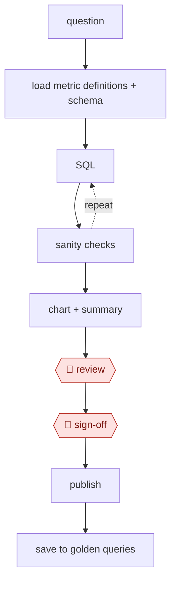

# Governed query

`TEC › DAT › ANALYTICS` · checkpointed · evidence B · **draft: needs a reference example** ([how to add one](../../../../../CONTRIBUTING.md#1-add-an-example-run))

**Shape:** `question → load metric definitions + schema → (SQL ⟲ sanity checks) → chart + summary → 🛑 review → 🛑 sign-off → publish → save to golden queries`

<!-- shape diagram: generated by scripts/build_diagrams.py from `shape`; don't edit -->

<!-- end shape diagram -->

## Steps
1. Map business terms to governed metric definitions. If a term is ambiguous, ask instead of guessing.
2. Inspect the schema and sample rows.
3. Draft SQL, preferring the semantic layer.
4. Validate: sanity bounds, join fan-out (did row counts explode?), and reconciliation with a canonical dashboard total.
5. Chart the result and attach the SQL.
6. 🛑 **Review**: an analyst reviews the logic.
7. 🛑 **Sign-off**: required before the result goes to execs.
8. Save the verified query to the golden set for reuse.

## Public runs

Coverage as of 2026-11-06: **Partial**: first-hand runs that cover part of the shape or put checkpoints elsewhere. From [Where are the real runs?](../../../../../research/2026-11-real-runs.md); every number was re-checked against its page.

- [Xu, Suresh, Tang, OpenAI, *Inside our in-house data agent*](https://openai.com/index/inside-our-in-house-data-agent) (2026-01-29). Schema, lineage and docs as context; SQL self-check; saved corrections; golden-SQL evals. "more than 3.5k internal users"; "70k datasets". *First-hand: yes; confidence: med.*
- [Johnson, Busch, Khune, Uber, *QueryGPT*](https://www.uber.com/blog/query-gpt/) (2024-09-19). Curated SQL samples → intent, table and column agents; the user confirms tables. "about 300 daily active users, with about 78%" reporting time saved. *First-hand: yes; confidence: med.*

