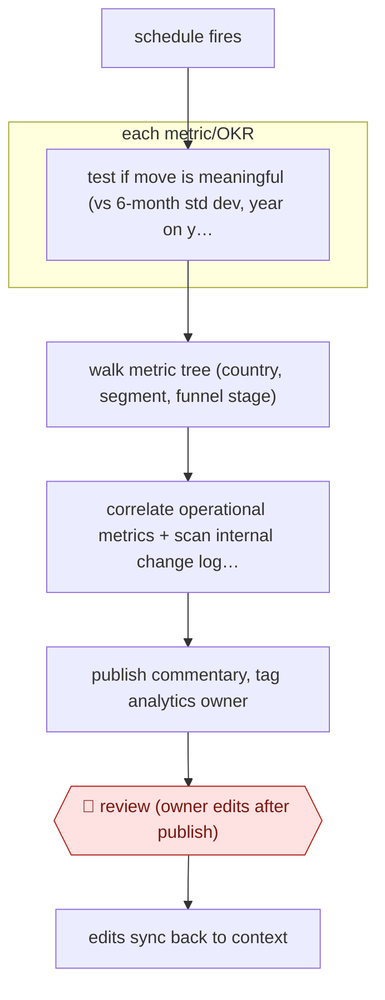

# Scheduled metric commentary

`TEC › DAT › ANALYTICS` · sampled · evidence A · **draft: needs a reference example** ([how to add one](../../../../../CONTRIBUTING.md#1-add-an-example-run))

**Shape:** `schedule fires → each metric/OKR: test if move is meaningful (vs 6-month std dev, year on year) → walk metric tree (country, segment, funnel stage) → correlate operational metrics + scan internal change log + same period last year → publish commentary, tag analytics owner → 🛑 review (owner edits after publish) → edits sync back to context`
**How it differs:** Closest is AWF-0006 (Governed query), where a person asks a question and the answer is reviewed and signed off before it is published. Here a schedule triggers the run, the agent publishes without approval first, and the owner reviews and corrects afterwards. The autonomy is sampled and the deliverable is a recurring narrative, not a one-off answer.
**Variants:** `grab-spartan-rca` · `slack` · `internal-context-registry`

<!-- shape diagram: generated by scripts/build_diagrams.py from `shape`; don't edit -->

<!-- end shape diagram -->

## Steps
1. On a set schedule, the root-cause analysis agent checks each tracked metric or OKR. It judges whether a move is meaningful against the standard deviation over six months and year on year [[1]](#sources).
2. Walk the metric tree to find which country, segment or funnel stage carried the move. Correlate the operational metrics that moved with it [[1]](#sources).
3. Scan internal context for what teams changed on the ground (fee and incentive moves, merchant visibility, experiments shipped in the same period). Compare against the same period last year to separate seasonal effects from real ones [[1]](#sources).
4. Ground the narrative in certified metrics and context documents. Publish the commentary automatically and tag the analytics owner on every report [[1]](#sources).
5. 🛑 **Review**: the tagged owner reviews and edits the published report. Edits sync back so the corrections land in the system. Repeated failures are written into context documents, golden datasets and evals [[1]](#sources).

**Output:** Recurring, published metric and OKR commentary with root causes, owned by a named analyst.
**Failure modes → guards:** Unclear metric definitions produce confident wrong output → metrics certified at the right grain, plus context documents. Seasonal dips misread as real drops → year-on-year comparison. No one watches the run → owner tagging, synced edits, and escalation gates [[1]](#sources).

## Public runs

Coverage as of 2026-11-06: **Partial**: first-hand runs that cover part of the shape or put checkpoints elsewhere. Collected and re-checked in [Second collection pass](../../../../../research/2026-11-second-pass.md).

- [Grab, How AI is transforming analytics at Grab](https://engineering.grab.com/how-ai-is-transforming-analytics) (2026-08-01). Automated metric/OKR commentaries in production; analyst mechanical work share fell (all Grab agents combined, not this workflow alone). "In February, 44% of the tickets our analysts closed were mechanical (data preparation, alerting, reporting); by June, that share had fallen to 30%.". *First-hand: yes; confidence: med.*

## Sources

1. Maanas Prabhakar, Grab Engineering, How AI is transforming analytics at Grab, 2026-08-01. https://engineering.grab.com/how-ai-is-transforming-analytics
