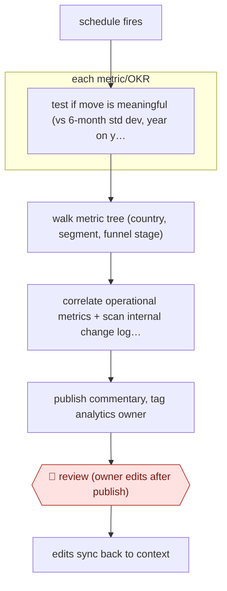

# Scheduled metric commentary

`TEC › DAT › ANALYTICS` · sampled · evidence A · **draft: needs a reference example** ([how to add one](../../../../../CONTRIBUTING.md#1-add-an-example-run))

**Shape:** `schedule fires → each metric/OKR: test if move is meaningful (vs 6-month std dev, year on year) → walk metric tree (country, segment, funnel stage) → correlate operational metrics + scan internal change log + same period last year → publish commentary, tag analytics owner → 🛑 review (owner edits after publish) → edits sync back to context`
**Variants:** `grab-spartan-rca` · `slack` · `internal-context-registry`

<!-- shape diagram: generated by scripts/build_diagrams.py from `shape`; don't edit -->

<!-- end shape diagram -->

## Background

Companies track a set of numbers over time: metrics such as orders or revenue, and OKRs (objectives and key results, the targets a team sets for a period). Each week or month someone in analytics must explain what moved and why, in a short written commentary that managers read. By hand this means checking which movements are real rather than normal variation, drilling into which country or customer group carried the change, and hunting for what the business did meanwhile (a price change, a promotion). Here the agent does that on a schedule and publishes the commentary straight away, tagging the analyst who owns the metric. The analyst reviews and corrects it afterwards, because only a person who knows the business can confirm the causal story, and managers act on it.

**Terms:**
- **Metric / OKR**: a tracked measure, or a target for a period.
- **Standard deviation**: a measure of how much a number normally varies; a move well beyond it is unlikely to be chance.
- **Year on year**: comparing a period with the same period a year earlier.
- **Metric tree**: a breakdown of a headline metric into parts, such as by country, customer segment or funnel stage.
- **Funnel stage**: one step on a customer's path, for example viewing, ordering and paying.
- **Operational metrics**: day-to-day measures from running the business, such as delivery times or driver supply, that may explain a move.
- **Seasonal effect**: a regular rise or fall tied to the calendar, such as a holiday.
- **Certified metric**: a metric whose definition and level of detail (its grain) the data team has approved.
- **Context documents**: written notes on what metrics and tables mean, which the agent reads.
- **Golden dataset / eval**: a set of checked answers, and a test that runs the agent against it.
- **Root-cause analysis**: working out what caused a change.
- **Analytics owner**: the analyst responsible for a metric or report.

## Build it with an agent

**Form:** `service`. The run starts on a schedule with nobody present, and the owner sees only the published commentary and is tagged on it.

**You need:** read-only access to the warehouse; a file describing the metric tree for each tracked metric; the certified metric definitions and context documents as files; the internal change log (fee changes, incentives, experiments shipped); a list of metrics and OKRs with the owner of each; permission to post to the commentary channel and nothing else; a store outside the conversation for what was published and what owners edited.

| Step | Built as |
|---|---|
| schedule fires | A cloud scheduled task, or your own scheduler starting `claude -p` or an Agent SDK program. |
| each metric/OKR: test if move is meaningful | A script compares each metric with its six-month standard deviation and with the year-earlier figure; only metrics that moved meaningfully go on. A subagent takes each one, or a dynamic workflow when there are many. |
| walk metric tree | A skill holds the metric tree; the agent queries each cut through a read-only warehouse MCP server (connector). |
| correlate operational metrics + scan internal change log + same period last year | The skill tells the agent to read the operational metrics, the change log and the year-earlier figure, and to name only causes those records support. |
| publish commentary, tag analytics owner | The agent posts through a chat connector limited to the commentary channel and tags the owner listed for that metric. |
| 🛑 review | See Checkpoints. |
| edits sync back to context | At its start, each run reads the owner's edits from the store and writes them into the context documents the skill loads. |

**Checkpoints:** `review`: the source publishes first and the owner reviews afterwards, and this build keeps that order. The tag is how the owner is asked: it is posted with every report, and the run log lists reports with no edit or reply yet. The agent's only write access is the commentary channel and the store, with no write access to the warehouse. If the commentary reaches readers outside the company, take away the posting tool and have the run save a draft for the owner to publish instead.

**Since the sources:** The single source, which is also the single public run, is dated 2026-08-01. It opened in this check, and its section on unattended loops supports steps 1 to 4 and the owner tag with synced edits in step 5. The article states the fix-the-context rule (encode a repeated failure into context documents, golden datasets, evals and gates) as a principle for all of its agents, not for this commentary alone. It describes Grab's own platform capability for root-cause analysis; this build uses a general agent with the skill and scripts above and does not reproduce that platform. The newest source is under 12 months old, so no search for newer accounts was needed.

*A design based on this entry's steps and the tool documentation as of 2026-11, not a reported run.*

## Steps

*As reported by the sources.*

1. On a set schedule, the root-cause analysis agent checks each tracked metric or OKR. It judges whether a move is meaningful against the standard deviation over six months and year on year [[1]](#sources).
2. The agent walks the metric tree to find which country, segment or funnel stage carried the move. It correlates the operational metrics that moved with it [[1]](#sources).
3. The agent scans internal context for what teams changed on the ground (fee and incentive moves, merchant visibility, experiments shipped in the same period). It compares against the same period last year to separate seasonal effects from real ones [[1]](#sources).
4. The agent grounds the narrative in certified metrics and context documents, publishes the commentary automatically and tags the analytics owner on every report [[1]](#sources).
5. 🛑 **Review**: the tagged owner reviews and edits the published report. Edits sync back so the corrections land in the system. Repeated failures are written into context documents, golden datasets and evals [[1]](#sources).

**Output:** Recurring, published metric and OKR commentary with root causes, owned by a named analyst.
**Failure modes → guards:** Unclear metric definitions produce confident wrong output → metrics certified at the right grain, plus context documents. Seasonal dips misread as real drops → year-on-year comparison. No one watches the run → owner tagging, synced edits, and escalation gates [[1]](#sources).
**How it differs:** Closest is AWF-0006 (Governed query), where a person asks a question and the answer is reviewed and signed off before it is published. Here a schedule triggers the run, the agent publishes without approval first, and the owner reviews and corrects afterwards. The autonomy is sampled and the deliverable is a recurring narrative, not a one-off answer.

## Public runs

Coverage as of 2026-11-06: **Partial**: first-hand runs that cover part of the shape or put checkpoints elsewhere. Collected and re-checked in [Second collection pass](../../../../../research/2026-11-second-pass.md).

- [Grab, How AI is transforming analytics at Grab](https://engineering.grab.com/how-ai-is-transforming-analytics) (2026-08-01). Automated metric/OKR commentaries in production; analyst mechanical work share fell (all Grab agents combined, not this workflow alone). "In February, 44% of the tickets our analysts closed were mechanical (data preparation, alerting, reporting); by June, that share had fallen to 30%.". *First-hand: yes; confidence: med.*

## Sources

1. Maanas Prabhakar, Grab Engineering, How AI is transforming analytics at Grab, 2026-08-01. https://engineering.grab.com/how-ai-is-transforming-analytics
