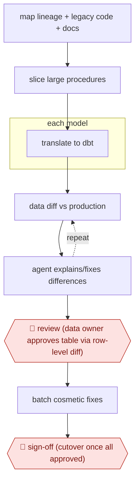

# Diff-proven dbt migration

`TEC › DAT › DATAENG` · checkpointed · evidence B · **draft: needs a reference example** ([how to add one](../../../../../CONTRIBUTING.md#1-add-an-example-run))

**Shape:** `map lineage + legacy code + docs → slice large procedures → each model: translate to dbt → (data diff vs production ⟲ agent explains/fixes differences) → 🛑 review (data owner approves table via row-level diff) → batch cosmetic fixes → 🛑 sign-off (cutover once all approved)`
**How it differs:** AWF-0002 fan-out codemod: also parallel code changes, but its gate is tests and PR review. Here the gate is data parity on production rows plus data-owner approval per table.
**Variants:** `datafold-migration-agent` · `claude-code-skills` · `dbt-mesh` · `snowflake`

<!-- shape diagram: generated by scripts/build_diagrams.py from `shape`; don't edit -->

<!-- end shape diagram -->

## Steps
1. The agent maps full lineage, the legacy codebase and the semantic layer. It pulls undocumented context from wikis and meeting recordings [[1]](#sources).
2. Split oversized stored procedures at logical boundaries. One 300K-character procedure became ~400 models [[2]](#sources). Translate to modular dbt projects with clear ownership, using dbt Mesh for cross-project pieces [[1]](#sources).
3. Check every translated model against production data with automated data diffing. The agent must justify any expected difference using legacy code, new code and requirements. Unexplained differences loop back until resolved [[1]](#sources). The solo variant runs bidirectional MINUS parity checks plus schema/CI checks before each push [[3]](#sources).
4. 🛑 **Review**: data owners approve each table after seeing a visual row-level diff. A written explanation alone is not enough [[1]](#sources).
5. Batch cosmetic changes such as column renames until the data is verified, because each one costs agent calls [[1]](#sources).
6. 🛑 **Sign-off**: cutover of the tables behind the reporting layer happens only after every dimension and fact has been reviewed and approved [[1]](#sources).

**Output:** A version-controlled dbt project at proven parity with legacy outputs, ready for cutover behind existing reporting.
**Failure modes → guards:** Owners assume any mismatch means 'bad data' → show row-level diffs [[1]](#sources). Incremental watermark silently dropping NULL/late rows → bidirectional parity diff with asymmetric-count check [[3]](#sources). Reviewer becomes the bottleneck through over-checking → let the diff evidence carry more of the review [[1]](#sources).

## Public runs

Coverage as of 2026-11-06: **Weak**: only anonymous, vendor-linked or journalist-told accounts. Collected and re-checked in [New workflows for empty categories](../../../../../research/2026-11-new-workflows.md).

- [dbt Labs, How Ecolab used an AI migration agent](https://www.getdbt.com/blog/ecolab-ai-agent-legacy-sql-migration) (2026-10-27). Ecolab legacy Snowflake SQL to 40+ dbt projects, diff-validated, owner-approved. "roughly 90 tables were approved within the first four weeks of review". *First-hand: vendor (dbt blog summary of an Ecolab and Datafold talk); confidence: high.*

## Sources

1. Daniel Poppy (dbt Labs), How Ecolab used an AI migration agent to shrink 84,000 lines of legacy SQL by 6x, 2026-10-27. https://www.getdbt.com/blog/ecolab-ai-agent-legacy-sql-migration
2. Gleb Mezhanskiy (Datafold), The Slicer vs. The Kraken, 2025-07-14. https://www.datafold.com/blog/stored-procedure-migration-slicer/ (search excerpt only, not fetched) (search excerpt only, not opened)
3. Sidhartha Ray, I had 45 hand-written Snowflake SQL pipelines to migrate to dbt (LinkedIn), 2026-06-22. https://www.linkedin.com/posts/sidhartharay_dbt-snowflake-etl-migration-agentic-ai-activity-7474834597030289408-AMAv (search excerpt only, not fetched) (search excerpt only, not opened)
