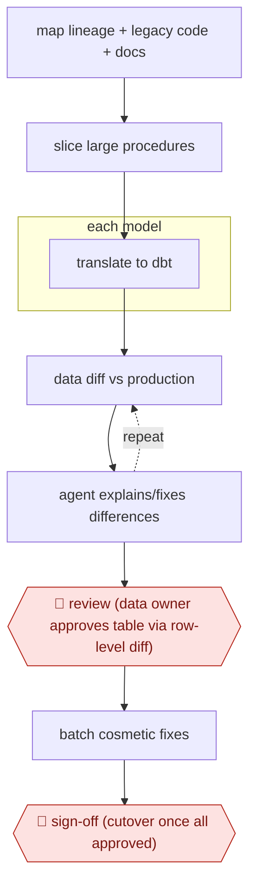

# Diff-proven dbt migration

`TEC › DAT › DATAENG` · checkpointed · evidence B · **draft: needs a reference example** ([how to add one](../../../../../CONTRIBUTING.md#1-add-an-example-run))

**Shape:** `map lineage + legacy code + docs → slice large procedures → each model: translate to dbt → (data diff vs production ⟲ agent explains/fixes differences) → 🛑 review (data owner approves table via row-level diff) → batch cosmetic fixes → 🛑 sign-off (cutover once all approved)`
**Variants:** `datafold-migration-agent` · `claude-code-skills` · `dbt-mesh` · `snowflake`

<!-- shape diagram: generated by scripts/build_diagrams.py from `shape`; don't edit -->

<!-- end shape diagram -->

## Background

Companies keep years of business logic as SQL scripts and stored procedures inside their data warehouse. They run, but few people understand them and they are hard to change or test. Teams migrate them to dbt, a tool that keeps each transformation as a small, version-controlled model with tests. The risk is that a rewritten model quietly produces different numbers, so the real work is proving that the new tables match the old ones on production data. The agent translates the code, compares each result with production and explains every difference. The person who owns each table still has to approve it, because only the owner can say whether a difference is a mistake in the old logic or the new, and the final switch changes what every report shows.

**Terms:**
- **Data warehouse**: the central database where a company keeps data for reporting.
- **Stored procedure**: a long program kept and run inside the database, often thousands of lines of SQL.
- **dbt model**: one transformation, written as a SQL file in a version-controlled project and tested; dbt is the tool that runs them.
- **Lineage**: the map of which tables are built from which other tables.
- **Semantic layer**: the shared definitions of business measures, such as what counts as revenue.
- **Dimension and fact tables**: the descriptive tables (customers, products) and the event or measure tables (sales) that reports are built from.
- **Data diff**: a comparison of two tables row by row, showing which rows or values differ.
- **Parity**: the new output matches the old output; a bidirectional MINUS check lists rows present on one side and not the other, in each direction.
- **Incremental watermark**: a filter that makes a model process only rows newer than the last run; it can silently drop rows with an empty or late timestamp.
- **dbt Mesh**: dbt's way of splitting a large project into several projects that depend on each other.
- **Data owner**: the person accountable for a table's numbers.
- **Cutover**: pointing the reports at the new tables in place of the old.

## Build it with an agent

**Form:** `project`. A skill could carry the translation, but three things must hold for every model: no table is marked approved without its data diff, production is never written to, and no cutover happens before every approval is on file. That needs hooks or permission rules, and the work fans out over hundreds of models with custom workers. The solo variant in source 3 ran its phases as Claude Code skills for 45 pipelines.

**You need:** the legacy code, lineage metadata and exported wiki pages and meeting transcripts as files; a dbt project (or one per owner) in a repository; a warehouse role that can read production and write only to a development schema; a script or tool that runs the data diff and writes the differing rows to a file; the list of data owners per table; the requirements for the new models.

| Step | Built as |
|---|---|
| map lineage + legacy code + docs | Read-only subagents read the code, the lineage metadata and the exported documents and write a lineage map and a list of undocumented assumptions to files. |
| slice large procedures | A skill instruction: split an oversized procedure at logical boundaries and record which slice feeds which model. |
| each model: translate to dbt | Custom subagents, one per model, write the dbt model and its tests on a branch. A dynamic workflow script can fan out over many models. |
| (data diff vs production ⟲ agent explains/fixes differences) | A script runs the bidirectional MINUS diff against production. The subagent must write an explanation for each difference from the legacy code, the new code and the requirements, or fix the model and rerun. Anything left unexplained goes back into the loop. |
| 🛑 review | See Checkpoints. |
| batch cosmetic fixes | The skill keeps a list of renames and similar changes and applies them in one pass after the data is verified. |
| 🛑 sign-off | See Checkpoints. |

**Checkpoints:** `review`: for each table the skill stops and presents the row-level diff and the explanations, not a written summary alone; the data owner's approval is recorded in an approvals file. A `PreToolUse` hook blocks any push that touches a model with no recorded approval once the review phase starts. `sign-off`: the agent's warehouse role is read-only on production and it has no deploy or cutover tool, so a person switches the tables behind the reporting layer only after every dimension and fact has an approval on file.

**Since the sources:** Sources date from 2025-07 to 2026-10. Sources 2 and 3 are listed as search excerpts, and all three were opened in 2026-11; each still supports the steps it is cited for. The main account (source 1) is a vendor blog's summary of a customer talk about Datafold's migration agent, a product. This build replaces its parts with a general agent, scripts and hooks, and it leaves out the product's own slicing and visual diff features. How a general agent does at the scale of source 1 is not reported; source 3 reports only the solo run of 45 pipelines. The cutover, which source 1 says was out of scope for the phase it describes, stays a person's act here.

*A design based on this entry's steps and the tool documentation as of 2026-11, not a reported run.*

## Steps

*As reported by the sources.*

1. The agent maps full lineage, the legacy codebase and the semantic layer. It pulls undocumented context from wikis and meeting recordings [[1]](#sources).
2. The agent splits oversized stored procedures at logical boundaries. One 300K-character procedure became ~400 models [[2]](#sources). It translates the legacy code to modular dbt projects with clear ownership, using dbt Mesh for cross-project pieces [[1]](#sources).
3. The agent checks every translated model against production data with automated data diffing. It must justify any expected difference using legacy code, new code and requirements. Unexplained differences loop back until resolved [[1]](#sources). The solo variant runs bidirectional MINUS parity checks plus schema/CI checks before each push [[3]](#sources).
4. 🛑 **Review**: data owners approve each table after seeing a visual row-level diff. A written explanation alone is not enough [[1]](#sources).
5. The team batches cosmetic changes such as column renames until the data is verified, because each one costs agent calls [[1]](#sources).
6. 🛑 **Sign-off**: cutover of the tables behind the reporting layer happens only after every dimension and fact has been reviewed and approved [[1]](#sources).

**Output:** A version-controlled dbt project at proven parity with legacy outputs, ready for cutover behind existing reporting.
**Failure modes → guards:** Owners assume any mismatch means 'bad data' → show row-level diffs [[1]](#sources). Incremental watermark silently dropping NULL/late rows → bidirectional parity diff with asymmetric-count check [[3]](#sources). Reviewer becomes the bottleneck through over-checking → let the diff evidence carry more of the review [[1]](#sources).
**How it differs:** AWF-0002 fan-out codemod: also parallel code changes, but its gate is tests and PR review. Here the gate is data parity on production rows plus data-owner approval per table.

## Public runs

Coverage as of 2026-11-06: **Weak**: only anonymous, vendor-linked or journalist-told accounts. Collected and re-checked in [New workflows for empty categories](../../../../../research/2026-11-new-workflows.md).

- [dbt Labs, How Ecolab used an AI migration agent](https://www.getdbt.com/blog/ecolab-ai-agent-legacy-sql-migration) (2026-10-27). Ecolab legacy Snowflake SQL to 40+ dbt projects, diff-validated, owner-approved. "roughly 90 tables were approved within the first four weeks of review". *First-hand: vendor (dbt blog summary of an Ecolab and Datafold talk); confidence: high.*

## Sources

1. Daniel Poppy (dbt Labs), How Ecolab used an AI migration agent to shrink 84,000 lines of legacy SQL by 6x, 2026-10-27. https://www.getdbt.com/blog/ecolab-ai-agent-legacy-sql-migration
2. Gleb Mezhanskiy (Datafold), The Slicer vs. The Kraken, 2025-07-14. https://www.datafold.com/blog/stored-procedure-migration-slicer/
3. Sidhartha Ray, I had 45 hand-written Snowflake SQL pipelines to migrate to dbt (LinkedIn), 2026-06-22. https://www.linkedin.com/posts/sidhartharay_dbt-snowflake-etl-migration-agentic-ai-activity-7474834597030289408-AMAv
