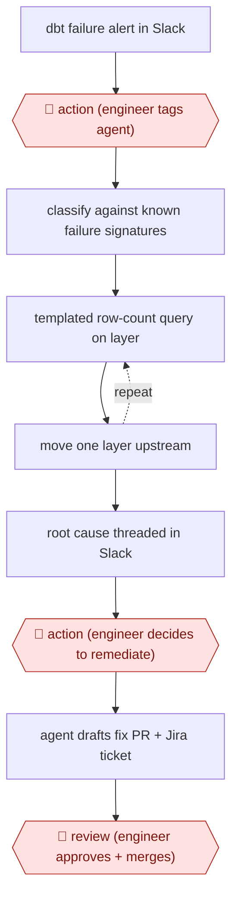

# Summoned dbt debugger

`TEC › DAT › DATAENG` · checkpointed · evidence A · **draft: needs a reference example** ([how to add one](../../../../../CONTRIBUTING.md#1-add-an-example-run))

**Shape:** `dbt failure alert in Slack → 🛑 action (engineer tags agent) → classify against known failure signatures → (templated row-count query on layer ⟲ move one layer upstream) → root cause threaded in Slack → 🛑 action (engineer decides to remediate) → agent drafts fix PR + Jira ticket → 🛑 review (engineer approves + merges)`
**Variants:** `claude-agent-sdk` · `dbt` · `snowflake` · `slack` · `jira` · `kestra`

<!-- shape diagram: generated by scripts/build_diagrams.py from `shape`; don't edit -->

<!-- end shape diagram -->

## Background

A company's reports are built each night by data pipelines: chains of steps that turn raw records into clean tables. dbt is a common tool for the later steps, and it runs tests after each step. When one fails, an engineer on call must work out why, which usually means checking the data layer by layer, from the finished report table back towards the raw source. Most of that is routine gathering of evidence, and many failures turn out to be temporary warehouse errors that need no fix at all. The agent does the tracing and says what it found. The engineer starts each investigation, decides whether any fix is worth making and merges it, because a needless fix costs a review and a wrong one can change the numbers people rely on.

**Terms:**
- **Data pipeline**: a chain of automated steps that moves and transforms data.
- **dbt**: a tool that builds tables from SQL files and runs tests on them; a failure means a build or a test went wrong.
- **Data warehouse**: the central database where the tables live.
- **Layers (source, base, staging, intermediate, mart)**: the stages a table passes through, from raw input (source) to the finished tables that reports read (mart).
- **Row-count query**: a query that counts the rows in a table, used to find the first layer where the numbers stop matching.
- **Failure signature**: a recognisable pattern in an error message that points to a known cause.
- **Schema path**: the full name that locates a table, such as database, schema and table.
- **PR (pull request)**: a proposed change, published for review before it is merged.
- **On-call engineer**: the engineer responsible for answering production failures that week.

## Build it with an agent

**Form:** `skill`. A person starts each investigation for one failure and decides what happens next, so a skill with a lookup table and query templates is the smallest form that works. The source ran as a Slack bot; a Slack connector can post the result to the thread, but the steps do not need it. If you want the tag in Slack to start the run with nobody at a keyboard, that is a `service` build.

**You need:** read-only access to the warehouse, with a role that cannot write; the failing job's logs; a reference file of known failure signatures and the fix or classification for each; pre-written row-count query templates in layer order; a short registry of schema paths for the models; for the second stage only, permission to push a branch, open a pull request and create a ticket.

| Step | Built as |
|---|---|
| dbt failure alert in Slack → 🛑 action (engineer tags agent) | The engineer starts the skill with the failing job's name or log. The skill never starts on its own. |
| classify against known failure signatures | The skill matches the error against the lookup table in its reference file before any other reasoning. |
| (templated row-count query on layer ⟲ move one layer upstream) | A script holds the query templates; the agent fills in model names and dates, runs them on the read-only role, finds the first layer where counts differ, reads that model's SQL and repeats one layer up. A failed query is retried with a corrected schema path from the registry. |
| root cause threaded in Slack | The skill writes the diagnosis, labelled a routine fix or a judgement call, and returns it to the engineer, or posts it to the thread through a connector. |
| 🛑 action (engineer decides to remediate) | See Checkpoints. |
| agent drafts fix PR + Jira ticket | A separate remediation skill, run by the engineer by name, edits a branch, opens a draft pull request and creates the ticket. |
| 🛑 review | See Checkpoints. |

**Checkpoints:** `action`: the first one is the engineer starting the skill. The second is deciding to remediate: the diagnosis skill is given read tools only and ends by asking, and the permission rules for `git push`, pull request creation and ticket creation are set to ask, so a missed stop still reaches a prompt. `review`: the pull request is a draft and the agent has no tool to merge it; the engineer reads, approves and merges.

**Since the sources:** The single source and public run is dated 2026-05. Its page could not be opened in this check (the site refused the automated reader), so this entry was converted from its own text and its figures are not repeated here. The source deliberately chose a manual trigger; this build keeps that choice. The query templates and the signature table are needed for the same reason the source gives: the agent otherwise invents column names and schema paths. A search for newer accounts was not needed because the source is under 12 months old.

*A design based on this entry's steps and the tool documentation as of 2026-11, not a reported run.*

## Steps

*As reported by the sources.*

1. A dbt production failure posts to the data notifications channel. 🛑 **Action**: the on-call engineer starts the investigation by tagging the agent. The team chose a manual trigger on purpose [[1]](#sources).
2. The agent classifies the error by matching it against a lookup table of 11 known failure signatures. It does not diagnose from first principles [[1]](#sources).
3. The agent traces upstream in a fixed layer order: mart, intermediate, staging, base, source. It runs pre-written row-count queries where it only fills in model names and dates. It finds the first layer where counts diverge, reads that layer's SQL, and repeats one level up. A made-up column name fails the query, and the agent retries with a corrected schema path [[1]](#sources).
4. The agent posts the diagnosis back in the same Slack thread within a few minutes, labelled as either a routine fix or a judgment call [[1]](#sources).
5. 🛑 **Action**: the engineer decides whether to proceed. Only then does the remediation skill draft the fix, open a PR and create a Jira ticket. 🛑 **Review**: the engineer reads, approves and merges [[1]](#sources).
6. The team keeps the failure taxonomy and the warehouse context registry up to date as new patterns appear [[1]](#sources).

**Output:** A root-cause diagnosis in the alert thread, plus a fix PR and Jira ticket when the engineer asks for them.
**Failure modes → guards:** Transient warehouse errors would create needless tickets and PRs if remediation ran on its own → a human decides on every fix (83% of diagnoses needed no action). Made-up schema paths (about 25% of queries failed at first) → templated queries plus a context registry, which brought failures down to about 13% [[1]](#sources). Edge cases such as upstream API drift → still go to a human.
**How it differs:** Closest is AWF-0063 (Diff-proven dbt migration), which translates legacy code into dbt and proves it with row-level diffs before cutover. This one diagnoses failures in a pipeline already in production. A person starts each run and a person decides on each fix.

## Public runs

Coverage as of 2026-11-06: **Strong**: a first-hand, detailed run that matches most of the shape. Collected and re-checked in [Second collection pass](../../../../../research/2026-11-second-pass.md).

- [Headway, De-Bug-T: an AI copilot for dbt debugging](https://headway.co/blog/headway-engineering-de-bug-t) (2026-05-07). Five weeks in production; most diagnoses needed no fix, which justified keeping humans on the remediate decision. "Of the diagnoses over five weeks, 83% required no action at all.". *First-hand: yes; confidence: high.*

## Sources

1. Trpti Sanghvi, Headway, De-Bug-T: an AI copilot for dbt debugging, 2026-05-07. https://headway.co/blog/headway-engineering-de-bug-t
