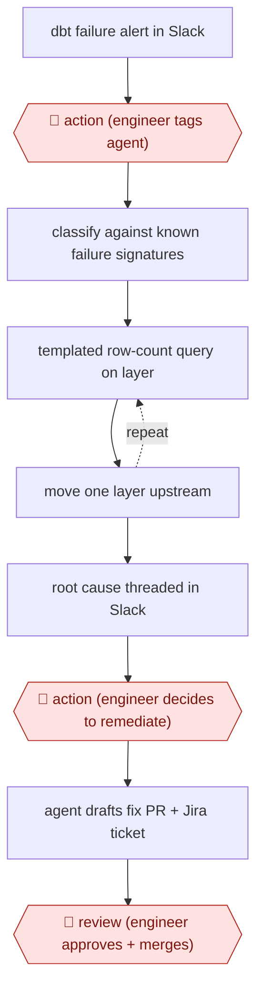

# Summoned dbt debugger

`TEC › DAT › DATAENG` · checkpointed · evidence A · **draft: needs a reference example** ([how to add one](../../../../../CONTRIBUTING.md#1-add-an-example-run))

**Shape:** `dbt failure alert in Slack → 🛑 action (engineer tags agent) → classify against known failure signatures → (templated row-count query on layer ⟲ move one layer upstream) → root cause threaded in Slack → 🛑 action (engineer decides to remediate) → agent drafts fix PR + Jira ticket → 🛑 review (engineer approves + merges)`
**How it differs:** Closest is AWF-0063 (Diff-proven dbt migration), which translates legacy code into dbt and proves it with row-level diffs before cutover. This one diagnoses failures in a pipeline already in production. A person starts each run and a person decides on each fix.
**Variants:** `claude-agent-sdk` · `dbt` · `snowflake` · `slack` · `jira` · `kestra`

<!-- shape diagram: generated by scripts/build_diagrams.py from `shape`; don't edit -->

<!-- end shape diagram -->

## Steps
1. A dbt production failure posts to the data notifications channel. 🛑 **Action**: the on-call engineer starts the investigation by tagging the agent. The team chose a manual trigger on purpose [[1]](#sources).
2. Classify the error by matching it against a lookup table of 11 known failure signatures. Do not diagnose from first principles [[1]](#sources).
3. Trace upstream in a fixed layer order: mart, intermediate, staging, base, source. Run pre-written row-count queries where the agent only fills in model names and dates. Find the first layer where counts diverge, read that layer's SQL, and repeat one level up. A made-up column name fails the query, and the agent retries with a corrected schema path [[1]](#sources).
4. Post the diagnosis back in the same Slack thread within a few minutes, labelled as either a routine fix or a judgment call [[1]](#sources).
5. 🛑 **Action**: the engineer decides whether to proceed. Only then does the remediation skill draft the fix, open a PR and create a Jira ticket. 🛑 **Review**: the engineer reads, approves and merges [[1]](#sources).
6. Keep the failure taxonomy and the warehouse context registry up to date as new patterns appear [[1]](#sources).

**Output:** A root-cause diagnosis in the alert thread, plus a fix PR and Jira ticket when the engineer asks for them.
**Failure modes → guards:** Transient warehouse errors would create needless tickets and PRs if remediation ran on its own → a human decides on every fix (83% of diagnoses needed no action). Made-up schema paths (about 25% of queries failed at first) → templated queries plus a context registry, which brought failures down to about 13% [[1]](#sources). Edge cases such as upstream API drift → still go to a human.

## Public runs

Coverage as of 2026-11-06: **Strong**: a first-hand, detailed run that matches most of the shape. Collected and re-checked in [Second collection pass](../../../../../research/2026-11-second-pass.md).

- [Headway, De-Bug-T: an AI copilot for dbt debugging](https://headway.co/blog/headway-engineering-de-bug-t) (2026-05-07). Five weeks in production; most diagnoses needed no fix, which justified keeping humans on the remediate decision. "Of the diagnoses over five weeks, 83% required no action at all.". *First-hand: yes; confidence: high.*

## Sources

1. Trpti Sanghvi, Headway, De-Bug-T: an AI copilot for dbt debugging, 2026-05-07. https://headway.co/blog/headway-engineering-de-bug-t
