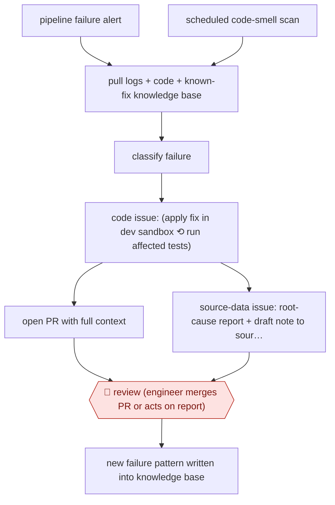

# Unprompted pipeline repair

`TEC › DAT › DATAENG` · checkpointed · evidence A · **draft: needs a reference example** ([how to add one](../../../../../CONTRIBUTING.md#1-add-an-example-run))

**Shape:** `pipeline failure alert | scheduled code-smell scan → pull logs + code + known-fix knowledge base → classify failure → code issue: (apply fix in dev sandbox ⟲ run affected tests) → open PR with full context | source-data issue: root-cause report + draft note to source owner → 🛑 review (engineer merges PR or acts on report) → new failure pattern written into knowledge base`
**Variants:** `snowpark-container-services` · `dbt-cloud` · `dbt-mcp` · `notion-kb` · `bigquery` · `claude-code-headless`

<!-- shape diagram: generated by scripts/build_diagrams.py from `shape`; don't edit -->

<!-- end shape diagram -->

## Background

A company's reports are built by data pipelines: chains of scheduled steps that turn raw records into clean tables, often with dbt, a tool that builds the tables from SQL files and tests them. When a step fails, an engineer has to gather the logs, the code and the history, find the cause and fix it, and most of the time goes on gathering context for a small change. Here an agent picks up each failure as it happens, and also scans the pipelines on a schedule for poor code. It tries a fix on a copy of the data and opens a pull request, or writes a report if the fault lies in the incoming data and no code change can cure it. An engineer still merges or acts, because the agent can misjudge whether a fault is in the code or in the data, and a patch that hides bad data is worse than a failure.

**Terms:**
- **Data pipeline**: a chain of automated steps that moves and transforms data.
- **dbt**: a tool that builds tables from SQL files and runs tests on them.
- **Webhook**: an automatic message that a system sends to a web address when something happens, here a failed run.
- **Code smell**: a pattern in code that is not wrong yet but tends to cause trouble or waste.
- **Known-fix knowledge base**: the team's written list of past failures and the documented remedy for each.
- **CODE / SOURCE**: the two failure classes: fixable in the project's code, or caused by bad data arriving from upstream.
- **Dev sandbox**: a development copy of the warehouse data where fixes can be tested without touching production.
- **DAG lineage**: the map of which tables depend on which.
- **PR (pull request)**: a proposed change, published for review before it is merged.

## Build it with an agent

**Form:** `service`. The agent starts on a failure webhook or a timer with nobody at a keyboard, and engineers see only the pull request or the report.

**You need:** a way to start a run: a small receiver that takes the failure webhook and starts `claude -p` or an Agent SDK program, and a schedule for the scan (a cloud scheduled task where your systems are reachable from it, or your own scheduler); scripts that clone the repository, download run artifacts, reduce the failed tests to a short summary, render the knowledge base to a Markdown file and clone production data into a sandbox; a warehouse role that is read-only on production; permission to push a branch and open a pull request, and none to merge; a channel for the team notification.

| Step | Built as |
|---|---|
| pipeline failure alert \| scheduled code-smell scan | The failure webhook starts a headless run through the receiver; the scan is a second scheduled run with its own prompt. |
| pull logs + code + known-fix knowledge base | Plain scripts run before the agent starts, so the agent begins with a failures file, the knowledge base as Markdown and a ready sandbox. |
| classify failure | The skill searches the knowledge base first and follows a matching documented fix exactly; otherwise it investigates logs, lineage and data, then labels the failure CODE or SOURCE. |
| code issue: (apply fix in dev sandbox ⟲ run affected tests) | The agent edits and runs the affected models and tests in the sandbox until they pass. The production role is read-only, and a `PreToolUse` hook can block commands that name the production target. |
| open PR with full context | A script or connector opens the pull request with the diagnosis and test results and notifies the channel. |
| source-data issue: root-cause report + draft note to source owner | The skill writes the diagnostic queries, the root cause and a plain-language note for the data's owner to a report file. It does not edit code for SOURCE failures. |
| 🛑 review | See Checkpoints. |
| new failure pattern written into knowledge base | A person adds the entry. The agent has no write access to the knowledge base, so the next run follows what a person approved. |

**Checkpoints:** `review`: the run's only outputs are a draft pull request or a report for the on-call engineer; the agent has no tool to merge, and production is read-only by role, so a wrong CODE or SOURCE call cannot reach production. The engineer merges the pull request or acts on the report.

**Since the sources:** Sources date from 2026-03 to 2026-10. The 2026-03 source (Hiflylabs) was opened in 2026-11 and still supports the steps cited to it: scripts gather context, the knowledge base is searched first, failures are split into CODE and SOURCE, production is read-only and the output is a pull request, not an auto-merged commit. The 2026-10 source (Snowflake) could not be opened in this check (the site refused the automated reader), so what is cited to it was not re-read. This build follows the Hiflylabs account, which says it runs coding-agent products in headless mode; it does not reproduce Snowflake's own platform. A search for newer accounts was not needed because both sources are under 12 months old.

*A design based on this entry's steps and the tool documentation as of 2026-11, not a reported run.*

## Steps

*As reported by the sources.*

1. A webhook from the scheduler triggers the agent on every monitored pipeline failure, and a timer triggers it too (e.g. every 12 hours) to scan pipelines for code smells and performance issues; no engineer has to summon the agent [[1]](#sources)[[2]](#sources).
2. Deterministic scripts, not the agent, gather context: clone the repo, download run artifacts, extract only the failed tests into a compact summary, render the team's known-failure knowledge base to markdown, and clone production data into a dev sandbox [[2]](#sources).
3. The agent searches the knowledge base first and follows a documented fix exactly when one matches; otherwise it investigates logs, DAG lineage and data from scratch, fixing upstream rather than patching each downstream test [[2]](#sources).
4. The agent classifies each failure: CODE (fixable in the project) or SOURCE (bad upstream data). SOURCE issues are report-only: the agent documents the root cause with diagnostic queries and drafts a plain-English note for the source owner, and never adds a workaround in code [[2]](#sources).
5. For CODE fixes, the agent applies the change and runs the affected models/tests in the sandbox until they pass; production stays read-only, enforced by warehouse roles [[2]](#sources). Snowflake's agent tests fixes "before anything touches production" [[1]](#sources).
6. The agent opens a PR with full context and notifies the team channel; Snowflake reports under 16 minutes from detection to PR on average [[1]](#sources).
7. 🛑 **Review**: an engineer reviews and merges the PR (or acts on the source report); "The agent proposes the repair. A person still decides what ships." [[1]](#sources). Output is a PR "not an auto-merged commit" because CODE/SOURCE classification is not perfect [[2]](#sources).
8. When a new failure pattern appears, a person adds an entry to the knowledge base; the next run follows it [[2]](#sources).

**Output:** A tested fix PR (or a source-data root-cause report with a drafted stakeholder note) waiting for the on-call engineer each morning; merged PRs and KB entries.
**Failure modes → guards:** Agent papers over bad source data with a creative filter → SOURCE issues are report-only by rule [2]. Agent patches each failing test separately → prompt to fix upstream [2]. Agent misclassifies CODE vs SOURCE → human PR review, no auto-merge [2]. Agent touches production → read-only roles, sandboxed dbt runs [2].
**How it differs:** AWF-0124 Summoned dbt debugger only starts when an engineer tags it (🛑 action) and only drafts a fix after the engineer decides to remediate (second 🛑 action). Here the agent runs unprompted on every failure and on a schedule for improvement work, goes straight to a sandbox-tested PR, and the only checkpoint is merge review: a different checkpoint arrangement and a different first deliverable (PR, not a diagnosis thread).

## Public runs

Coverage as of 2026-11-13: **Strong**: a first-hand, detailed run that matches most of the shape. Collected and re-checked in [Third collection pass](../../../../../research/2026-11-third-pass.md).

- [Snowflake, How Snowflake Built an Agent to Fix Broken Data Pipelines](https://www.snowflake.com/en/blog/ai-agent-fixes-data-pipeline-failures/) (2026-10-19). Five months in production on internal team's pipelines; every monitored failure investigated; PRs merged by humans. "Under 16 minutes from incident detection to PR creation."; "100s of PRs merged."; "500+ pipelines improved.". *First-hand: yes; confidence: high.*
- [Hiflylabs, Agentic System for DataOps](https://hiflylabs.com/blog/2026/3/5/ai-agent-for-data-pipeline-ops) (2026-03-05). Consultancy's production system for a client's dbt Cloud jobs; KB-first fixes, CODE/SOURCE routing, PR review. "Total elapsed time: maybe an hour. The fix itself took two minutes." (manual baseline). *First-hand: yes; confidence: med.*

## Sources

1. Zachary Blackwood, Carsten Stann, Sebastian Cattes, Snowflake, The Path to Autonomous Data Engineering: Fixing Data Pipeline Failures with AI, 2026-10-19. https://www.snowflake.com/en/blog/ai-agent-fixes-data-pipeline-failures/
2. Gustavo Saidler, Hiflylabs, Agentic System for DataOps: Building Self-Healing dbt Pipelines, 2026-03-05. https://hiflylabs.com/blog/2026/3/5/ai-agent-for-data-pipeline-ops
