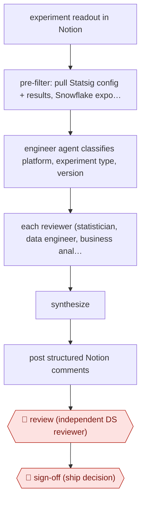

# Multi-agent readout review

`TEC › DAT › DS` · checkpointed · evidence A · **draft: needs a reference example** ([how to add one](../../../../../CONTRIBUTING.md#1-add-an-example-run))

**Shape:** `experiment readout in Notion → pre-filter: pull Statsig config + results, Snowflake exposure counts, Metabase charts, code → engineer agent classifies platform, experiment type, version → each reviewer (statistician, data engineer, business analyst): pass/fail checks → synthesize → post structured Notion comments → 🛑 review (independent DS reviewer) → 🛑 sign-off (ship decision)`
**How it differs:** Closest is AWF-0064 (Repo-grounded analysis), where the agent writes an analysis memo for an analyst to verify. Here the agent critiques someone else's experiment readout with three parallel specialist checklists, posted ahead of a required human peer review and ship decision. The deliverable and checkpoint layout both differ.
**Variants:** `claude-code-skills` · `statsig` · `snowflake` · `notion` · `metabase` · `mercari-cursor-ab-report`

<!-- shape diagram: generated by scripts/build_diagrams.py from `shape`; don't edit -->

<!-- end shape diagram -->

## Steps
1. The orchestrator, a Claude skill in the data monorepo, fetches the experiment writeup from Notion. It then gathers config, allocation and metric results from Statsig, exposure counts and trends from Snowflake, and exposure-reconciliation charts from Metabase [[1]](#sources).
2. An engineer sub-agent searches the backend, frontend and mobile code to work out who is actually exposed: platform, onboarding or not, and required app version. That decides which SQL pattern to use. Company-specific metric definitions are attached here [[1]](#sources).
3. Three reviewers run in parallel. Statistician: sample-ratio mismatch, duration, sample size, and whether every claimed effect has a confidence interval that excludes zero. Data engineer: null metrics, and expected versus actual exposure lines. Business analyst: claim deltas, guardrails, cannibalization, revenue recomputed with 2-cell scaling, and trade-offs [[1]](#sources).
4. Synthesize the findings and post them as structured comments on the experiment's Notion doc [[1]](#sources).
5. 🛑 **Review**: an independent data scientist from outside the project reviews the readout and the AI comments. 🛑 **Sign-off**: the ship decision comes only after that peer review [[1]](#sources).

**Output:** Pass/fail review comments on every experiment readout, ready for the human peer reviewer and the ship decision.
**Failure modes → guards:** Generic, unhelpful reviews → dozens of prompt iterations. Company jargon (for example what 'DAU' means internally) caused false flags → a one-line definition removed a whole class of them. Dumping full metric payloads confused the agents → a pre-filter stage [[1]](#sources).

## Public runs

Coverage as of 2026-11-06: **Strong**: a first-hand, detailed run that matches most of the shape. Collected and re-checked in [Second collection pass](../../../../../research/2026-11-second-pass.md).

- [Kikoff, Building the AI Experiment Reviewer with Claude](https://about.kikoff.com/build/ai-experiment-reviewer) (2026-03-27). Runs on every experiment readout before the human DS peer reviewer looks at it. "A single review can take 30 minutes to an hour." (the manual peer review the tool supports). *First-hand: yes; confidence: high.*

## Sources

1. Jue Hou and Karthic Thangarasu, Kikoff, Building the AI Experiment Reviewer with Claude, 2026-03-27. https://about.kikoff.com/build/ai-experiment-reviewer
