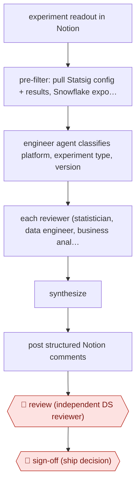

# Multi-agent readout review

`TEC › DAT › DS` · checkpointed · evidence A · **draft: needs a reference example** ([how to add one](../../../../../CONTRIBUTING.md#1-add-an-example-run))

**Shape:** `experiment readout in Notion → pre-filter: pull Statsig config + results, Snowflake exposure counts, Metabase charts, code → engineer agent classifies platform, experiment type, version → each reviewer (statistician, data engineer, business analyst): pass/fail checks → synthesize → post structured Notion comments → 🛑 review (independent DS reviewer) → 🛑 sign-off (ship decision)`
**Variants:** `claude-code-skills` · `statsig` · `snowflake` · `notion` · `metabase` · `mercari-cursor-ab-report`

<!-- shape diagram: generated by scripts/build_diagrams.py from `shape`; don't edit -->

<!-- end shape diagram -->

## Background

Before a company changes its product for everyone, it often tests the change on part of its users and compares them with users who did not get it; this is an A/B experiment, and the write-up of its results is the readout. A data scientist who was not part of the project then reviews the readout as an independent reviewer, much as engineers review each other's code, and only afterwards is the ship decision made. A thorough review means checking the claims against the experiment platform, counting who was really exposed in the database, recomputing revenue figures and confirming that the code does what the targeting rules say, which can take 30 minutes to an hour. Here the agent runs the mechanical checks and posts its findings on the readout. The independent reviewer still reads the readout and the findings, and people make the ship decision, because the judgement calls and the business risk are theirs.

**Terms:**
- **Experiment readout**: the written report of an experiment's setup and results.
- **Exposure**: a user who was actually shown the tested change; exposure counts are checked against the number expected.
- **Sample-ratio mismatch**: the groups end up in different proportions from the planned split, which suggests a fault in how users were assigned.
- **Confidence interval**: the range in which the true effect probably lies; if it includes zero, the effect is not shown to be real.
- **Statistical power / sample size**: whether enough users were included to detect an effect of the size claimed.
- **Guardrail metric**: a measure that must not get worse, such as complaints, even if the main metric improves.
- **Cannibalization**: a gain in one metric that comes at the expense of another.
- **2-cell scaling**: in a 50/50 split only half of users got the change, so the measured increase must be doubled to project a full rollout.
- **DAU**: daily active users; companies define it differently, which is why the agent needs the company's own definition.
- **Ship decision**: the decision to release the change to everyone.
- **Monorepo**: one code repository holding many projects.

## Build it with an agent

**Form:** `skill`. A data scientist reviews one readout at a time and stays in the conversation, and the three checklists can run as built-in subagents inside one skill. The source built it as a skill with sub-agents too. If you want every new readout reviewed with nobody starting it, that is a `service` build.

**You need:** a connector (MCP server) to the document tool that holds the readouts, able to read them and post comments; read-only connectors to the experiment platform and to the warehouse; the product's code checked out where the agent can search it; a way to chart expected against actual exposure; a file of the company's metric definitions; one checklist file per reviewer role. Give the agent aggregate counts, not user-level records.

| Step | Built as |
|---|---|
| experiment readout in Notion | The data scientist starts the skill with the readout's link; the skill reads it through a document-tool connector. |
| pre-filter: pull Statsig config + results, Snowflake exposure counts, Metabase charts, code | The skill reads each system through its connector and writes a short context bundle containing only the fields the checklists need, instead of the full metric payload. |
| engineer agent classifies platform, experiment type, version | A subagent searches the code and the targeting rules and returns the platform, whether it is an onboarding experiment, and the version requirement. The skill chooses the exposure query from that. |
| each reviewer (statistician, data engineer, business analyst): pass/fail checks | Three subagents run in parallel, each with its own checklist file, the metric definitions and the bundle, and each returns a pass/fail list. |
| synthesize | The skill merges the three lists into one set of comments. |
| post structured Notion comments | The skill posts the comments through the document-tool connector. |
| 🛑 review | See Checkpoints. |
| 🛑 sign-off | See Checkpoints. |

**Checkpoints:** `review`: the skill ends once the comments are posted and tells the data scientist who started it that the readout now needs an independent reviewer from outside the project; the skill takes no part in that review. `sign-off`: the ship decision is made by people outside the skill. The connectors to the experiment platform are read-only and a permission rule denies any write tool there, so the agent cannot start, stop or ship an experiment.

**Since the sources:** The single source and public run is dated 2026-03-27. It opened in this check and supports every step: the skill and sub-agents, the three reviewers' checks, the pre-filter and the independent human review before any ship decision. Its authors describe the system as a Claude skill with MCP connections, so this build matches it and changes little. The page says the reviewer now runs on every readout; it does not say how a run starts, so the trigger here is a design choice. It does not report accuracy figures, and the build makes no performance claim. The source is under 12 months old, so no search for newer accounts was needed.

*A design based on this entry's steps and the tool documentation as of 2026-11, not a reported run.*

## Steps

*As reported by the sources.*

1. The orchestrator, a Claude skill in the data monorepo, fetches the experiment writeup from Notion. It then gathers config, allocation and metric results from Statsig, exposure counts and trends from Snowflake, and exposure-reconciliation charts from Metabase [[1]](#sources).
2. An engineer sub-agent searches the backend, frontend and mobile code to work out who is actually exposed: platform, onboarding or not, and required app version. That decides which SQL pattern to use. Company-specific metric definitions are attached here [[1]](#sources).
3. Three reviewers run in parallel. Statistician: sample-ratio mismatch, duration, sample size, and whether every claimed effect has a confidence interval that excludes zero. Data engineer: null metrics, and expected versus actual exposure lines. Business analyst: claim deltas, guardrails, cannibalization, revenue recomputed with 2-cell scaling, and trade-offs [[1]](#sources).
4. The orchestrator synthesizes the findings and posts them as structured comments on the experiment's Notion doc [[1]](#sources).
5. 🛑 **Review**: an independent data scientist from outside the project reviews the readout and the AI comments. 🛑 **Sign-off**: the ship decision comes only after that peer review [[1]](#sources).

**Output:** Pass/fail review comments on every experiment readout, ready for the human peer reviewer and the ship decision.
**Failure modes → guards:** Generic, unhelpful reviews → dozens of prompt iterations. Company jargon (for example what 'DAU' means internally) caused false flags → a one-line definition removed a whole class of them. Dumping full metric payloads confused the agents → a pre-filter stage [[1]](#sources).
**How it differs:** Closest is AWF-0064 (Repo-grounded analysis), where the agent writes an analysis memo for an analyst to verify. Here the agent critiques someone else's experiment readout with three parallel specialist checklists, posted ahead of a required human peer review and ship decision. The deliverable and checkpoint layout both differ.

## Public runs

Coverage as of 2026-11-06: **Strong**: a first-hand, detailed run that matches most of the shape. Collected and re-checked in [Second collection pass](../../../../../research/2026-11-second-pass.md).

- [Kikoff, Building the AI Experiment Reviewer with Claude](https://about.kikoff.com/build/ai-experiment-reviewer) (2026-03-27). Runs on every experiment readout before the human DS peer reviewer looks at it. "A single review can take 30 minutes to an hour." (the manual peer review the tool supports). *First-hand: yes; confidence: high.*

## Sources

1. Jue Hou and Karthic Thangarasu, Kikoff, Building the AI Experiment Reviewer with Claude, 2026-03-27. https://about.kikoff.com/build/ai-experiment-reviewer
