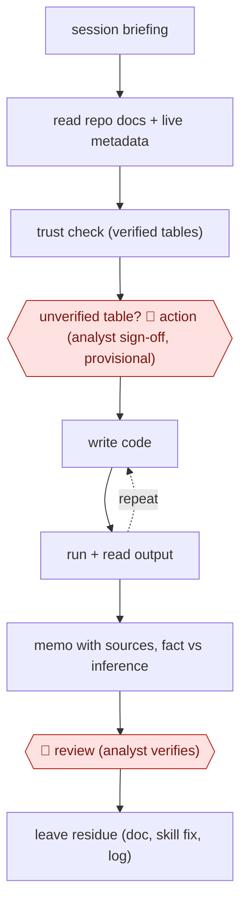

# Repo-grounded analysis

`TEC › DAT › DS` · checkpointed · evidence A · **draft: needs a reference example** ([how to add one](../../../../../CONTRIBUTING.md#1-add-an-example-run))

**Shape:** `session briefing → read repo docs + live metadata → trust check (verified tables) → unverified table? 🛑 action (analyst sign-off, provisional) → (write code ⟲ run + read output) → memo with sources, fact vs inference → 🛑 review (analyst verifies) → leave residue (doc, skill fix, log)`
**How it differs:** AWF-0006 governed query: one question → SQL → chart → review → exec sign-off. This is a multi-file, multi-day analysis project in a repo. Its deliverable is a memo, and its extra gate is an access sign-off for unverified data.
**Variants:** `claude-code` · `cursor` · `datahub` · `glean`

<!-- shape diagram: generated by scripts/build_diagrams.py from `shape`; don't edit -->

<!-- end shape diagram -->

## Steps
1. The analyst opens the shared DS repo in a coding agent. The repo supplies instructions ('a data scientist who joined last week'), about 250 skills, documented tables and guardrails [[1]](#sources).
2. The session opens with a briefing on what changed and what is in flight. The agent pulls live context from DataHub, Glean and GitHub [[1]](#sources).
3. Trust check: results are trusted and shareable only when they come from tables marked verified in DataHub. Undocumented knowledge gets 'I don't know — is this documented somewhere?' [[1]](#sources)
4. 🛑 **Action**: an unverified, non-sensitive table can be queried only after the agent names it, shows its metadata and gets explicit analyst sign-off. The access is logged and the numbers are marked provisional [[1]](#sources).
5. The agent writes code, runs it, reads the output and iterates. A cost check dry-runs each query, and code hooks enforce guardrails [[1]](#sources).
6. Write findings with every claim linked to its query or source, labelling fact versus inference [[1]](#sources).
7. 🛑 **Review**: the analyst verifies the draft before it is relied on or shared [[1]](#sources).
8. Leave residue: document the table, fix a skill, or log the unverified data touched. Skill improvements land for every team through the shared repo [[1]](#sources).

**Output:** A draft analysis memo with provenance-linked numbers. Once verified by the analyst, it goes to stakeholders, and the repo knowledge base grows.
**Failure modes → guards:** Confident report built on a deprecated table → verified-table rule, with provisional access gated by sign-off. Hard gating that kills adoption → gate trust and shipping, not access. Markdown rules ignored → pair each rule with code enforcement [[1]](#sources).

## Public runs

Coverage as of 2026-11-06: **Strong**: a first-hand, detailed run that matches most of the shape. Collected and re-checked in [New workflows for empty categories](../../../../../research/2026-11-new-workflows.md).

- [Snap Engineering, DS Agent: Snap's AI Data Scientist](https://eng.snap.com/ds_agent) (2026). Snap's repo-based DS agent used across DS teams with verified-table governance. "roughly a hundred contributors across every single domain area and roughly 250 skills". *First-hand: yes; confidence: high.*

## Sources

1. Snap Engineering, DS Agent: Snap's AI Data Scientist. https://eng.snap.com/ds_agent
