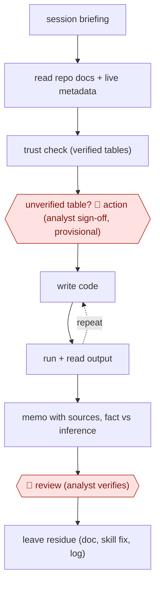

# Repo-grounded analysis

`TEC › DAT › DS` · checkpointed · evidence A · **draft: needs a reference example** ([how to add one](../../../../../CONTRIBUTING.md#1-add-an-example-run))

**Shape:** `session briefing → read repo docs + live metadata → trust check (verified tables) → unverified table? 🛑 action (analyst sign-off, provisional) → (write code ⟲ run + read output) → memo with sources, fact vs inference → 🛑 review (analyst verifies) → leave residue (doc, skill fix, log)`
**Variants:** `claude-code` · `cursor` · `datahub` · `glean`

<!-- shape diagram: generated by scripts/build_diagrams.py from `shape`; don't edit -->

<!-- end shape diagram -->

## Background

A data scientist is asked a business question, such as why a metric moved, and answers it with a written analysis memo for the people who must decide (the stakeholders). The work runs across many files and days: finding the right tables, writing queries and code, and checking the numbers. The risk is a confident memo built on the wrong table, for example one that is out of date or that nobody maintains, because a newcomer cannot tell which tables the company trusts. Here the agent does the code-writing and running inside the team's code repository, which holds the team's rules and documented tables, and it labels what is fact and what is inference. An analyst decides when an unchecked table may be used and verifies the memo before anyone relies on it, because the numbers will drive decisions and the agent cannot tell a verified table from a plausible one by itself.

**Terms:**
- **Data scientist / analyst**: a person who answers questions from data and judges what the numbers mean.
- **Analysis memo**: a short written report of findings with the evidence behind each claim.
- **Data catalog**: a directory of the company's tables with their meaning, owner, source and health.
- **Verified table**: a table the data team has checked and marked as trustworthy in the catalog.
- **Provisional**: usable for exploring, but not final and not to be shared.
- **Dry run**: asking the database what a query would cost without running it.
- **Hook**: a script that runs automatically at a set point in the agent's work and can block an action.
- **Guardrail**: a rule that limits what the agent may do.
- **Residue**: what a session leaves behind for the next one: a new table description, a skill fix, a log entry.

## Build it with an agent

**Form:** `project`. The analysis runs across many files and days, and two rules must hold every time (check a query's cost, and log and gate use of an unverified table), which a skill's text alone cannot guarantee. The repo also carries standing knowledge: table documents, a persona and many playbooks.

**You need:** the team repository with a `CLAUDE.md`, skills, and documents for each table (what it holds, which pipeline produces it, the query that defines it); connectors (MCP servers) to the data catalog, to internal search and to the code host; a warehouse role limited to reading; a log file for unverified tables touched; the hook scripts. Keep tables with sensitive data out of the agent's reach altogether.

| Step | Built as |
|---|---|
| session briefing | `CLAUDE.md` tells the agent to run a briefing skill first: what changed in the analyst's area and what is in flight, from the repo and the code host. |
| read repo docs + live metadata | `CLAUDE.md` sets the rule to behave as a capable analyst who has just joined and knows nothing undocumented. The agent reads the table documents and fetches live metadata through the catalog and search connectors, and says "I don't know" for anything undocumented. |
| trust check (verified tables) | A skill states that only results from tables marked verified in the catalog are trusted and shareable; the agent reads that mark for every table it plans to use. |
| unverified table? 🛑 action | See Checkpoints. |
| (write code ⟲ run + read output) | The agent writes code, runs it on the read-only role and reads the output. A `PreToolUse` hook dry-runs each query and blocks one over the cost limit. |
| memo with sources, fact vs inference | A skill holds the memo template: each claim links to its query or source and is labelled fact or inference. |
| 🛑 review | See Checkpoints. |
| leave residue (doc, skill fix, log) | A closing skill offers a document for each table touched and any skill fix; a hook appends each unverified table touched to the log. |

**Checkpoints:** `action`: a `PreToolUse` hook stops any query on a table that is not marked verified unless the analyst has approved that table in this session; the agent must name the table and show its metadata first. The hook records the access in the log, the memo marks every number from it as provisional, and a permission rule denies tables marked sensitive. `review`: the memo is a draft, and the agent has no tool to send or publish it; the analyst verifies it and shares it themselves.

**Since the sources:** The single source is undated in the entry; the page places the repo's current form in January 2026 and the post about six months later, so it dates from 2026. It opened in this check and supports every step. The source says markdown rules shape behaviour but do not bound it, and pairs each important rule with code, which is why this build uses hooks for the cost check and the unverified-table gate. The source's repo has about a hundred contributors and about 250 skills; this build starts with a handful and grows as the team documents its tables. The source runs the same repo with several agent tools; this build is written with Claude Code blocks. The source says its last step, in which the repo studies its own sessions and proposes new skills, is still being built; this build leaves it out. The source is under 12 months old, so no search for newer accounts was needed.

*A design based on this entry's steps and the tool documentation as of 2026-11, not a reported run.*

## Steps

*As reported by the sources.*

1. The analyst opens the shared DS repo in a coding agent. The repo supplies instructions ('a data scientist who joined last week'), about 250 skills, documented tables and guardrails [[1]](#sources).
2. The session opens with a briefing on what changed and what is in flight. The agent pulls live context from DataHub, Glean and GitHub [[1]](#sources).
3. The agent runs a trust check: results are trusted and shareable only when they come from tables marked verified in DataHub. Undocumented knowledge gets 'I don't know — is this documented somewhere?' [[1]](#sources)
4. 🛑 **Action**: an unverified, non-sensitive table can be queried only after the agent names it, shows its metadata and gets explicit analyst sign-off. The access is logged and the numbers are marked provisional [[1]](#sources).
5. The agent writes code, runs it, reads the output and iterates. A cost check dry-runs each query, and code hooks enforce guardrails [[1]](#sources).
6. The agent writes findings with every claim linked to its query or source, labelling fact versus inference [[1]](#sources).
7. 🛑 **Review**: the analyst verifies the draft before it is relied on or shared [[1]](#sources).
8. The agent leaves residue: it documents the table, fixes a skill, or logs the unverified data touched. Skill improvements land for every team through the shared repo [[1]](#sources).

**Output:** A draft analysis memo with provenance-linked numbers. Once verified by the analyst, it goes to stakeholders, and the repo knowledge base grows.
**Failure modes → guards:** Confident report built on a deprecated table → verified-table rule, with provisional access gated by sign-off. Hard gating that kills adoption → gate trust and shipping, not access. Markdown rules ignored → pair each rule with code enforcement [[1]](#sources).
**How it differs:** AWF-0006 governed query: one question → SQL → chart → review → exec sign-off. This is a multi-file, multi-day analysis project in a repo. Its deliverable is a memo, and its extra gate is an access sign-off for unverified data.

## Public runs

Coverage as of 2026-11-06: **Strong**: a first-hand, detailed run that matches most of the shape. Collected and re-checked in [New workflows for empty categories](../../../../../research/2026-11-new-workflows.md).

- [Snap Engineering, DS Agent: Snap's AI Data Scientist](https://eng.snap.com/ds_agent) (2026). Snap's repo-based DS agent used across DS teams with verified-table governance. "roughly a hundred contributors across every single domain area and roughly 250 skills". *First-hand: yes; confidence: high.*

## Sources

1. Snap Engineering, DS Agent: Snap's AI Data Scientist. https://eng.snap.com/ds_agent
