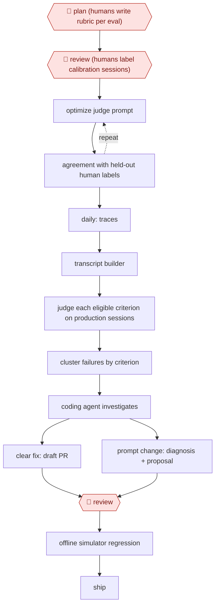

# Calibrated-judge quality loop

`TEC › DAT › MLOPS` · checkpointed · evidence A · **draft: needs a reference example** ([how to add one](../../../../../CONTRIBUTING.md#1-add-an-example-run))

**Shape:** `🛑 plan (humans write rubric per eval) → 🛑 review (humans label calibration sessions) → (optimize judge prompt ⟲ agreement with held-out human labels) → daily: traces → transcript builder → judge each eligible criterion on production sessions → cluster failures by criterion → coding agent investigates → clear fix: draft PR | prompt change: diagnosis + proposal → 🛑 review → offline simulator regression → ship`
**How it differs:** Closest is AWF-0065 (Overnight experiment ratchet), which runs training changes overnight against a frozen eval with a human-written protocol and promotion sign-off. Here the eval itself is the product: a judge calibrated against human labels scores live production sessions every day, and the fixes it leads to go through human review and offline regression. The deliverable and checkpoints both differ.
**Variants:** `gepa` · `dspy` · `opentelemetry` · `clickhouse` · `dropbox-dash-judges` · `netflix-explanation-judge`

<!-- shape diagram: generated by scripts/build_diagrams.py from `shape`; don't edit -->

<!-- end shape diagram -->

## Steps
1. 🛑 **Plan**: people write a rubric for each eval (guardrails, plus capability checks for each domain agent). Each check is pass/fail and verifiable from the session itself, so a human and the judge can grade it the same way [[1]](#sources).
2. 🛑 **Review**: human reviewers label a calibration set of sessions. Optimize the judge prompt with GEPA, keeping revisions that raise agreement with human labels on a held-out set. Recalibrate whenever the rubrics change [[1]](#sources).
3. Every session is traced with OpenTelemetry into ClickHouse. A transcript builder rebuilds each session and gives each criterion only the evidence it needs. The judge first decides whether a criterion applies, then grades it with a short rationale [[1]](#sources).
4. Run the judge daily on production sessions. Cluster failures by the criterion they broke, and rank the themes by how often they occur [[1]](#sources).
5. A coding agent works from a cluster: it reads failing traces, code and recent changes. When the fix is clear, it drafts a PR. For prompt changes, it writes a diagnosis and proposal. 🛑 **Review**: an engineer reviews either one [[1]](#sources).
6. Before shipping, run the offline simulator with fixed tool fixtures and simulated users, for example 50 scenarios × 8 trials. Use the same rubric and judge as production [[1]](#sources).

**Output:** A daily, human-calibrated quality score for a production agent, failure themes ranked by frequency, and reviewed fixes validated offline before release.
**Failure modes → guards:** A judge that disagrees with humans → calibration against human labels, rerun when rubrics evolve. The most recent anecdote drives the fix → cluster by rubric criterion. Changes can't be tested on real users → fixture-pinned simulator. Skill misclassifies a cluster → update the skill, not the one run [[1]](#sources).

## Public runs

Coverage as of 2026-11-06: **Strong**: a first-hand, detailed run that matches most of the shape. Collected and re-checked in [Second collection pass](../../../../../research/2026-11-second-pass.md).

- [DoorDash, Building Ask DoorDash (Part 3): Evaluation](https://careersatdoordash.com/blog/building-ask-doordash-part-three-evaluation/) (2026-06-30). Calibrated judge on production sessions plus simulator regression before nationwide launch. "from an average of 1 employee-submitted feedback to 2,000 auto-graded sessions per day". *First-hand: yes; confidence: high.*
- [Dropbox, How we used DSPy to turn AI evaluations into better responses in Dash Chat](https://dropbox.tech/machine-learning/how-we-turned-ai-evaluations-into-better-responses-in-dash-chat) (2026-06-25). Judges calibrated to human labels, then used to optimize the agent prompt by replay. "26% reduction in incomplete answers". *First-hand: yes; confidence: med.*

## Sources

1. Steven Xu and Fabio Flores, DoorDash, Building Ask DoorDash (Part 3): Evaluation, 2026-06-30. https://careersatdoordash.com/blog/building-ask-doordash-part-three-evaluation/
2. Simran Jumani, Dropbox, How we used DSPy to turn AI evaluations into better responses in Dash Chat, 2026-06-25. https://dropbox.tech/machine-learning/how-we-turned-ai-evaluations-into-better-responses-in-dash-chat
