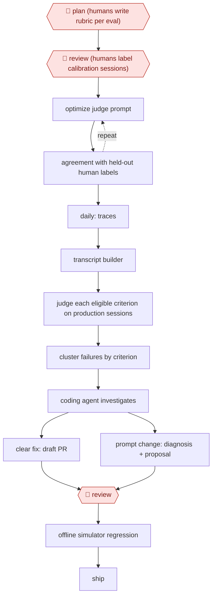

# Calibrated-judge quality loop

`TEC › DAT › MLOPS` · checkpointed · evidence A · **draft: needs a reference example** ([how to add one](../../../../../CONTRIBUTING.md#1-add-an-example-run))

**Shape:** `🛑 plan (humans write rubric per eval) → 🛑 review (humans label calibration sessions) → (optimize judge prompt ⟲ agreement with held-out human labels) → daily: traces → transcript builder → judge each eligible criterion on production sessions → cluster failures by criterion → coding agent investigates → clear fix: draft PR | prompt change: diagnosis + proposal → 🛑 review → offline simulator regression → ship`
**Variants:** `gepa` · `dspy` · `opentelemetry` · `clickhouse` · `dropbox-dash-judges` · `netflix-explanation-judge`

<!-- shape diagram: generated by scripts/build_diagrams.py from `shape`; don't edit -->

<!-- end shape diagram -->

## Background

A company that runs an AI assistant for customers needs to know, every day, whether it is answering well, and no one can read thousands of conversations. The usual answer is a second AI model, a judge, that grades each conversation against a written checklist (a rubric). A judge is only useful if its grades agree with what careful people would say, so people first grade a sample of conversations themselves and the judge's instructions are adjusted until it matches them. After that the judge grades the day's real conversations, the failures are grouped by the rule they broke, and a coding agent investigates the biggest groups and drafts fixes. People write the rubrics, grade the sample and approve each fix, because the rubric defines what "good" means and a wrong fix reaches real customers.

**Terms:**
- **Production session**: one real conversation between a customer and the live assistant.
- **Trace**: the recorded step-by-step log of what the assistant did in a session.
- **Rubric**: a checklist of pass/fail criteria for grading a session.
- **LLM judge**: an AI model that grades sessions against the rubric.
- **Calibration set / held-out set**: sessions graded by people; the judge is tuned on one part (calibration) and checked on a part it has not seen (held-out).
- **Agreement**: how often the judge's grade matches the human grade.
- **Cluster**: a group of failures that broke the same criterion.
- **PR (pull request)**: a proposed code change, published for review before it is merged.
- **Fixture**: a fixed, recorded reply from a tool, used so that tests give the same result every time.
- **Simulator**: a test harness in which simulated users talk to the assistant in many scenarios, each repeated in several trials.
- **Regression**: a change that makes something that worked stop working.

## Build it with an agent

**Form:** `service`. After the one-off setup, the judging runs daily with nobody present, and people see only the failure clusters and the proposed fixes.

**You need:** the rubric files and the human-labelled sessions, kept in a repository; a store of session traces that a script can read; a way to rebuild each session as a transcript; the assistant's code and prompts, with permission to open a draft PR and no permission to merge or deploy; a simulator with fixed tool fixtures. Conversations hold customers' personal data: use a store and redaction your privacy team has approved, and keep the judge and coding agent inside it.

| Step | Built as |
|---|---|
| 🛑 plan | See Checkpoints. |
| 🛑 review | See Checkpoints. |
| (optimize judge prompt ⟲ agreement with held-out human labels) | The judge is a skill. A script runs it on the held-out sessions and reports agreement with the human labels; the agent proposes a revision to the skill, and the revision is kept only if agreement rises. The source used GEPA for this search. Rerun when the rubric changes. |
| daily: traces → transcript builder | A cloud scheduled task, or your own scheduler starting `claude -p` or an Agent SDK program, runs a script that exports the day's sessions and rebuilds each transcript, giving each criterion only the evidence it needs. |
| judge each eligible criterion on production sessions | The judge skill first decides whether a criterion applies, then grades it with a short rationale. A dynamic workflow fans this out over the sessions. |
| cluster failures by criterion | A script groups failures by criterion and ranks the groups by how often they occur. |
| coding agent investigates → clear fix: draft PR \| prompt change: diagnosis + proposal | A skill reads the failing traces, the code and recent changes for one cluster. For a clear fix it opens a draft pull request; for a prompt change it writes a diagnosis and proposal to a review queue. |
| 🛑 review | See Checkpoints. |
| offline simulator regression → ship | A script runs the scenarios and trials with the fixed fixtures, using the same rubric and judge skill as production. An engineer ships. |

**Checkpoints:** `plan`: the judge skill and the scheduled run refuse to start unless every rubric file carries an approval field set by a person; the agent is not given write access to that field. `review`: first, humans label the calibration sessions, and the judge's agreement is measured only against those labels. Second, an engineer reviews every fix: the coding agent can open only a draft pull request, a permission rule denies merge and deploy, and prompt proposals wait in a queue until a person applies them.

**Since the sources:** Sources date from 2026-06-25 to 2026-06-30. The Dropbox page (source 2) opened in this check and confirms judges tuned against human-labelled examples, with DSPy and its GEPA and MIPROv2 algorithms, and candidate prompts replayed on historical chats and scored; its page lists a second author, Dmitriy Meyerzon. The DoorDash page (source 1), on which steps 1 to 6 are based, refused the automated reader (HTTP 403), so its steps, the simulator numbers and the quote rest on the entry text alone. Both sources are under 12 months old, so no search for newer accounts was needed. The sources built on a tracing pipeline and an optimizer library of their own; this build replaces them with scripts around a judge skill and does not require those tools.

*A design based on this entry's steps and the tool documentation as of 2026-11, not a reported run.*

## Steps

*As reported by the sources.*

1. 🛑 **Plan**: people write a rubric for each eval (guardrails, plus capability checks for each domain agent). Each check is pass/fail and verifiable from the session itself, so a human and the judge can grade it the same way [[1]](#sources).
2. 🛑 **Review**: human reviewers label a calibration set of sessions. The team optimizes the judge prompt with GEPA, keeping revisions that raise agreement with human labels on a held-out set. It recalibrates whenever the rubrics change [[1]](#sources).
3. A tracing system records every session with OpenTelemetry into ClickHouse (an analytics database). A transcript builder rebuilds each session and gives each criterion only the evidence it needs. The judge first decides whether a criterion applies, then grades it with a short rationale [[1]](#sources).
4. The judge runs daily on production sessions. The pipeline clusters failures by the criterion they broke and ranks the themes by how often they occur [[1]](#sources).
5. A coding agent works from a cluster: it reads failing traces, code and recent changes. When the fix is clear, it drafts a PR. For prompt changes, it writes a diagnosis and proposal. 🛑 **Review**: an engineer reviews either one [[1]](#sources).
6. Before shipping, the team runs the offline simulator with fixed tool fixtures and simulated users, for example 50 scenarios × 8 trials, using the same rubric and judge as production [[1]](#sources).

**Output:** A daily, human-calibrated quality score for a production agent, failure themes ranked by frequency, and reviewed fixes validated offline before release.
**Failure modes → guards:** A judge that disagrees with humans → calibration against human labels, rerun when rubrics evolve. The most recent anecdote drives the fix → cluster by rubric criterion. Changes can't be tested on real users → fixture-pinned simulator. Skill misclassifies a cluster → update the skill, not the one run [[1]](#sources).
**How it differs:** Closest is AWF-0065 (Overnight experiment ratchet), which runs training changes overnight against a frozen eval with a human-written protocol and promotion sign-off. Here the eval itself is the product: a judge calibrated against human labels scores live production sessions every day, and the fixes it leads to go through human review and offline regression. The deliverable and checkpoints both differ.

## Public runs

Coverage as of 2026-11-06: **Strong**: a first-hand, detailed run that matches most of the shape. Collected and re-checked in [Second collection pass](../../../../../research/2026-11-second-pass.md).

- [DoorDash, Building Ask DoorDash (Part 3): Evaluation](https://careersatdoordash.com/blog/building-ask-doordash-part-three-evaluation/) (2026-06-30). Calibrated judge on production sessions plus simulator regression before nationwide launch. "from an average of 1 employee-submitted feedback to 2,000 auto-graded sessions per day". *First-hand: yes; confidence: high.*
- [Dropbox, How we used DSPy to turn AI evaluations into better responses in Dash Chat](https://dropbox.tech/machine-learning/how-we-turned-ai-evaluations-into-better-responses-in-dash-chat) (2026-06-25). Judges calibrated to human labels, then used to optimize the agent prompt by replay. "26% reduction in incomplete answers". *First-hand: yes; confidence: med.*

## Sources

1. Steven Xu and Fabio Flores, DoorDash, Building Ask DoorDash (Part 3): Evaluation, 2026-06-30. https://careersatdoordash.com/blog/building-ask-doordash-part-three-evaluation/
2. Simran Jumani, Dropbox, How we used DSPy to turn AI evaluations into better responses in Dash Chat, 2026-06-25. https://dropbox.tech/machine-learning/how-we-turned-ai-evaluations-into-better-responses-in-dash-chat
