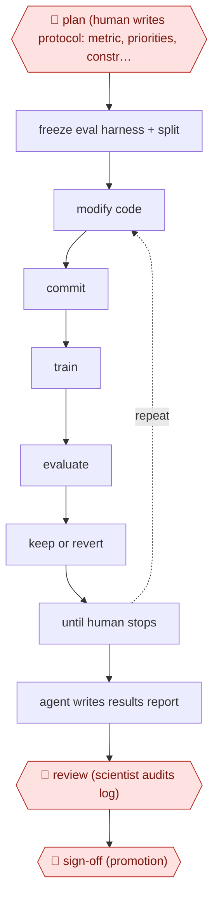

# Overnight experiment ratchet

`TEC › DAT › MLOPS` · sampled · evidence A · **draft: needs a reference example** ([how to add one](../../../../../CONTRIBUTING.md#1-add-an-example-run))

**Shape:** `🛑 plan (human writes protocol: metric, priorities, constraints) → freeze eval harness + split → (modify code → commit → train → evaluate → keep or revert) ⟲ until human stops → agent writes results report → 🛑 review (scientist audits log) → 🛑 sign-off (promotion)`
**How it differs:** AWF-0023 event-driven model update updates an investment model on news events. This is an ML training ratchet against a frozen held-out metric. AWF-0004 triage then remediate is ops, not training.
**Variants:** `autoresearch` · `git` · `weights-and-biases`

<!-- shape diagram: generated by scripts/build_diagrams.py from `shape`; don't edit -->

<!-- end shape diagram -->

## Steps
1. 🛑 **Plan**: a human writes the protocol (program.md): the primary metric, a priority order for what to try (features before hyperparameters, simplification before complexity), constraints and commands [[1]](#sources)[[2]](#sources).
2. Make the evaluation code and train/test split read-only so the agent cannot game the metric [[1]](#sources)[[3]](#sources). Faire adds explicit guardrails after seeing loss-function changes that made metrics incomparable [[2]](#sources).
3. Loop: modify code → git commit → train under a hard wall-clock budget → evaluate → keep if improved, else revert. Append every result to a structured log [[1]](#sources)[[2]](#sources).
4. Keep a durable experiments.md with hypotheses, results and a standing plan, so long runs don't forget discarded ideas. Scientists can inspect and re-steer without stopping the run [[2]](#sources).
5. When the run stops, the agent writes a report on what it tried, what failed and why, and how the winning configuration came together [[1]](#sources).
6. 🛑 **Review**: scientists audit the full results log and git history the next morning [[1]](#sources).
7. 🛑 **Sign-off**: humans own framing and metric selection and decide what goes to production [[2]](#sources).

**Output:** A better model candidate with a git trail, an experiment log and a written report. It goes to a human promotion decision.
**Failure modes → guards:** Metric gaming → read-only eval harness [[1]](#sources)[[3]](#sources). Context loss after 20-30 iterations → persistent experiment memory [[2]](#sources). Agent concludes the search is exhausted too early → steady supply of ideas plus human steering [[2]](#sources). Overfitting to the offline metric → human review of candidates before promotion [[1]](#sources)[[2]](#sources).

## Public runs

Coverage as of 2026-11-06: **Strong**: a first-hand, detailed run that matches most of the shape. Collected and re-checked in [New workflows for empty categories](../../../../../research/2026-11-new-workflows.md).

- [Rocket, What 200+ autonomous ML experiments taught us](https://careers.rocket.com/blog/technology-and-product/autonomous-ml-experiments-model-tuning) (2026-04-15). Overnight agent loop on a production classification model; humans reviewed log next morning. "220+ experiments, a 14% success rate, and a roughly 3% improvement to our primary metric". *First-hand: yes; confidence: high.*
- [Faire, Autoscience](https://craft.faire.com/autoscience-how-we-built-agent-driven-ml-exploration-at-faire-f3183e7deb29) (2026-07-22). Harnessed autoresearch loop rolled out to most Faire ML teams. "improve production model accuracy, in some cases by double-digit percentages". *First-hand: yes; confidence: high.*

## Sources

1. Abu Mahmud (Rocket), What 200+ autonomous machine learning experiments taught us about the future of model tuning, 2026-04-15. https://careers.rocket.com/blog/technology-and-product/autonomous-ml-experiments-model-tuning
2. Le Nguyen (Faire), Autoscience: How we built agent-driven ML exploration at Faire, 2026-07-22. https://craft.faire.com/autoscience-how-we-built-agent-driven-ml-exploration-at-faire-f3183e7deb29
3. PathAI, Autonomous Agents for ML Research Acceleration, 2026-06-24. https://www.pathai.com/blog/autonomous-agents-for-ml-research-acceleration (search excerpt only, not fetched) (search excerpt only, not opened)
