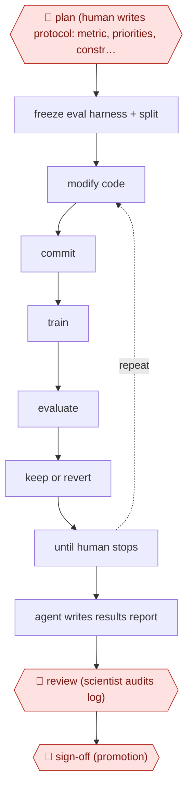

# Overnight experiment ratchet

`TEC › DAT › MLOPS` · sampled · evidence A · **draft: needs a reference example** ([how to add one](../../../../../CONTRIBUTING.md#1-add-an-example-run))

**Shape:** `🛑 plan (human writes protocol: metric, priorities, constraints) → freeze eval harness + split → (modify code → commit → train → evaluate → keep or revert) ⟲ until human stops → agent writes results report → 🛑 review (scientist audits log) → 🛑 sign-off (promotion)`
**Variants:** `autoresearch` · `git` · `weights-and-biases`

<!-- shape diagram: generated by scripts/build_diagrams.py from `shape`; don't edit -->

<!-- end shape diagram -->

## Background

A machine-learning team improves a model by trying changes to its training code or settings, training again and checking the result on a test the model has not seen. Each attempt needs setup, hours of computing and analysis, so researchers keep a long list of ideas they never get to. Here the agent works through the list overnight in a ratchet: it makes a change, trains, measures, keeps the change only if the score improved and undoes it otherwise. The risk is that the agent improves the measuring stick instead of the model, so the test code and data split are locked. People write the rules of the run beforehand and audit everything the next morning. Only a person can decide that a candidate goes to production, because the offline score does not prove the model is right for real use.

**Terms:**
- **Training run / evaluation**: teaching the model on data, then measuring it on data it has not seen.
- **Held-out metric**: the score computed on data kept out of training; it is the number the loop tries to raise.
- **Train/test split**: the division of the data into the part the model learns from and the part used for measuring.
- **Hyperparameters**: settings chosen before training, such as the learning rate, as opposed to what the model learns.
- **Loss function**: the formula the model is trained to minimise.
- **Wall-clock budget**: a hard limit on how much real time one training run may take.
- **Gaming the metric**: raising the score without improving the model, for example by changing how it is computed.
- **Overfitting**: doing well on the test used for choosing changes but not on new data.
- **git commit / revert**: recording a version of the code, and undoing a change to return to the previous version.
- **Protocol (program.md)**: the file in which a person states the metric, the priorities, the limits and the commands.
- **Promotion**: moving a candidate model into production use.

## Build it with an agent

**Form:** `project`. One scientist starts the run and leaves it, so it is more than a conversation, and one rule must hold every time: the agent must not touch the evaluation code or the split, which only a hook or permission rule can guarantee. If your own scheduler should start the run each night with nobody present, it becomes a `service`.

**You need:** the training code in a git repository on its own experiment branch; the evaluation harness and split kept apart in locked paths; compute that the run is allowed to use; the protocol file written by a scientist; a place for the experiment log (for example an experiment-tracking tool); permission to run only the named training and evaluation commands and git commits on that branch.

| Step | Built as |
|---|---|
| 🛑 plan (human writes protocol: metric, priorities, constraints) | A scientist writes the protocol file, and `CLAUDE.md` tells the agent to read it first and to do nothing without it. See Checkpoints. |
| freeze eval harness + split | A `PreToolUse` hook blocks any edit to the evaluation, metric and split paths; the permission rules allow edits only to training code and model configs. |
| (modify code → commit → train → evaluate → keep or revert) ⟲ until human stops | A skill holds the loop: the agent changes allowed files, makes a git commit, runs the training command under the protocol's budget, reads the metric, keeps the commit if the score improved and reverts otherwise, and appends the result to a structured log. It also keeps `experiments.md` with hypotheses, results and the standing plan, and rereads it each round. A scientist stops the run. |
| agent writes results report | The skill's closing step: what was tried, what failed and why, and how the best configuration came about. |
| 🛑 review (scientist audits log) | See Checkpoints. |
| 🛑 sign-off (promotion) | See Checkpoints. |

**Checkpoints:** `plan`: the skill stops at once if the protocol file is missing, and the permission rules allow only the commands the protocol lists. `review`: the agent works on an experiment branch and has no tool to merge it; scientists audit the full log and the git history the next morning. `sign-off`: the agent has no tool to register, release or deploy a model, so promotion is a decision a person takes in their own systems.

**Since the sources:** Sources date from 2026-04-15 to 2026-07-22. Source 3 (2026-06-24) opened in this check. It confirms git-versioned changes, runs tracked in Weights & Biases, an edit surface limited to training code and model configs with validation and metric code kept fixed, and a generic playbook; it also prefers fixed step budgets to time limits because infrastructure variance made time-based comparisons noisy, while step 3 reports a wall-clock budget from sources 1 and 2, so this build leaves the budget type to the protocol. Source 3 describes a hackathon proof of concept on three tasks, not an overnight production run. Its list entry still reads "search excerpt only, not opened" and has not been changed. Sources 1 (Rocket) and 2 (Faire) refused the automated reader (HTTP 403), so steps 1 to 7 and the figures in the public runs rest on the entry text. The newest source is under 12 months old, so no search for newer accounts was needed.

*A design based on this entry's steps and the tool documentation as of 2026-11, not a reported run.*

## Steps

*As reported by the sources.*

1. 🛑 **Plan**: a human writes the protocol (program.md): the primary metric, a priority order for what to try (features before hyperparameters, simplification before complexity), constraints and commands [[1]](#sources)[[2]](#sources).
2. The team makes the evaluation code and train/test split read-only so the agent cannot game the metric [[1]](#sources)[[3]](#sources). Faire adds explicit guardrails after seeing loss-function changes that made metrics incomparable [[2]](#sources).
3. The agent loops: modify code → git commit → train under a hard wall-clock budget → evaluate → keep if improved, else revert. It appends every result to a structured log [[1]](#sources)[[2]](#sources).
4. The agent keeps a durable experiments.md with hypotheses, results and a standing plan, so long runs don't forget discarded ideas. Scientists can inspect and re-steer without stopping the run [[2]](#sources).
5. When the run stops, the agent writes a report on what it tried, what failed and why, and how the winning configuration came together [[1]](#sources).
6. 🛑 **Review**: scientists audit the full results log and git history the next morning [[1]](#sources).
7. 🛑 **Sign-off**: humans own framing and metric selection and decide what goes to production [[2]](#sources).

**Output:** A better model candidate with a git trail, an experiment log and a written report. It goes to a human promotion decision.
**Failure modes → guards:** Metric gaming → read-only eval harness [[1]](#sources)[[3]](#sources). Context loss after 20-30 iterations → persistent experiment memory [[2]](#sources). Agent concludes the search is exhausted too early → steady supply of ideas plus human steering [[2]](#sources). Overfitting to the offline metric → human review of candidates before promotion [[1]](#sources)[[2]](#sources).
**How it differs:** AWF-0023 event-driven model update updates an investment model on news events. This is an ML training ratchet against a frozen held-out metric. AWF-0004 triage then remediate is ops, not training.

## Public runs

Coverage as of 2026-11-06: **Strong**: a first-hand, detailed run that matches most of the shape. Collected and re-checked in [New workflows for empty categories](../../../../../research/2026-11-new-workflows.md).

- [Rocket, What 200+ autonomous ML experiments taught us](https://careers.rocket.com/blog/technology-and-product/autonomous-ml-experiments-model-tuning) (2026-04-15). Overnight agent loop on a production classification model; humans reviewed log next morning. "220+ experiments, a 14% success rate, and a roughly 3% improvement to our primary metric". *First-hand: yes; confidence: high.*
- [Faire, Autoscience](https://craft.faire.com/autoscience-how-we-built-agent-driven-ml-exploration-at-faire-f3183e7deb29) (2026-07-22). Harnessed autoresearch loop rolled out to most Faire ML teams. "improve production model accuracy, in some cases by double-digit percentages". *First-hand: yes; confidence: high.*

## Sources

1. Abu Mahmud (Rocket), What 200+ autonomous machine learning experiments taught us about the future of model tuning, 2026-04-15. https://careers.rocket.com/blog/technology-and-product/autonomous-ml-experiments-model-tuning
2. Le Nguyen (Faire), Autoscience: How we built agent-driven ML exploration at Faire, 2026-07-22. https://craft.faire.com/autoscience-how-we-built-agent-driven-ml-exploration-at-faire-f3183e7deb29
3. PathAI, Autonomous Agents for ML Research Acceleration, 2026-06-24. https://www.pathai.com/blog/autonomous-agents-for-ml-research-acceleration
