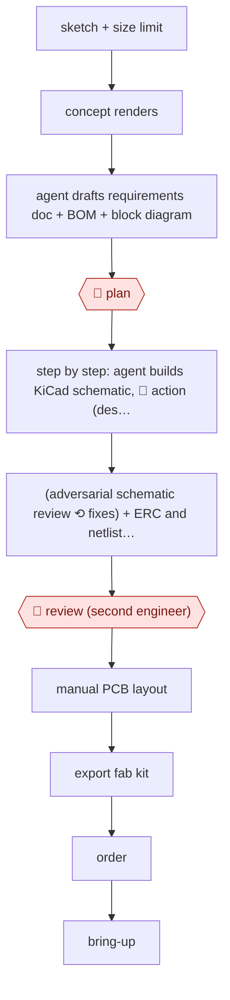

# Agent-drafted PCB schematic

`TEC › ENG › CAD` · assist · evidence A · **draft: needs a reference example** ([how to add one](../../../../../CONTRIBUTING.md#1-add-an-example-run))

**Shape:** `sketch + size limit → concept renders → agent drafts requirements doc + BOM + block diagram → 🛑 plan → step by step: agent builds KiCad schematic, 🛑 action (designer confirms each step) → (adversarial schematic review ⟲ fixes) + ERC and netlist export → 🛑 review (second engineer) → manual PCB layout → export fab kit → order → bring-up`
**How it differs:** Closest is AWF-0056 (Phased preview build), which loops CadQuery → STL → render for a 3D-printed part with preview reviews. This one produces an electrical schematic and fab kit. Its checks are ERC/netlist plus adversarial LLM review, the designer confirms each step, and a second engineer reviews before ordering.
**Variants:** `openai-codex` · `claude-code` · `kicad-cli` · `kicad-happy` · `jlcpcb`

<!-- shape diagram: generated by scripts/build_diagrams.py from `shape`; don't edit -->

<!-- end shape diagram -->

## Steps
1. Start from a hand sketch inside a size limit. Generate a few concept renders [[1]](#sources).
2. The agent drafts a technical requirements doc, a core BOM and a block diagram, and estimates cost from LCSC queries. 🛑 **Plan**: the designer reviews and revises them [[1]](#sources).
3. The coding agent builds the KiCad schematic step by step from the BOM, sourcing parts with easyeda2kicad/pcbparts. 🛑 **Action**: the designer confirms each step and does placement and wiring decisions [[1]](#sources).
4. Ask for an adversarial schematic review written to a markdown file. Fix the findings, and repeat until nothing new comes up. Check with kicad-cli ERC and netlist export, and separate real issues from import noise [[1]](#sources).
5. 🛑 **Review**: a second engineer reviews the schematic (30 min). Then do the PCB layout by hand, export the production kit, and order boards and assembly [[1]](#sources).
6. Bring-up: the agent writes self-test firmware first. The designer debugs hardware faults on the bench [[1]](#sources).

**Output:** A reviewed KiCad schematic and fab/assembly kit ordered from a PCB house, plus bring-up firmware.
**Failure modes → guards:** The LLM loses the whole-project picture and misses faults when a part has no model (a shorted switch pin held BOOT0 low) → human second review and bench bring-up. ERC noise from imported parts → use the netlist for real findings [[1]](#sources).

## Public runs

Coverage as of 2026-11-06: **Partial**: first-hand runs that cover part of the shape or put checkpoints elsewhere. Collected and re-checked in [Second collection pass](../../../../../research/2026-11-second-pass.md).

- [Federico Maggi, I let GPT + Opus build a wearable PCB badge](https://trustial.substack.com/p/i-let-gpt-opus-build-a-wearable-pcb) (2026-08-04). Schematic drafted by the agent, adversarial review loop, human review; boards built, one fault the agent missed. "5" badges at "~$66" each; adversarial review took "4 minutes". *First-hand: yes; confidence: med.*

## Sources

1. Federico Maggi, Trustial, I let GPT + Opus build a wearable PCB badge from a paper sketch, 2026-08-04. https://trustial.substack.com/p/i-let-gpt-opus-build-a-wearable-pcb
