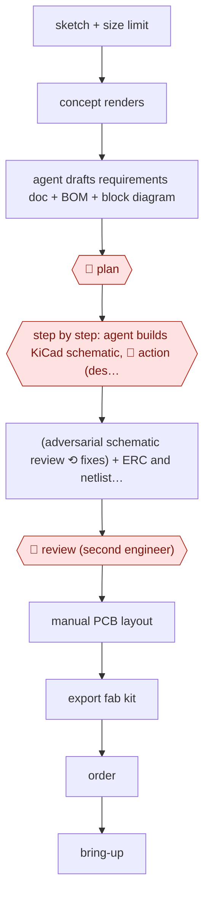

# Agent-drafted PCB schematic

`TEC › ENG › CAD` · assist · evidence A · **draft: needs a reference example** ([how to add one](../../../../../CONTRIBUTING.md#1-add-an-example-run))

**Shape:** `sketch + size limit → concept renders → agent drafts requirements doc + BOM + block diagram → 🛑 plan → step by step: agent builds KiCad schematic, 🛑 action (designer confirms each step) → (adversarial schematic review ⟲ fixes) + ERC and netlist export → 🛑 review (second engineer) → manual PCB layout → export fab kit → order → bring-up`
**Variants:** `openai-codex` · `claude-code` · `kicad-cli` · `kicad-happy` · `jlcpcb`

<!-- shape diagram: generated by scripts/build_diagrams.py from `shape`; don't edit -->

<!-- end shape diagram -->

## Background

A printed circuit board is the board inside an electronic device: it carries the chips, connectors and small parts, and the copper traces that join them. Designing one starts as a sketch and ends as the files a factory builds from. The schematic says which part pin connects to which; the bill of materials lists exactly which parts to buy; the block diagram shows how the circuit breaks into functional sections; the fabrication kit is what the board house and the assembly house need. An electronics designer does this work, and the slow part is rarely the drawing itself: every part must exist, be in stock, and have a symbol and a footprint that match the real component, and every net must be connected the way the designer intended. The finished schematic is then laid out by hand, because placement and routing decide whether the board survives manufacture. Here the agent drafts the requirements, the part list, the block diagram and the schematic, imports the parts, runs the rule checks and writes the review brief. The decisions stay with people: the designer approves the plan, confirms each wiring step, lays out the board and orders it, a second engineer reads the schematic, and the first board is proved on the bench. A schematic mistake costs a board re-spin and weeks of waiting, so those approvals are not ceremonial.

**Terms:**
- **schematic**: the drawing of which component pin connects to which, before anything physical is decided.
- **BOM** (bill of materials): the list of parts to order, with part numbers and quantities.
- **block diagram**: a coarse drawing of the circuit's functional sections and how they connect.
- **symbol, footprint**: the schematic shape and the physical pad layout that stand for one real component; if either does not match the component, the board cannot be built as drawn.
- **ERC** (electrical rules check): the design tool's automatic check for electrical faults, such as two outputs driving the same net.
- **netlist**: the machine-readable list of connections the schematic implies, used to check that the drawing and the physical board agree.
- **fab kit**: the manufacturing files — copper layers, drill data, assembly positions, BOM.
- **bring-up**: powering a newly built board for the first time and finding what does not work.
- **LCSC**: a parts distributor whose catalogue an agent can query for cost and stock.

## Build it with an agent

**Form:** `project`. One designer works one board at a time, but the rules that keep a design buildable — parts only from the project library, nothing without a datasheet, checks clean before anyone reviews — have to hold on every edit, and that is a repository with hooks and a reviewer of its own, not one skill.

**You need:** the KiCad project and its component library in a git repository, with a folder of part datasheets; a way for the agent to drive the design tool — a KiCad MCP server, or `kicad-cli` plus small scripts beside the project; the BOM kept as a CSV in the repository that the agent reads and updates as it goes; query access to a parts catalogue for price and stock; a bench, and a second engineer for the review. Give the agent no tool that exports the fab kit to a board house and no way to place an order.

| Step | Built as |
|---|---|
| sketch + size limit → concept renders | A Skill step that hands the sketch and photographs of past boards to the vision model and writes the renders into the repository beside the brief. |
| requirements doc + BOM + block diagram | `CLAUDE.md` fixes the file names and the rule that no BOM row exists without a datasheet; the Skill writes the three files, and a script beside it prices each row against the parts catalogue. |
| 🛑 plan | The Skill ends its turn with the three files; plan mode, or a `PreToolUse` hook that refuses any schematic write until an approval file exists. |
| step by step: agent builds KiCad schematic, 🛑 action | A KiCad MCP server exposes placing a symbol, drawing a wire and reading a net; a permission rule asks before each write, and a `PreToolUse` hook keeps every write inside the project folder. |
| adversarial schematic review ⟲ fixes | A Subagent given the schematic, the BOM and the datasheets and told to report faults only, not to fix them; it never sees the conversation that produced the design. |
| ERC and netlist export | A script runs the tool's own ERC and netlist export and writes both reports into the repository; the review loop repeats until a run produces no new finding. |
| 🛑 review (second engineer) | The Skill assembles a review packet — schematic diff, ERC and netlist output, open findings — and stops; the engineer approves in the repository or on the pull request. |
| manual PCB layout → export fab kit → order | Outside the agent: the designer lays out in KiCad, a script exports copper, drill and assembly data, and the order is placed by a person. |
| bring-up | The agent writes the self-test firmware first; bench work and any rework stay with the designer. |

**Checkpoints:** `plan`: the run ends once the requirements, BOM and block diagram are written, and no schematic write is possible until the approval file exists. `action`: every schematic write is a permission-rule prompt, so the designer sees the component and the net before it lands, and a hook denies writes outside the project. `review`: the review packet goes to a named second engineer, and the agent has no tool that exports a fab kit or orders boards, so the order is placed by hand.

**Since the sources:** Sources date from 2026-08: one first-hand account, which is also the entry's public run. Its page was opened this month. What has changed since: the account assembles the flow by hand — `easyeda2kicad` to import symbols and footprints, `kicad-cli` for ERC, a markdown file for the adversarial review. KiCad connectors now cover part of that. [Konnect](https://cyber-ivy.com/en/articles/konnect-kicad-ai-pcb-tool-check-2026) (0.11.0, beta, 2026-08) exposes schematic and board edits, ERC/DRC and manufacturing exports to an agent over MCP, and [Copperhead](https://copperhead.sh/blog/meet-copperhead) (2026-07) runs the draft-document-check loop with every artifact kept in the repository; the symbol-import step above is the part current tooling replaces. The build keeps the manual layout, the second-engineer review and the bench bring-up: the account's designer describes himself as not a professional electronics engineer, and the fault it reports was found after the boards were made. Nothing opened this month shows a board ordered without a person reading the schematic.

*A design based on this entry's steps and the tool documentation as of 2026-11, not a reported run.*

## Steps

*As reported by the sources.*

1. Start from a hand sketch inside a size limit. Generate a few concept renders [[1]](#sources).
2. The agent drafts a technical requirements doc, a core BOM and a block diagram, and estimates cost from LCSC queries. 🛑 **Plan**: the designer reviews and revises them [[1]](#sources).
3. The coding agent builds the KiCad schematic step by step from the BOM, sourcing parts with easyeda2kicad/pcbparts. 🛑 **Action**: the designer confirms each step and does placement and wiring decisions [[1]](#sources).
4. Ask for an adversarial schematic review written to a markdown file. Fix the findings, and repeat until nothing new comes up. Check with kicad-cli ERC and netlist export, and separate real issues from import noise [[1]](#sources).
5. 🛑 **Review**: a second engineer reviews the schematic (30 min). Then do the PCB layout by hand, export the production kit, and order boards and assembly [[1]](#sources).
6. Bring-up: the agent writes self-test firmware first. The designer debugs hardware faults on the bench [[1]](#sources).

**Output:** A reviewed KiCad schematic and fab/assembly kit ordered from a PCB house, plus bring-up firmware.
**Failure modes → guards:** The LLM loses the whole-project picture and misses faults when a part has no model (a shorted switch pin held BOOT0 low) → human second review and bench bring-up. ERC noise from imported parts → use the netlist for real findings [[1]](#sources).
**How it differs:** Closest is AWF-0056 (Phased preview build), which loops CadQuery → STL → render for a 3D-printed part with preview reviews. This one produces an electrical schematic and fab kit. Its checks are ERC/netlist plus adversarial LLM review, the designer confirms each step, and a second engineer reviews before ordering.

## Public runs

Coverage as of 2026-11-06: **Partial**: first-hand runs that cover part of the shape or put checkpoints elsewhere. Collected and re-checked in [Second collection pass](../../../../../research/2026-11-second-pass.md).

- [Federico Maggi, I let GPT + Opus build a wearable PCB badge](https://trustial.substack.com/p/i-let-gpt-opus-build-a-wearable-pcb) (2026-08-04). Schematic drafted by the agent, adversarial review loop, human review; boards built, one fault the agent missed. "5" badges at "~$66" each; adversarial review took "4 minutes". *First-hand: yes; confidence: med.*

## Sources

1. Federico Maggi, Trustial, I let GPT + Opus build a wearable PCB badge from a paper sketch, 2026-08-04. https://trustial.substack.com/p/i-let-gpt-opus-build-a-wearable-pcb
