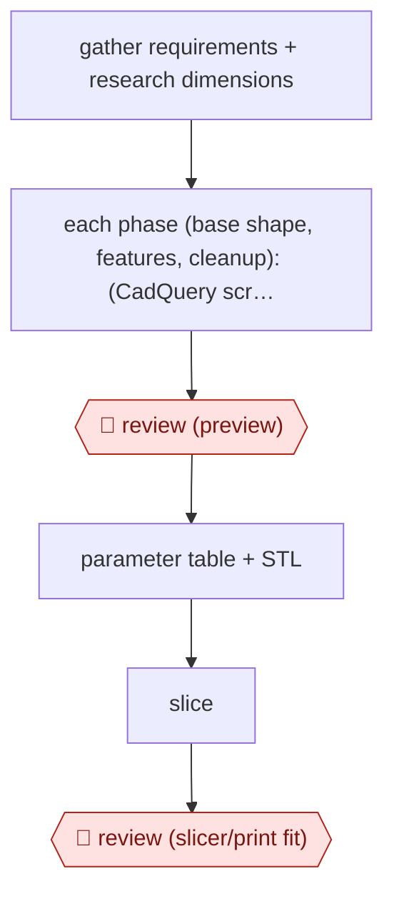

# Phased preview build

`TEC › ENG › CAD` · checkpointed · evidence A · **draft: needs a reference example** ([how to add one](../../../../../CONTRIBUTING.md#1-add-an-example-run))

**Shape:** `gather requirements + research dimensions → each phase (base shape, features, cleanup): (CadQuery script → STL → 4-view render ⟲ checklist self-review) → 🛑 review (preview) → parameter table + STL → slice → 🛑 review (slicer/print fit)`
**Variants:** `cadquery` · `trimesh-pyrender`

<!-- shape diagram: generated by scripts/build_diagrams.py from `shape`; don't edit -->

<!-- end shape diagram -->

## Background

A 3D printer builds a part by laying down molten plastic in thin layers, so the digital model has to suit the process as well as the job: walls thick enough to survive, no overhang steeper than the printer can bridge, a flat face to grip the build plate. Makers design these parts in CAD, and for a one-off bracket or a phone stand the design is usually driven by numbers — a puck diameter, a cable thickness, a wall thickness — that get nudged until the thing fits. A parametric model keeps those numbers as named variables, so the next revision is an edit, not a rebuild. The work is slow by hand for two reasons: the model has to be rebuilt and re-looked-at after every change, and a mistake such as a wrongly recessed button is only obvious once the part is in your hand. Here the agent writes the model as a script, renders pictures of it, and checks the print constraints itself before showing anything; the maker looks at each phase's preview, says what is wrong in plain words, and slices the final file to judge whether it will print. Those two judgements stay with the maker: whether the part fits the physical object, and whether the toolpath will actually work, are things a picture and a script cannot settle.

**Terms:**
- **parametric CAD**: modelling by named numbers ("wall = 1.2 mm") so a change is one edit, not a rebuild.
- **CadQuery**: a Python library that builds solid models from code; the model is a script that can be version-controlled and diffed.
- **STL**: the plain triangle mesh a slicer reads; it holds the shape but no parameters.
- **watertight**: a mesh with no holes, so the slicer can tell inside from outside.
- **slicer**: the program that turns a mesh into printer instructions, and the first place print problems show.
- **overhang**: a surface that leans out over empty space; steep ones need support material.
- **bed adhesion**: how well the first layer sticks to the build plate; a warped or detached part ruins the print.
- **boolean**: joining or cutting one solid with another, which is how features such as holes and slots are made.

## Build it with an agent

**Form:** `skill`. One maker, one part, a conversation with a preview at each phase: the procedure and its checklist fit in one skill with two scripts beside it.

**You need:** a Python environment with CadQuery (which needs Python 3.10 to 3.12) and a headless renderer such as trimesh with pyrender, so a preview can be made without a screen; a slicer, which the maker runs; the real dimensions of whatever the part must fit, from the maker or from the supplier's published drawings; a folder for the script, the STL and the renders. No access to the printer is needed: the maker prints.

| Step | Built as |
|---|---|
| gather requirements + research dimensions | The Skill's first instruction: ask what the part must fit, then read the supplier's or standards page for the mating dimensions and write them down as named variables. |
| each phase: CadQuery script → STL → 4-view render ⟲ checklist self-review | A script beside the Skill runs the model, exports the STL and renders four views; the print checklist is a reference file the agent applies to its own render, and it loops while the checklist still fails. |
| 🛑 review (preview) | The Skill stops at the end of each phase and shows the renders with the parameters that produced them; the next phase begins only when the maker replies. |
| parameter table + STL | The Skill's closing step: every dimension the maker might change, with its variable name and current value, written next to the STL. |
| slice | The maker slices; the agent never drives the printer. |
| 🛑 review (slicer/print fit) | Slicer screenshots come back into the conversation; the agent reads them, changes the parameters the fault points to, and re-renders. |

**Checkpoints:** `review`: both gates are the Skill stopping and waiting. After each phase it presents renders and does not write the next phase's code until the maker answers; before printing it presents the parameter table and the STL, and the slicer run stays with the maker, so a part that will not print cannot reach the machine through the agent.

**Since the sources:** Sources date from 2026-03: one first-hand account, which is also the entry's public run. Its page refused an automated reader this month (HTTP 403) and was not opened again; the entry still rests on the text collected when it was first read, and the entry is flagged `source-unreachable`. What has changed since: the author has packaged this same three-phase method as a skill — [flowful-ai/cad-skill](https://www.blog.brightcoding.dev/2026/07/18/flowful-aicad-skill-natural-language-to-parametric-3d-prints) (2026-07-18) builds base shape, features and finish in phases with a headless six-view render and a strict watertight check, which is the self-review loop above, ready to install. [SOMA](https://www.3dprintingjournal.com/p/soma-another-ai-powered-cad-with) (2026-11-04) puts an agent and CadQuery behind a desktop app with a model timeline, print-constraint skills and overhang and wall-thickness analysis, so the render-and-inspect loop now happens inside the CAD window. Neither removes the maker's two judgements: whether the part fits the physical object, and whether the sliced result will print.

*A design based on this entry's steps and the tool documentation as of 2026-11, not a reported run.*

## Steps

*As reported by the sources.*

1. Gather requirements in conversation, then research the real dimensions the part has to fit. In the MagSafe stand run this meant the puck size, coil position and cable diameter; in the phone-case run it meant Apple's accessory guidelines [[1]](#sources).
2. Build in three visual phases: base shape, then features, then final cleanup. Never jump straight to a finished model, because if the base shape is wrong the detail work is wasted [[1]](#sources).
3. In each phase, write a parametric CadQuery script, run it to produce an STL, and render a 4-view preview with trimesh/pyrender. The agent reads its own render [[1]](#sources).
4. Self-review every preview against a design checklist: does it match the request, are features visible, is the bottom flat for bed adhesion, are overhangs under 45 degrees, are walls over 1.2mm thick. Iterate before showing anything [[1]](#sources).
5. 🛑 **Review**: at the end of each phase the maker looks at the preview and gives corrections such as 'make it 5mm taller' or 'the cable hole isn't connected'. Then the next phase starts [[1]](#sources).
6. Deliver the STL plus a table of every key parameter for quick tweaks [[1]](#sources).
7. 🛑 **Review**: the maker slices the part and sends slicer screenshots back as feedback. This catches structural and clearance problems before filament is wasted [[1]](#sources).

**Output:** A parametric CadQuery script and STL, with a parameter table, ready to slice and print. Later changes are made by editing parameters.
**Failure modes → guards:** Booleans that fail silently, shells too thin to print, and features cut the wrong way (buttons recessed instead of raised) → the per-preview checklist plus a human preview gate in each phase. Unstable or unusable geometry (a stand that tips over) → real slicer feedback and a human judging physical use.
**How it differs:** None close in the catalog. AWF-0007 and AWF-0008 produce UI code, not solid geometry.

## Public runs

Coverage as of 2026-11-06: **Strong**: a first-hand, detailed run that matches most of the shape. Collected and re-checked in [New workflows for empty categories](../../../../../research/2026-11-new-workflows.md).

- [Nicolas Chourrout, I Taught Claude to Design 3D-Printable Parts](https://pub.towardsai.net/i-taught-claude-to-design-3d-printable-parts-heres-how-675f644af78a) (2026-03-05). MagSafe stand and TPU phone case built through phased previews and slicer feedback. "Four exchanges, including real slicer feedback with screenshots"; "Final model: 76 x 70 x 125mm". *First-hand: yes; confidence: high.*

## Sources

1. Nicolas Chourrout, I Taught Claude to Design 3D-Printable Parts. Here's How, Towards AI, 2026-03-05. https://pub.towardsai.net/i-taught-claude-to-design-3d-printable-parts-heres-how-675f644af78a
