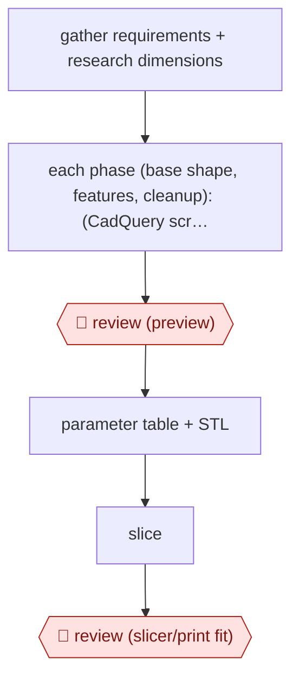

# Phased preview build

`TEC › ENG › CAD` · checkpointed · evidence A · **draft: needs a reference example** ([how to add one](../../../../../CONTRIBUTING.md#1-add-an-example-run))

**Shape:** `gather requirements + research dimensions → each phase (base shape, features, cleanup): (CadQuery script → STL → 4-view render ⟲ checklist self-review) → 🛑 review (preview) → parameter table + STL → slice → 🛑 review (slicer/print fit)`
**How it differs:** None close in the catalog. AWF-0007 and AWF-0008 produce UI code, not solid geometry.
**Variants:** `cadquery` · `trimesh-pyrender`

<!-- shape diagram: generated by scripts/build_diagrams.py from `shape`; don't edit -->

<!-- end shape diagram -->

## Steps
1. Gather requirements in conversation, then research the real dimensions the part has to fit. In the MagSafe stand run this meant the puck size, coil position and cable diameter; in the phone-case run it meant Apple's accessory guidelines [[1]](#sources).
2. Build in three visual phases: base shape, then features, then final cleanup. Never jump straight to a finished model, because if the base shape is wrong the detail work is wasted [[1]](#sources).
3. In each phase, write a parametric CadQuery script, run it to produce an STL, and render a 4-view preview with trimesh/pyrender. The agent reads its own render [[1]](#sources).
4. Self-review every preview against a design checklist: does it match the request, are features visible, is the bottom flat for bed adhesion, are overhangs under 45 degrees, are walls over 1.2mm thick. Iterate before showing anything [[1]](#sources).
5. 🛑 **Review**: at the end of each phase the maker looks at the preview and gives corrections such as 'make it 5mm taller' or 'the cable hole isn't connected'. Then the next phase starts [[1]](#sources).
6. Deliver the STL plus a table of every key parameter for quick tweaks [[1]](#sources).
7. 🛑 **Review**: the maker slices the part and sends slicer screenshots back as feedback. This catches structural and clearance problems before filament is wasted [[1]](#sources).

**Output:** A parametric CadQuery script and STL, with a parameter table, ready to slice and print. Later changes are made by editing parameters.
**Failure modes → guards:** Booleans that fail silently, shells too thin to print, and features cut the wrong way (buttons recessed instead of raised) → the per-preview checklist plus a human preview gate in each phase. Unstable or unusable geometry (a stand that tips over) → real slicer feedback and a human judging physical use.

## Public runs

Coverage as of 2026-11-06: **Strong**: a first-hand, detailed run that matches most of the shape. Collected and re-checked in [New workflows for empty categories](../../../../../research/2026-11-new-workflows.md).

- [Nicolas Chourrout, I Taught Claude to Design 3D-Printable Parts](https://pub.towardsai.net/i-taught-claude-to-design-3d-printable-parts-heres-how-675f644af78a) (2026-03-05). MagSafe stand and TPU phone case built through phased previews and slicer feedback. "Four exchanges, including real slicer feedback with screenshots"; "Final model: 76 x 70 x 125mm". *First-hand: yes; confidence: high.*

## Sources

1. Nicolas Chourrout, I Taught Claude to Design 3D-Printable Parts. Here's How, Towards AI, 2026-03-05. https://pub.towardsai.net/i-taught-claude-to-design-3d-printable-parts-heres-how-675f644af78a
