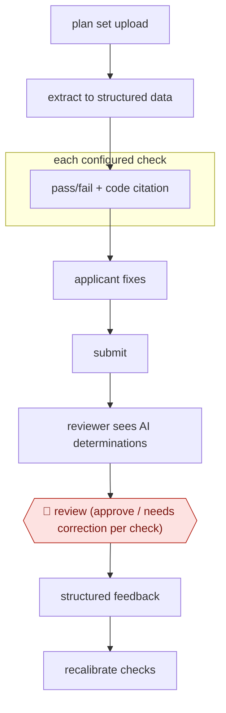

# Cited pre-screen checks

`TEC › ENG › CODECOMP` · checkpointed · evidence A · **draft: needs a reference example** ([how to add one](../../../../../CONTRIBUTING.md#1-add-an-example-run))

**Shape:** `plan set upload → extract to structured data → each configured check: pass/fail + code citation → applicant fixes → submit → reviewer sees AI determinations → 🛑 review (approve / needs correction per check) → structured feedback → recalibrate checks`
**How it differs:** None close. AWF-0024 playbook contract review checks a document against a playbook, but the deliverable there is a redlined contract, not permit findings.
**Variants:** `civcheck` · `archistar` · `codecomply-ai` · `blitz-ai`

<!-- shape diagram: generated by scripts/build_diagrams.py from `shape`; don't edit -->

<!-- end shape diagram -->

## Steps
1. Configure only checks that can be turned into unambiguous logic. Seattle used 34 completeness checks and 67 compliance checks, scoped to simpler residential 'middle housing' under the Seattle Residential Code [[1]](#sources).
2. The applicant uploads the plan set. The tool extracts plan content into structured data and runs every configured check, returning pass/fail findings tied to code requirements [[1]](#sources)[[2]](#sources).
3. The applicant fixes flagged issues before submitting. The application still goes through the normal City review [[2]](#sources).
4. 🛑 **Review**: in the plan-review phase, a City reviewer does the normal review and then sees the tool's pass/fail call on each check. They click 'approve' or 'needs correction', and can submit structured feedback when the tool is wrong [[1]](#sources).
5. The vendor recalibrates checks from reviewer feedback. Accuracy improved over the course of the pilot [[1]](#sources)[[2]](#sources).

**Output:** A per-check findings report with code references for the applicant, followed by a normal City permit review. Reviewers keep final authority.
**Failure modes → guards:** Missed corrections, i.e. the tool passes an item the reviewer sends back → reviewer gate on every check plus tracking of false-pass rates. Coverage gaps where code can't be turned into logic, so applicants see it as 'just another hurdle' → limit scope to simple building types and completeness first [[1]](#sources)[[2]](#sources).

## Public runs

Coverage as of 2026-11-06: **Strong**: a first-hand, detailed run that matches most of the shape. Collected and re-checked in [New workflows for empty categories](../../../../../research/2026-11-new-workflows.md).

- [City of Seattle, CivCheck AI Pre-Screening Pilot Report](https://seattle.gov/documents/Departments/Performance/Publications/2026CivCheckEvaluationReport.pdf) (2026). Reviewers judged AI pass/fail on 1,262 checks across 57 residential applications. "Overall Accuracy: 91.7%". *First-hand: yes; confidence: high.*
- [Seattle Innovation & Performance, CivCheck pilot insights](https://innovation-hub.seattle.gov/2026/06/17/ai-construction-permitting-seattle-civcheck-study/) (2026-06-17). City summary of the pilot: accuracy, and coverage mattering as much as accuracy. "application completeness checks were 87% accurate and design compliance checks were 92% accurate". *First-hand: yes; confidence: high.*

## Sources

1. City of Seattle IP & SDCI, CivCheck AI Pre-Screening Pilot Report (Proof of Value Mar–Oct 2025), 2026. https://seattle.gov/documents/Departments/Performance/Publications/2026CivCheckEvaluationReport.pdf
2. Seattle Innovation & Performance, Can AI Speed Up Construction Permitting in Seattle? Insights from the CivCheck Pilot, 2026-06-17. https://innovation-hub.seattle.gov/2026/06/17/ai-construction-permitting-seattle-civcheck-study/
