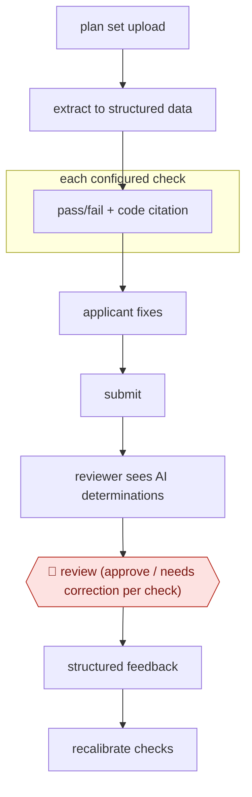

# Cited pre-screen checks

`TEC › ENG › CODECOMP` · checkpointed · evidence A · **draft: needs a reference example** ([how to add one](../../../../../CONTRIBUTING.md#1-add-an-example-run))

**Shape:** `plan set upload → extract to structured data → each configured check: pass/fail + code citation → applicant fixes → submit → reviewer sees AI determinations → 🛑 review (approve / needs correction per check) → structured feedback → recalibrate checks`
**Variants:** `civcheck` · `archistar` · `codecomply-ai` · `blitz-ai`

<!-- shape diagram: generated by scripts/build_diagrams.py from `shape`; don't edit -->

<!-- end shape diagram -->

## Background

Before a building may be built, its drawings have to pass plan review: a city plans examiner reads the set against the building code and writes corrections the applicant must answer. Examiners spend much of that time on questions with a definite answer — is there a sheet for every required item, is the stair width at least the code minimum, does the smoke-alarm layout cover every bedroom — and only part of it on judgement. This workflow puts a pre-screen in front of the examiner: the applicant uploads the set, software runs a fixed list of checks, and each result is a pass or a fail tied to the code requirement behind it. The applicant fixes what it can and submits; the examiner then does the normal review and, for each check, either approves the tool's call or marks it wrong. That signature is the only thing that issues anything: the pre-screen is advisory, the code interpretation stays with the city, and a missed fault is a safety defect, so no result may reach the applicant as a decision. The list of checks is deliberately narrow — only requirements that can be written as unambiguous logic — and it is retuned from the disagreements recorded along the way.

**Terms:**
- **plan review**: the city's examination of permit drawings, ending in approval or a corrections letter.
- **plan set**: the bound drawings and documents submitted for a permit: site, architectural, structural, mechanical, electrical, plumbing.
- **plans examiner**: the city official who reviews a set and holds the authority to approve it.
- **pre-screen**: a check that runs before the official review and does not replace it.
- **corrections, resubmittal**: the list of faults the applicant must fix, and the revised set sent back.
- **completeness check**: whether a required document or sheet exists at all, as opposed to whether its content complies.
- **citation**: the section of the adopted code that a finding rests on, including the edition.
- **false pass**: a check that passed an item the examiner later sent back; the error that matters most here.

## Build it with an agent

**Form:** `service`. Applications arrive continuously and the checks run with nobody at the keyboard; the examiner sees per-check results inside their own review and answers them later.

**You need:** the adopted code text with its edition and local amendments, and a rule library where each check is written as one requirement, its threshold, the citation, and the extraction it needs from a sheet; a plan-set converter that returns text, a sheet index and measurements, each with a page number and coordinates; the queue of applications and a place to keep each run's output keyed by application and set revision; the examiner's screen in the permitting system. The agent must have no tool that stamps, approves or issues a permit, and no write access to the applicant's set.

| Step | Built as |
|---|---|
| plan set upload | The permitting portal, or a watch folder, starts a run per uploaded set; a revision of the same set is a new run, so no old result can be shown against new drawings. |
| extract to structured data | A converter script returns text, sheet index and measurements with page numbers and coordinates; anything it cannot locate is recorded as missing rather than guessed. |
| each configured check: pass/fail + code citation | One Subagent per check group, given the rule and the extracted data and told to answer that check only; it returns pass, fail or cannot-determine, with the citation and the page it read the value from. |
| applicant fixes | Outside the agent: the applicant edits the drawings and resubmits. |
| submit | The resubmittal starts a fresh run on the new set; the earlier result is kept for comparison. |
| reviewer sees AI determinations → 🛑 review (approve / needs correction per check) | The results arrive as one row per check in the examiner's queue, with the citation and a crop of the sheet; approving or rejecting a row is a permission the examiner holds in the permitting system, which the run can only read. |
| structured feedback → recalibrate checks | A wrong determination writes a record against the check's id and the rule version, and the rule library changes only through a reviewed commit, with the false-pass rate per check visible before a new rule goes live. |

**Checkpoints:** `review`: nothing leaves the run as a decision. Its output is a row per check in the examiner's queue, and the approve or needs-correction action exists only in the permitting system, where the run has read-only access, so the code interpretation and the signature stay with the city. Where a missed fault would be dangerous, the rule is written so an undecidable case returns cannot-determine instead of pass, and that is enforced in the check's code, not in its instructions.

**Since the sources:** Sources date from 2026-06: the city's pilot report, covering a proof of value from March to October 2025, and the city's own summary page. Both were opened this month, the report through a PDF text reader. What has changed since: the pilot has become a requirement. Honolulu made the same pre-screen mandatory for eligible residential projects from 2026-09-01, rejecting applications that skip it, and reports 40.5 days saved per permit with [plan-review cycles down from 3.4 to 1.4](https://www.honolulu.gov/dpp?p=43765). Toronto launched a pilot in which [every finding carries a citation to the requirement behind it](https://www.claritisoftware.com/blog/city-of-toronto-launches-ai-pre-check-with-clariti-to-speed-up-housing-approvals), and both cities describe the tool as guidance that does not approve, refuse or delay a permit. That matches the checkpoint this entry describes, and it moves the weight onto the reviewer's per-check rejection: once applicants must use the pre-screen, the false-pass rate is the number that matters, and the recalibration loop above is how it is held.

*A design based on this entry's steps and the tool documentation as of 2026-11, not a reported run.*

## Steps

*As reported by the sources.*

1. Configure only checks that can be turned into unambiguous logic. Seattle used 34 completeness checks and 67 compliance checks, scoped to simpler residential 'middle housing' under the Seattle Residential Code [[1]](#sources).
2. The applicant uploads the plan set. The tool extracts plan content into structured data and runs every configured check, returning pass/fail findings tied to code requirements [[1]](#sources)[[2]](#sources).
3. The applicant fixes flagged issues before submitting. The application still goes through the normal City review [[2]](#sources).
4. 🛑 **Review**: in the plan-review phase, a City reviewer does the normal review and then sees the tool's pass/fail call on each check. They click 'approve' or 'needs correction', and can submit structured feedback when the tool is wrong [[1]](#sources).
5. The vendor recalibrates checks from reviewer feedback. Accuracy improved over the course of the pilot [[1]](#sources)[[2]](#sources).

**Output:** A per-check findings report with code references for the applicant, followed by a normal City permit review. Reviewers keep final authority.
**Failure modes → guards:** Missed corrections, i.e. the tool passes an item the reviewer sends back → reviewer gate on every check plus tracking of false-pass rates. Coverage gaps where code can't be turned into logic, so applicants see it as 'just another hurdle' → limit scope to simple building types and completeness first [[1]](#sources)[[2]](#sources).
**How it differs:** None close. AWF-0024 playbook contract review checks a document against a playbook, but the deliverable there is a redlined contract, not permit findings.

## Public runs

Coverage as of 2026-11-06: **Strong**: a first-hand, detailed run that matches most of the shape. Collected and re-checked in [New workflows for empty categories](../../../../../research/2026-11-new-workflows.md).

- [City of Seattle, CivCheck AI Pre-Screening Pilot Report](https://seattle.gov/documents/Departments/Performance/Publications/2026CivCheckEvaluationReport.pdf) (2026). Reviewers judged AI pass/fail on 1,262 checks across 57 residential applications. "Overall Accuracy: 91.7%". *First-hand: yes; confidence: high.*
- [Seattle Innovation & Performance, CivCheck pilot insights](https://innovation-hub.seattle.gov/2026/06/17/ai-construction-permitting-seattle-civcheck-study/) (2026-06-17). City summary of the pilot: accuracy, and coverage mattering as much as accuracy. "application completeness checks were 87% accurate and design compliance checks were 92% accurate". *First-hand: yes; confidence: high.*

## Sources

1. City of Seattle IP & SDCI, CivCheck AI Pre-Screening Pilot Report (Proof of Value Mar–Oct 2025), 2026. https://seattle.gov/documents/Departments/Performance/Publications/2026CivCheckEvaluationReport.pdf
2. Seattle Innovation & Performance, Can AI Speed Up Construction Permitting in Seattle? Insights from the CivCheck Pilot, 2026-06-17. https://innovation-hub.seattle.gov/2026/06/17/ai-construction-permitting-seattle-civcheck-study/
