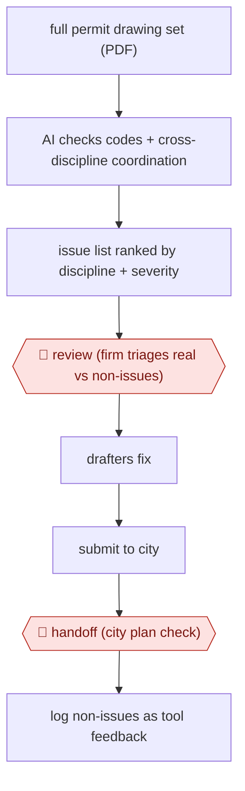

# Pre-submittal plan check

`TEC › ENG › CODECOMP` · checkpointed · evidence B · **draft: needs a reference example** ([how to add one](../../../../../CONTRIBUTING.md#1-add-an-example-run))

**Shape:** `full permit drawing set (PDF) → AI checks codes + cross-discipline coordination → issue list ranked by discipline + severity → 🛑 review (firm triages real vs non-issues) → drafters fix → submit to city → 🛑 handoff (city plan check) → log non-issues as tool feedback`
**How it differs:** Closest is AWF-0058 (Cited pre-screen checks), run on the regulator side: applicants fix flagged checks and a city reviewer approves each determination. Here the design firm runs the check on its own whole set before submittal and triages the false positives itself. The city's review is a later handoff, not the checkpoint, so the user, deliverable and checkpoint owner all differ.
**Variants:** `inspectmind` · `archiboost` · `ichi` · `bluebeam`

<!-- shape diagram: generated by scripts/build_diagrams.py from `shape`; don't edit -->

<!-- end shape diagram -->

## Steps
1. The design firm uploads the full drawing set it plans to submit (architectural, civil, structural, specs) [[1]](#sources)[[2]](#sources).
2. The AI checks it against codes and standards and across disciplines. It returns an issue list ranked by discipline and severity [[2]](#sources).
3. 🛑 **Review**: the firm triages each flag as real or a non-issue. At one firm about a quarter were legitimate. The firm keeps its own QA/QC process [[1]](#sources).
4. Drafters fix the confirmed issues before submitting [[2]](#sources).
5. 🛑 **Handoff**: the city does its own plan check. The firm records non-issues and sends them to the tool vendor to improve the checks [[1]](#sources)[[2]](#sources).

**Output:** A cleaned permit set submitted with fewer issues for the city to find, plus a triaged issue log.
**Failure modes → guards:** High false-positive rate (about 1 in 4 flags real at Charlan Brock) → firm triage before any fix. Shallow tools miss known violations → benchmark against the firm's own pre-IFC review list. Over-reliance → keep internal QA/QC; the AI is 'another set of eyes' [[1]](#sources).

## Public runs

Coverage as of 2026-11-06: **Weak**: only anonymous, vendor-linked or journalist-told accounts. Collected and re-checked in [Second collection pass](../../../../../research/2026-11-second-pass.md).

- [InspectMind, Charlan Brock Architects case study](https://www.inspectmind.ai/case-studies/charlan-brock-architects) (undated). Multifamily permit set of 750+ drawings; AI found issues the firm's own pre-IFC review missed; firm triaged false positives. "at least 97 others that had escaped their pre-IFC review"; "roughly a quarter of flagged issues being legitimate". *First-hand: vendor; confidence: med.*
- [InspectMind, Owens Design church project](https://www.inspectmind.ai/case-studies/owens-design-church) (undated). Firm fixed AI-flagged issues before city submittal; city comments were minor. "The AI plan checker flagged ~300 issues". *First-hand: vendor; confidence: med.*

## Sources

1. InspectMind, Charlan Brock Architects case study (undated). https://www.inspectmind.ai/case-studies/charlan-brock-architects
2. InspectMind, Church Project: AI Caught ~300 Issues, City Barely Found (Owens Design Consultants, undated). https://www.inspectmind.ai/case-studies/owens-design-church
