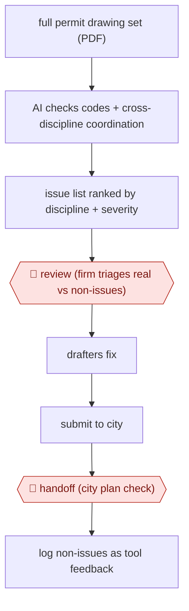

# Pre-submittal plan check

`TEC › ENG › CODECOMP` · checkpointed · evidence B · **draft: needs a reference example** ([how to add one](../../../../../CONTRIBUTING.md#1-add-an-example-run))

**Shape:** `full permit drawing set (PDF) → AI checks codes + cross-discipline coordination → issue list ranked by discipline + severity → 🛑 review (firm triages real vs non-issues) → drafters fix → submit to city → 🛑 handoff (city plan check) → log non-issues as tool feedback`
**Variants:** `inspectmind` · `archiboost` · `ichi` · `bluebeam`

<!-- shape diagram: generated by scripts/build_diagrams.py from `shape`; don't edit -->

<!-- end shape diagram -->

## Background

An architecture firm finishes a set of drawings and sends it to the city for a building permit. The city then checks it against the building code and sends back a corrections letter listing what is wrong; every round costs weeks, and the firm's own reputation for clean submittals is part of what clients buy. So firms run their own quality review before submitting: a senior architect or a dedicated reviewer reads the whole set — architectural, structural, civil, mechanical — for code compliance and, just as often, for coordination errors, such as a structural opening drawn in one place and an architectural wall in another. That reading is slow, and a reviewer who has looked at forty sheets stops seeing them. This workflow puts a machine check first: every sheet is read against the code and across disciplines, and the reviewer gets a list ranked by discipline and severity instead of a blank set. The reviewer then decides which items are real, because a high share of what comes back is not — the vendor's own account puts it at about one flag in four — and only the confirmed ones go to the drafters. What the city finds after that is the outcome that matters, and the non-issues are logged to tune the checks.

**Terms:**
- **permit set**: the complete drawings and specifications submitted to a city to obtain a building permit.
- **plan check**: the city's review of that set, answered by a corrections letter or an approval.
- **discipline**: one profession's part of the set — architectural, structural, civil, mechanical, electrical, plumbing.
- **coordination error**: a clash between two disciplines' drawings, such as a beam where a duct is routed.
- **pre-IFC review**: the firm's own internal check before drawings are issued for construction.
- **false positive**: a flag the reviewer judges not to be a real problem.
- **QA/QC**: quality assurance and quality control, the firm's own checking process.
- **triage**: sorting the list into real problems and noise before anyone fixes anything.

## Build it with an agent

**Form:** `skill`. One reviewer works one set in a conversation, with a triage gate before any fix; per-discipline reads are parallel checks inside that skill.

**You need:** the full set as PDF, in a project folder, with its sheet index; a script that splits the set by discipline and renders each sheet legibly, since a check is only as good as the text and geometry it can see; the firm's own checklist — the code items and the coordination checks it already reviews by hand — as a reference file beside the skill; the city's corrections letters from past projects, as a benchmark; the triage log where non-issues accumulate. The agent needs no access to the firm's CAD files: fixes stay with the drafters.

| Step | Built as |
|---|---|
| full permit drawing set (PDF) | The reviewer points the skill at one folder; a script indexes sheets, splits them by discipline and renders each at a readable size. |
| AI checks codes + cross-discipline coordination | One Subagent per discipline, each with that discipline's checklist and its sheets only; a second pass takes the sheet index and looks for the clashes no single discipline can see. |
| issue list ranked by discipline + severity | The Skill merges the returns into one list, de-duplicates items found on more than one sheet, and ranks each by the checklist's own severity wording. |
| 🛑 review (firm triages real vs non-issues) | The Skill stops and presents the list with the sheet crop and the checklist item behind each flag; the reviewer marks real or noise, and only real items continue. |
| drafters fix | Outside the agent: the drafters edit the drawings. |
| submit to city → 🛑 handoff (city plan check) | The city's plan check happens outside the firm's tools; the Skill's last output is the submittal log and the triaged list, and no agent output goes to the city. |
| log non-issues as tool feedback | Each noise mark is written against the checklist item that produced it, so the false-positive rate per item is visible and the checklist is edited between projects. |

**Checkpoints:** `review`: the list is presented, not acted on; the reviewer's marks decide what reaches the drafters, and the skill has no tool that edits drawings. `handoff`: the city's review is not something the build can do or pre-empt — the output stops at the firm's own record, and the corrections letter the city later sends is the independent measure of whether the check was worth running.

**Since the sources:** Sources are two undated vendor case studies, opened this month. Both describe the firm's own triage as the gate and neither publishes a measured false-positive rate: the "about a quarter" figure is the vendor quoting one firm. What has changed since: the category has widened from "another set of eyes" to checks placed earlier in the design tools themselves — a 2026 comparison of six zoning and code products describes [model-based checks inside the design environment, code research agents that answer with citations, and pre-submittal review as separate layers](https://engtechnica.com/six-zoning-and-code-compliance-tools-bring-checks-earlier-into-architectural-design), and all of them repeat that results remain advisory. Two things in the build follow from that: the checklist is the durable artifact, not the vendor; and the triage log matters more as coverage grows, because a longer list with a stable one-in-four rate costs the reviewer more time than it saves.

*A design based on this entry's steps and the tool documentation as of 2026-11, not a reported run.*

## Steps

*As reported by the sources.*

1. The design firm uploads the full drawing set it plans to submit (architectural, civil, structural, specs) [[1]](#sources)[[2]](#sources).
2. The AI checks it against codes and standards and across disciplines. It returns an issue list ranked by discipline and severity [[2]](#sources).
3. 🛑 **Review**: the firm triages each flag as real or a non-issue. At one firm about a quarter were legitimate. The firm keeps its own QA/QC process [[1]](#sources).
4. Drafters fix the confirmed issues before submitting [[2]](#sources).
5. 🛑 **Handoff**: the city does its own plan check. The firm records non-issues and sends them to the tool vendor to improve the checks [[1]](#sources)[[2]](#sources).

**Output:** A cleaned permit set submitted with fewer issues for the city to find, plus a triaged issue log.
**Failure modes → guards:** High false-positive rate (about 1 in 4 flags real at Charlan Brock) → firm triage before any fix. Shallow tools miss known violations → benchmark against the firm's own pre-IFC review list. Over-reliance → keep internal QA/QC; the AI is 'another set of eyes' [[1]](#sources).
**How it differs:** Closest is AWF-0058 (Cited pre-screen checks), run on the regulator side: applicants fix flagged checks and a city reviewer approves each determination. Here the design firm runs the check on its own whole set before submittal and triages the false positives itself. The city's review is a later handoff, not the checkpoint, so the user, deliverable and checkpoint owner all differ.

## Public runs

Coverage as of 2026-11-06: **Weak**: only anonymous, vendor-linked or journalist-told accounts. Collected and re-checked in [Second collection pass](../../../../../research/2026-11-second-pass.md).

- [InspectMind, Charlan Brock Architects case study](https://www.inspectmind.ai/case-studies/charlan-brock-architects) (undated). Multifamily permit set of 750+ drawings; AI found issues the firm's own pre-IFC review missed; firm triaged false positives. "at least 97 others that had escaped their pre-IFC review"; "roughly a quarter of flagged issues being legitimate". *First-hand: vendor; confidence: med.*
- [InspectMind, Owens Design church project](https://www.inspectmind.ai/case-studies/owens-design-church) (undated). Firm fixed AI-flagged issues before city submittal; city comments were minor. "The AI plan checker flagged ~300 issues". *First-hand: vendor; confidence: med.*

## Sources

1. InspectMind, Charlan Brock Architects case study (undated). https://www.inspectmind.ai/case-studies/charlan-brock-architects
2. InspectMind, Church Project: AI Caught ~300 Issues, City Barely Found (Owens Design Consultants, undated). https://www.inspectmind.ai/case-studies/owens-design-church
