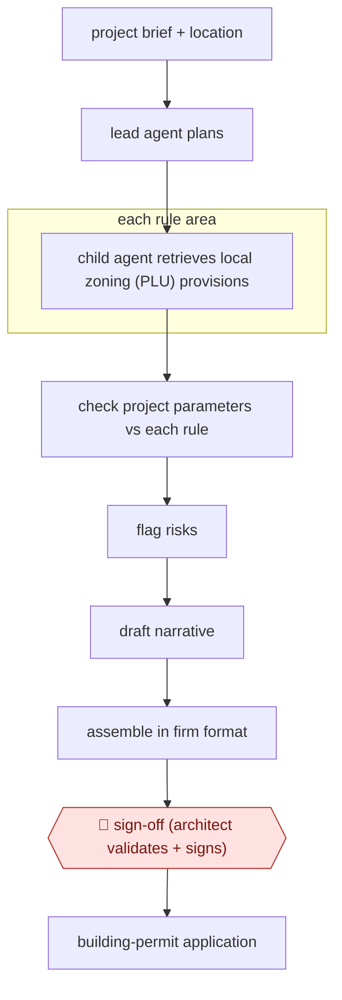

# Zoning-rule study crew

`TEC › ENG › CODECOMP` · checkpointed · evidence B · **draft: needs a reference example** ([how to add one](../../../../../CONTRIBUTING.md#1-add-an-example-run))

**Shape:** `project brief + location → lead agent plans → each rule area: child agent retrieves local zoning (PLU) provisions → check project parameters vs each rule → flag risks → draft narrative → assemble in firm format → 🛑 sign-off (architect validates + signs) → building-permit application`
**Variants:** `fleece-ai`

<!-- shape diagram: generated by scripts/build_diagrams.py from `shape`; don't edit -->

<!-- end shape diagram -->

## Background

In France a building project needs a permis de construire — the planning permission filed with the commune — and the file must show that the project obeys the local plan, the PLU (plan local d'urbanisme). That document says, parcel by parcel, how far from the boundary a building may sit, how tall it may be, what share of the plot it may cover, how many parking spaces it needs, and whether the site is inside a heritage protection area where an additional state architect must agree. Architects write a study that walks through each of these rules and states the project's value against it, because an application that ignores one is refused or delayed for months. Writing that study is slow and repetitive: the rules differ by commune, the PLU runs to hundreds of pages, and each project needs the same walk-through in the same format. Here an agent plans the study, retrieves and quotes the applicable articles area by area, compares each rule with the project's dimensions, and drafts the narrative in the firm's format. The architect checks every article against the quoted text and signs the study before it goes into the permit file: a signed misreading is a professional liability, and the state architect's agreement on a heritage site is not something an agent can obtain.

**Terms:**
- **permis de construire**: the French planning permission application filed with the commune.
- **PLU** (plan local d'urbanisme): the commune's zoning plan; its written rules govern height, setbacks, coverage and use.
- **setback** (recul): the minimum distance between a building and the plot boundary or the street.
- **footprint ratio** (emprise au sol): the share of the plot the building may cover, as a maximum percentage.
- **height rule** (hauteur): the maximum height, measured to a stated point, which differs between communes.
- **heritage protection area**: land around a listed monument where a state architect (ABF) must approve the design.
- **rule area**: one group of related provisions — setbacks, height, coverage, parking, heritage — which is how the study is organised.
- **file**: the complete permit application: drawings, the study, and the forms.

## Build it with an agent

**Form:** `skill`. One architect produces one study in a conversation and signs it; the "crew" the source describes is one agent running parallel subagents per rule area today, which is what a skill with subagents does.

**You need:** the commune's PLU as published — the written rules and any graphic annexes — and the zoning that applies to the parcel; the project brief with the dimensions the rules test, or a note of which are still to be fixed; the plot's boundary geometry; the firm's study template and its wording conventions; the heritage map for the area. Nothing in the build may file the permit or contact the administration: that stays with the architect.

| Step | Built as |
|---|---|
| project brief + location | The Skill's first step: read the brief, resolve the commune and the zoning in force, and fetch the PLU document; a connector or an MCP server for the planning portal if the firm has one, otherwise the downloaded file. |
| each rule area: child agent retrieves local zoning provisions | One Subagent per rule area with that area's instruction only; each returns the article number, the quoted text and the page, and nothing it could not find. |
| check project parameters vs each rule | A table per rule: the rule's value, the project's value, the difference, and a verdict; where the brief lacks a value, the row says to confirm instead of passing. |
| flag risks | The Skill separates hard non-compliance from judgement calls — a heritage question, a rule whose wording is ambiguous — and says which article makes it one. |
| draft narrative → assemble in firm format | The Skill writes the study in the firm's template, every claim citing the article it rests on. |
| 🛑 sign-off (architect validates + signs) | The Skill stops with the study and the table; the architect checks each article against the quote and signs in the firm's own file system, where the agent has no write access. |
| building-permit application | Outside the agent: the architect files it. |

**Checkpoints:** `sign-off`: the study leaves the agent as a draft with every rule quoted beside the project's value, and the signature happens outside its tools, so a rule it misread is a visible line the architect can reject rather than an assumption buried in prose. The build gives the agent no way to submit or amend a permit file, and no way to contact the state architect.

**Since the sources:** Sources date from 2026-07: one vendor blog post, which is also the entry's public run, opened this month. Its figures are the vendor's own and it names one production agent at one firm. What has changed since: the products that check zoning have widened from feasibility studies to cited answers and model-based checks, but their coverage is built jurisdiction by jurisdiction — a 2026 comparison describes [one tool digitising zoning and planning rules mainly for Australia, another answering code questions with citations, a third reviewing plans against ICC and local amendments](https://engtechnica.com/six-zoning-and-code-compliance-tools-bring-checks-earlier-into-architectural-design), and all of it advisory. That is the gap this entry's build fills: where no digitised rule library exists for a commune, retrieving the PLU article and quoting it is the agent's work, and the architect's signature is what makes the study usable. Nothing opened this month shows a French PLU available as an executable rule set.

*A design based on this entry's steps and the tool documentation as of 2026-11, not a reported run.*

## Steps

*As reported by the sources.*

1. A lead agent takes the project brief and location and plans the study [[1]](#sources).
2. Child agents retrieve and interpret the applicable PLU (local planning code) provisions and check setbacks, heights, footprint ratios, parking and heritage constraints rule by rule [[1]](#sources).
3. Draft the narrative and assemble the study in the firm's format [[1]](#sources).
4. 🛑 **Sign-off**: 'a human validates and signs off' before the study feeds the building-permit application [[1]](#sources).

**Output:** Regulatory urban-planning study for a French building-permit file.
**Failure modes → guards:** Misread local rules → point-by-point check with architect sign-off.
**How it differs:** Same class as AWF-0058, but that is reviewer-side screening with per-check approval. Here the applicant's architect produces the study with a single sign-off.

## Public runs

Coverage as of 2026-11-06: **Weak**: only anonymous, vendor-linked or journalist-told accounts. Collected and re-checked in [Second collection pass](../../../../../research/2026-11-second-pass.md).

- [Fleece AI, Créabim](https://www.fleeceai.agency/blog/ai-automation-for-architecture-firms) (2026-07-11). Production agent ('Jarvis') at the French firm Créabim. "roughly 10x faster than the manual process". *First-hand: vendor; confidence: low.*

## Sources

1. Loïc Jané, Fleece AI, AI Automation for Architecture & AEC Firms, 2026-07-11. https://www.fleeceai.agency/blog/ai-automation-for-architecture-firms
