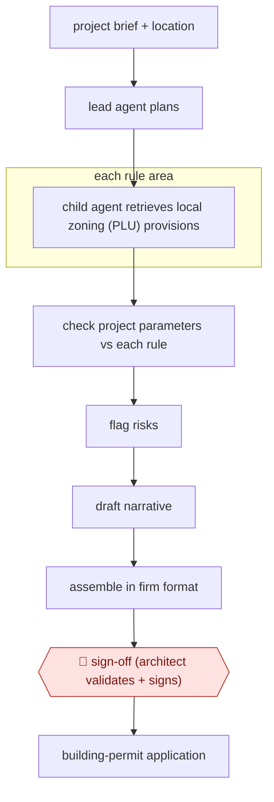

# Zoning-rule study crew

`TEC › ENG › CODECOMP` · checkpointed · evidence B · **draft: needs a reference example** ([how to add one](../../../../../CONTRIBUTING.md#1-add-an-example-run))

**Shape:** `project brief + location → lead agent plans → each rule area: child agent retrieves local zoning (PLU) provisions → check project parameters vs each rule → flag risks → draft narrative → assemble in firm format → 🛑 sign-off (architect validates + signs) → building-permit application`
**How it differs:** Same class as AWF-0058, but that is reviewer-side screening with per-check approval. Here the applicant's architect produces the study with a single sign-off.
**Variants:** `fleece-ai`

<!-- shape diagram: generated by scripts/build_diagrams.py from `shape`; don't edit -->

<!-- end shape diagram -->

## Steps
1. A lead agent takes the project brief and location and plans the study [[1]](#sources).
2. Child agents retrieve and interpret the applicable PLU (local planning code) provisions and check setbacks, heights, footprint ratios, parking and heritage constraints rule by rule [[1]](#sources).
3. Draft the narrative and assemble the study in the firm's format [[1]](#sources).
4. 🛑 **Sign-off**: 'a human validates and signs off' before the study feeds the building-permit application [[1]](#sources).

**Output:** Regulatory urban-planning study for a French building-permit file.
**Failure modes → guards:** Misread local rules → point-by-point check with architect sign-off.

## Public runs

Coverage as of 2026-11-06: **Weak**: only anonymous, vendor-linked or journalist-told accounts. Collected and re-checked in [Second collection pass](../../../../../research/2026-11-second-pass.md).

- [Fleece AI, Créabim](https://www.fleeceai.agency/blog/ai-automation-for-architecture-firms) (2026-07-11). Production agent ('Jarvis') at the French firm Créabim. "roughly 10x faster than the manual process". *First-hand: vendor; confidence: low.*

## Sources

1. Loïc Jané, Fleece AI, AI Automation for Architecture & AEC Firms, 2026-07-11. https://www.fleeceai.agency/blog/ai-automation-for-architecture-firms
