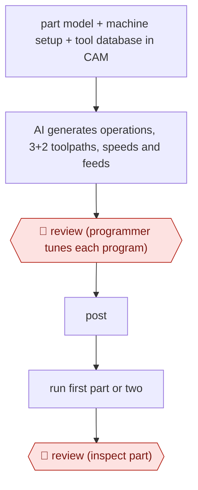

# AI-first CAM program

`TEC › ENG › MFG` · checkpointed · evidence B · **draft: needs a reference example** ([how to add one](../../../../../CONTRIBUTING.md#1-add-an-example-run))

**Shape:** `part model + machine setup + tool database in CAM → AI generates operations, 3+2 toolpaths, speeds and feeds → 🛑 review (programmer tunes each program) → post → run first part or two → 🛑 review (inspect part)`
**How it differs:** Closest is AWF-0059 (Drawing-to-route draft), which drafts a process route with workstations and labour times. This one drafts the machine toolpaths themselves. The checkpoints are the programmer tuning each program and inspecting the first part, not a team leader releasing a route.
**Variants:** `cloudnc-cam-assist` · `autodesk-fusion` · `mastercam`

<!-- shape diagram: generated by scripts/build_diagrams.py from `shape`; don't edit -->

<!-- end shape diagram -->

## Steps
1. Set up the job in the CAM system. Load the part geometry, pick the machine setup (its limits are built in), and fill the tool database with work holding and cutting tools for the cutting-parameters module [[1]](#sources)[[2]](#sources).
2. Run the AI. It writes about 80% of the program in minutes: operations grouped into folders, 3+2 toolpaths, and speeds and feeds from the work holding and tool you entered [[1]](#sources)[[2]](#sources).
3. 🛑 **Review**: the programmer opens each generated program and tunes it. This includes approaching some 3+2 features from a different side and simplifying strategies the AI over-complicated. The source says 'Each program still requires optimization.' [[1]](#sources)[[2]](#sources)
4. Post the program and run 'a part or two' on the machine. 🛑 **Review**: newer staff inspect those first parts before trusting the program [[2]](#sources).
5. For families of similar parts (the shop ran hundreds of size variants), repeat for each variant with the same tool database [[1]](#sources).

**Output:** A proven NC program for each part variant, released to the shop floor.
**Failure modes → guards:** The AI over-complicates strategies, or picks an awkward approach side on 3+2 work → the programmer reviews and edits every program. Operators distrust AI output → let them check and change parts of the program and prove it out on a first part [[1]](#sources)[[2]](#sources). Setting up the tool database slows early adoption → build it once and reuse it [[2]](#sources).

## Public runs

Coverage as of 2026-11-06: **Partial**: first-hand runs that cover part of the shape or put checkpoints elsewhere. Collected and re-checked in [Second collection pass](../../../../../research/2026-11-second-pass.md).

- [Modern Machine Shop, Cutting Part Programming Times Through AI](https://mmsonline.com/articles/automating-part-programming-cuts-the-time-to-engaging-work) (2024-06-19). Florida job shop programs many size variants with CAM Assist; the programmer still optimizes each one. "45 minutes to an hour" per iteration before; "five to 10 minutes" with CAM Assist. *First-hand: interview; confidence: med.*

## Sources

1. Evan Doran, Modern Machine Shop, Cutting Part Programming Times Through AI, 2024-06-19 (updated 2025-06-27). https://mmsonline.com/articles/automating-part-programming-cuts-the-time-to-engaging-work
2. CloudNC, Total Manufacturing Solutions: cutting programming time with CAM Assist (case study, undated). https://www.cloudnc.com/case-studies/total-manufacturing-solutions-cutting-programming-time-with-cam-assist
