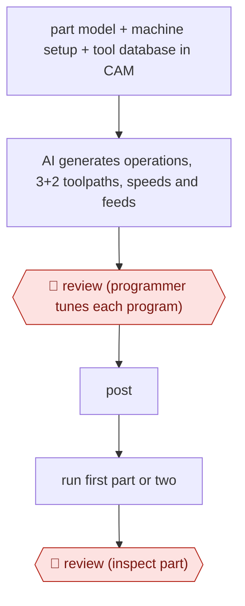

# AI-first CAM program

`TEC › ENG › MFG` · checkpointed · evidence B · **draft: needs a reference example** ([how to add one](../../../../../CONTRIBUTING.md#1-add-an-example-run))

**Shape:** `part model + machine setup + tool database in CAM → AI generates operations, 3+2 toolpaths, speeds and feeds → 🛑 review (programmer tunes each program) → post → run first part or two → 🛑 review (inspect part)`
**Variants:** `cloudnc-cam-assist` · `autodesk-fusion` · `mastercam`

<!-- shape diagram: generated by scripts/build_diagrams.py from `shape`; don't edit -->

<!-- end shape diagram -->

## Background

A computer numerical control (CNC) machine cuts metal by following a program: a list of moves, spindle speeds and tool changes. Writing that program is the job of a CAM programmer. The programmer starts from the part's 3D model, says which machine and which tools will be used, and the CAM software works out the toolpaths — where the cutter travels — and posts them into the code the machine runs. On a 3+2 machine the part is held at an angle and cut from several directions, which adds choices a person normally makes case by case. The work is slow because a shop programs hundreds of near-identical size variants, and because a wrong speed, a bad approach direction or a tool that cannot reach a face is only found when a part is scrapped or a tool breaks. Here an AI function inside the CAM software proposes the operations, the toolpaths and the cutting parameters; the programmer still opens every program, changes what it got awkward, and releases it; the machinists run one or two parts and inspect them before the program is trusted. Those two stops stay with people because the first decides how the part is made and the second is the only proof that it is made correctly.

**Terms:**
- **CAM** (computer-aided manufacturing): the software that turns a part model into machine instructions, as opposed to CAD, which designs the part.
- **toolpath**: the path the cutter follows, with feeds (how fast it moves) and speeds (how fast it spins).
- **3+2**: milling from several fixed directions by tilting the part, rather than continuous five-axis motion.
- **post** (post-processor): the step that converts the CAM toolpaths into the code for one specific machine.
- **tool database**: the shop's list of holders and cutters with their geometry and cutting limits; the CAM software reads it to choose tools and parameters.
- **work holding**: how the part is clamped, which limits where the cutter may go.
- **size variant**: one of a family of parts identical in shape but different in a few dimensions.
- **first article inspection**: measuring the first parts off the machine before the program is released for the run.

## Build it with an agent

**Form:** `platform`. Generating collision-checked toolpaths and post-processed code needs the CAM kernel and the machine's own post-processor, and proving the program needs the machine; a general agent can run the planning, the setup sheet and the checking around them, which is what this build uses it for.

**You need:** the part model and the shop's machine definitions inside the CAM system, with the tool database filled in for the holders and cutters the job will use; the AI function of that CAM system, enabled for the machine type; for the agent's part, read access to the part model's feature list, the tool database as an export, the shop's cutting-parameter rules and past programs for similar parts; a programmer with the CAM seat, and machinists with a measuring bench. The agent gets no way to post a program to a machine or to start a cycle.

| Step | Built as |
|---|---|
| part model + machine setup + tool database in CAM | Inside the CAM system by the programmer; the agent may read an exported feature list and tool table and flag gaps — a missing holder, a cutter with no cutting data — before the job starts. |
| AI generates operations, 3+2 toolpaths, speeds and feeds | The CAM system's own AI function, which is the part no general agent substitutes; MCP gives the agent read access to what it produced. |
| 🛑 review (programmer tunes each program) | The Skill prepares the review: per program, the operation list, the approach directions, the tools and parameters, and the shop's rules it could not confirm; the programmer edits in the CAM seat and approves. |
| post | The machine's post-processor in the CAM system; the agent checks the posted code against a checklist (tool numbers, work offsets, program number) but cannot send it. |
| run first part or two → 🛑 review (inspect part) | On the shop floor by machinists; inspection results come back into the skill, which records them against the part and flags the family template for the next variant. |

**Checkpoints:** `review`: both stops are outside the agent's reach and both are recorded. The programmer's tuning happens in the CAM seat, where the agent has no write tool, and the skill's job is to hand over a review sheet and take back the approved program; inspection is done by machinists on a bench, and the agent only receives the measurements. Nothing in the build can post a program to a machine, so an unreviewed program cannot start a cycle.

**Since the sources:** Sources date from 2024-06, with the magazine article updated 2025-06; the vendor case study is undated. The vendor case study was opened this month; the magazine article refused an automated reader (HTTP 403) and was not re-opened, so its quotes still rest on the earlier reading. They are older than twelve months, so the tool was checked again: CloudNC's CAM Assist, the product the case study describes, was extended during 2026 to [Fusion, Mastercam, Siemens NX, GibbsCAM, SolidCAM and Creo](https://www.cloudnc.com/blog/what-to-see-at-imts-2026-ai-assisted-cnc-programming-and-where-to-find-cloudnc), with a 2.0 workflow whose Strategy Editor shows the proposed operations and tool choices for review before the toolpaths go back into the CAM system — the programmer's tuning stop, now with an explicit review screen rather than only the feature tree. What the sources show as a shop-specific setup (a tool database built once and reused across hundreds of variants) is still the shop's own work. The build adds nothing the CAM system cannot do; it puts a general agent around the edges, where the reading, the checklist and the variant bookkeeping happen, and leaves generation and verification with the platform.

*A design based on this entry's steps and the tool documentation as of 2026-11, not a reported run.*

## Steps

*As reported by the sources.*

1. Set up the job in the CAM system. Load the part geometry, pick the machine setup (its limits are built in), and fill the tool database with work holding and cutting tools for the cutting-parameters module [[1]](#sources)[[2]](#sources).
2. Run the AI. It writes about 80% of the program in minutes: operations grouped into folders, 3+2 toolpaths, and speeds and feeds from the work holding and tool you entered [[1]](#sources)[[2]](#sources).
3. 🛑 **Review**: the programmer opens each generated program and tunes it. This includes approaching some 3+2 features from a different side and simplifying strategies the AI over-complicated. The source says 'Each program still requires optimization.' [[1]](#sources)[[2]](#sources)
4. Post the program and run 'a part or two' on the machine. 🛑 **Review**: newer staff inspect those first parts before trusting the program [[2]](#sources).
5. For families of similar parts (the shop ran hundreds of size variants), repeat for each variant with the same tool database [[1]](#sources).

**Output:** A proven NC program for each part variant, released to the shop floor.
**Failure modes → guards:** The AI over-complicates strategies, or picks an awkward approach side on 3+2 work → the programmer reviews and edits every program. Operators distrust AI output → let them check and change parts of the program and prove it out on a first part [[1]](#sources)[[2]](#sources). Setting up the tool database slows early adoption → build it once and reuse it [[2]](#sources).
**How it differs:** Closest is AWF-0059 (Drawing-to-route draft), which drafts a process route with workstations and labour times. This one drafts the machine toolpaths themselves. The checkpoints are the programmer tuning each program and inspecting the first part, not a team leader releasing a route.

## Public runs

Coverage as of 2026-11-06: **Partial**: first-hand runs that cover part of the shape or put checkpoints elsewhere. Collected and re-checked in [Second collection pass](../../../../../research/2026-11-second-pass.md).

- [Modern Machine Shop, Cutting Part Programming Times Through AI](https://mmsonline.com/articles/automating-part-programming-cuts-the-time-to-engaging-work) (2024-06-19). Florida job shop programs many size variants with CAM Assist; the programmer still optimizes each one. "45 minutes to an hour" per iteration before; "five to 10 minutes" with CAM Assist. *First-hand: interview; confidence: med.*

## Sources

1. Evan Doran, Modern Machine Shop, Cutting Part Programming Times Through AI, 2024-06-19 (updated 2025-06-27). https://mmsonline.com/articles/automating-part-programming-cuts-the-time-to-engaging-work
2. CloudNC, Total Manufacturing Solutions: cutting programming time with CAM Assist (case study, undated). https://www.cloudnc.com/case-studies/total-manufacturing-solutions-cutting-programming-time-with-cam-assist
