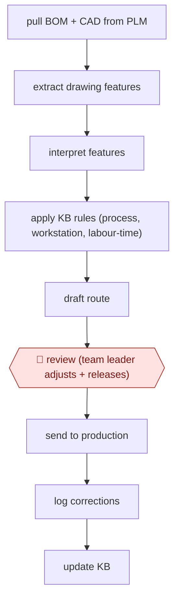

# Drawing-to-route draft

`TEC › ENG › MFG` · checkpointed · evidence B · **draft: needs a reference example** ([how to add one](../../../../../CONTRIBUTING.md#1-add-an-example-run))

**Shape:** `pull BOM + CAD from PLM → extract drawing features → interpret features → apply KB rules (process, workstation, labour-time) → draft route → 🛑 review (team leader adjusts + releases) → send to production → log corrections → update KB`
**How it differs:** None close. AWF-0022 invoice extract-match-route turns documents into routed transactions, but in finance, with a different deliverable and approver.
**Variants:** `plm-extract` · `vision-llm` · `rules-kb`

<!-- shape diagram: generated by scripts/build_diagrams.py from `shape`; don't edit -->

<!-- end shape diagram -->

## Steps
1. Pull the BOM and CAD drawings for each new part from the PLM system [[1]](#sources).
2. Extract features with image processing, then interpret them with a visual reasoning model to identify the processes each workpiece needs (bending, milling, drilling, welding and so on) [[1]](#sources).
3. Apply a structured knowledge base of workstation rules, process definitions and labour-time logic. Generate a draft route with workstation assignments and labour-hour estimates [[1]](#sources).
4. 🛑 **Review**: the team leader checks the draft route, adjusts it as needed, and submits it to production. Any output can be corrected by hand [[1]](#sources).
5. Log every change. Team leaders update the knowledge base as processes evolve, so the system improves over time [[1]](#sources).

**Output:** A released process route (steps, workstations, labour hours) that goes to production scheduling and crews.
**Failure modes → guards:** Specialised drawings that no single model can read → layered pipeline (image features → visual reasoning → rules KB). Wrong routes → mandatory leader review and release, with a change log feeding the knowledge base [[1]](#sources).

## Public runs

Coverage as of 2026-11-06: **Weak**: only anonymous, vendor-linked or journalist-told accounts. Collected and re-checked in [New workflows for empty categories](../../../../../research/2026-11-new-workflows.md).

- [HKU CAMO, Scaling Expert Knowledge with AI at CIMC](https://camo.hku.hk/nanocase-scalingexpertknowledgewithaiatcimc/) (2026-03-31). CIMC Tianda routing agent drafts routes; team leaders review and release. "the dedicated staffing footprint has decreased from 18 people to 2"; "accuracy has reached approximately 95%". *First-hand: no (third-party academic case study); confidence: med.*

## Sources

1. Jie Gong, Augustus Pan, Harry Zhang (HKU Centre for AI, Management and Organization), Scaling Expert Knowledge with AI at CIMC, 2026-03-31. https://camo.hku.hk/nanocase-scalingexpertknowledgewithaiatcimc/
