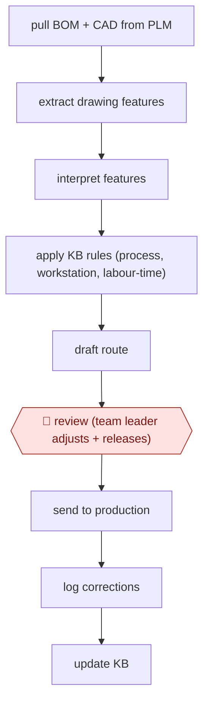

# Drawing-to-route draft

`TEC › ENG › MFG` · checkpointed · evidence B · **draft: needs a reference example** ([how to add one](../../../../../CONTRIBUTING.md#1-add-an-example-run))

**Shape:** `pull BOM + CAD from PLM → extract drawing features → interpret features → apply KB rules (process, workstation, labour-time) → draft route → 🛑 review (team leader adjusts + releases) → send to production → log corrections → update KB`
**Variants:** `plm-extract` · `vision-llm` · `rules-kb`

<!-- shape diagram: generated by scripts/build_diagrams.py from `shape`; don't edit -->

<!-- end shape diagram -->

## Background

A fabrication shop that bends, welds and machines metal has to decide, for every new part, how it will be made: which operations in which order, at which workstation, and how many labour hours to allow. That decision is called the process route (工艺路线) and it drives scheduling, costing and what the crews are told to do. It is normally made by an experienced planner who reads the part's drawing — dimensions, tolerances, material, surface treatment — and matches what he sees against the shop's hard-won rules about which machine can hold which tolerance and how long each step takes. It is slow because every part gets read by hand, and it is fragile because the knowledge sits in a few heads near retirement. Here the agent reads the bill of materials and the drawings pulled from the product data system, lists the features each part needs, applies the shop's rules to draft a route with workstations and hours, and writes down which rules it could not apply. The team leader still checks every draft, adjusts it, and releases it to production; corrections are written back into the rules so the next draft is better. That stop is not removable: releasing a route commits the shop's machines and hours, and a wrong route is paid for in late orders and rework.

**Terms:**
- **PLM** (product lifecycle management): the system holding the bill of materials, drawings and revisions for each product.
- **BOM** (bill of materials): the parts list for an assembly.
- **process route / routing** (工艺路线): the ordered operations for a part, with the workstation and labour hours for each.
- **workstation** (工位): one place on the floor where an operation happens, with its own machine and skill.
- **labour-hour estimate** (工时): the standard time allowed for an operation, used for costing and scheduling.
- **feature**: a shape the drawing calls out — a bend, a hole pattern, a weld seam — which is what decides the operation.
- **knowledge base** here: the shop's written rules for choosing processes, workstations and times, kept as a structured document.
- **release**: the planner's act of accepting a route, after which production schedules against it.

## Build it with an agent

**Form:** `skill`. One planner drafts one part's route in a conversation and one team leader releases it; the shop's rules are reference files, and nothing else about the work needs a bigger form.

**You need:** read access to the PLM, through an MCP connector or an export script that puts the BOM rows and drawings in a working folder; the drawing files as PDF or image, plus a script that renders each sheet at a legible resolution; the shop's rule set as structured files beside the skill — processes, workstation capability, labour-time tables — and a few released routes from the past to check the draft against; the route table's own template, in the format the plant system accepts. The agent must have no write access to the production or scheduling system.

| Step | Built as |
|---|---|
| pull BOM + CAD from PLM | An MCP connector, or a script beside the skill that exports one part's BOM rows and drawings into the working folder and names them by part number. |
| extract drawing features → interpret features | One pass by the Skill: it reads every sheet and the part model's views and writes a feature list per part — bends, holes, weld seams, tolerances — with the sheet and callout it read each from. |
| apply KB rules (process, workstation, labour-time) | The rules sit as reference files; the Skill applies them and cites, for each line of the draft, the rule that produced it. |
| draft route | The Skill writes the route table — operation, workstation, hours, and the rule behind each line — plus a short list of the features no rule covers. |
| 🛑 review (team leader adjusts + releases) | The Skill stops with the table; the leader edits it and releases it in the plant system by hand, and the agent has no tool that can submit a route. |
| send to production → log corrections → update KB | After the run, the leader replies with what he changed; the Skill appends the diff to the rule files as a proposed change for the process engineer to accept, so the correction is reviewed like any other edit. |

**Checkpoints:** `review`: the Skill ends its turn with the draft route and the uncovered features, and the release happens in the plant system, which the agent has no credentials or tool for. Every later correction is written as a proposed diff against the rule files rather than applied silently, so a wrong lesson cannot enter the knowledge base unnoticed.

**Since the sources:** Sources date from 2026-03: one third-party academic case study, which is also the entry's public run. Its page refused an automated reader this month (HTTP 403) and was not opened again; the entry is flagged `source-unreachable` and rests on the text collected when it was first read. The study's method — image processing to find features, a visual reasoning model to name the process, then a rules knowledge base — is reported as a layered pipeline, and that layering was a workaround for models that could not read a drawing reliably. It is superseded for this job: a vision-capable general agent reads the sheets and applies written rules in one pass, which is what the build does, and the entry is flagged `outdated-method` on that point while Steps stay the record of what was reported. Newer accounts of the same practice are vendor material, not runs: a 2026 article from a Chinese manufacturing-software vendor describes agents that parse CAD and PDF drawings and [produce a BOM plus a draft route with operation steps and hour estimates](https://www.xiaogongdan.cn/news/industrial-ai-manufacturing-agents-drawing-parsing-guide.html) (undated, opened this month), which is the same claim with no case behind it. What still cannot be done with a general agent: certifying the route against the shop's liability and quality rules, which is why a person releases it.

*A design based on this entry's steps and the tool documentation as of 2026-11, not a reported run.*

## Steps

*As reported by the sources.*

1. Pull the BOM and CAD drawings for each new part from the PLM system [[1]](#sources).
2. Extract features with image processing, then interpret them with a visual reasoning model to identify the processes each workpiece needs (bending, milling, drilling, welding and so on) [[1]](#sources).
3. Apply a structured knowledge base of workstation rules, process definitions and labour-time logic. Generate a draft route with workstation assignments and labour-hour estimates [[1]](#sources).
4. 🛑 **Review**: the team leader checks the draft route, adjusts it as needed, and submits it to production. Any output can be corrected by hand [[1]](#sources).
5. Log every change. Team leaders update the knowledge base as processes evolve, so the system improves over time [[1]](#sources).

**Output:** A released process route (steps, workstations, labour hours) that goes to production scheduling and crews.
**Failure modes → guards:** Specialised drawings that no single model can read → layered pipeline (image features → visual reasoning → rules KB). Wrong routes → mandatory leader review and release, with a change log feeding the knowledge base [[1]](#sources).
**How it differs:** None close. AWF-0022 invoice extract-match-route turns documents into routed transactions, but in finance, with a different deliverable and approver.

## Public runs

Coverage as of 2026-11-06: **Weak**: only anonymous, vendor-linked or journalist-told accounts. Collected and re-checked in [New workflows for empty categories](../../../../../research/2026-11-new-workflows.md).

- [HKU CAMO, Scaling Expert Knowledge with AI at CIMC](https://camo.hku.hk/nanocase-scalingexpertknowledgewithaiatcimc/) (2026-03-31). CIMC Tianda routing agent drafts routes; team leaders review and release. "the dedicated staffing footprint has decreased from 18 people to 2"; "accuracy has reached approximately 95%". *First-hand: no (third-party academic case study); confidence: med.*

## Sources

1. Jie Gong, Augustus Pan, Harry Zhang (HKU Centre for AI, Management and Organization), Scaling Expert Knowledge with AI at CIMC, 2026-03-31. https://camo.hku.hk/nanocase-scalingexpertknowledgewithaiatcimc/
