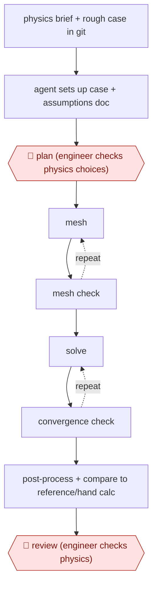

# Engineer-checked CFD run

`TEC › ENG › SIM` · checkpointed · evidence A · **draft: needs a reference example** ([how to add one](../../../../../CONTRIBUTING.md#1-add-an-example-run))

**Shape:** `physics brief + rough case in git → agent sets up case + assumptions doc → 🛑 plan (engineer checks physics choices) → (mesh ⟲ mesh check) → (solve ⟲ convergence check) → post-process + compare to reference/hand calc → 🛑 review (engineer checks physics)`
**How it differs:** None close. SRE and FEAT workflows act on code. This one acts on solver cases, and its acceptance gate is physics validation.
**Variants:** `openfoam` · `snappyhexmesh` · `gmsh` · `calculix` · `paraview-pvpython`

<!-- shape diagram: generated by scripts/build_diagrams.py from `shape`; don't edit -->

<!-- end shape diagram -->

## Steps
1. Create the CAD and domain as usual. Put a rough OpenFOAM case in a GitHub repo so every change the agent makes can be diffed [[3]](#sources).
2. The agent sets up the case from a plain-language brief: solver choice, turbulence model, inlet turbulence derived from first principles, domain sizing. It writes a document listing the equations, assumptions and values used [[2]](#sources)[[3]](#sources).
3. 🛑 **Plan**: the engineer reads the assumptions document and the git diff before trusting the setup [[3]](#sources). In the tool-based version, a human approves gated actions [[1]](#sources).
4. Mesh and check the mesh. If the solve diverges, the agent inspects and regenerates the mesh. Script a mesh study (for example three snappyHexMesh meshes), run it, and fix errors [[2]](#sources)[[3]](#sources).
5. Solve until convergence. Cross-check the solver's convergence message against clean exit and divergence detection, because timeouts and kills can look like convergence [[1]](#sources). Refine the mesh again if the case does not converge [[3]](#sources).
6. Post-process with scripted ParaView/Python plots. Compare results to a published experiment or reference case, or to a hand calculation in the FEA variant [[1]](#sources)[[4]](#sources). Flag non-physical results such as efficiency above 1 instead of hiding them [[1]](#sources).
7. 🛑 **Review**: the responsible engineer checks the physics and the validation before any design decision. Authors stress the results are unvalidated predictions until checked against experiments [[2]](#sources)[[3]](#sources)[[4]](#sources).

**Output:** A converged case in git, plots and renders, and a report with a validation-vs-reference table. It goes to the engineer who signs the design call.
**Failure modes → guards:** Wrong boundary conditions that still converge (a rotating wall left as noSlip, so the blades never spun) → swirl probe and a human-judgment diagnostic checklist [[1]](#sources). Fake convergence → convergence cross-checks [[1]](#sources). Plausible but wrong turbulence choice → engineer reviews the assumptions document and the comparison to experiment [[2]](#sources)[[3]](#sources).

## Public runs

Coverage as of 2026-11-06: **Strong**: a first-hand, detailed run that matches most of the shape. Collected and re-checked in [New workflows for empty categories](../../../../../research/2026-11-new-workflows.md).

- [jwjoo00, myOpenFoamAgent](https://github.com/jwjoo00/myOpenFoamAgent) (2026-08-01). Agent-run propeller MRF case validated against published experiment, with human-approved gated actions. "Kt = 0.1476 vs 0.146 measured". *First-hand: yes; confidence: high.*
- [Fayaz Rasheed, LLM-Orchestrated CFD](https://fayazrasheed.com/blog/llm-orchestrated-cfd-bear-aerodynamics.html) (2026-06). Full mesh-solve-optimise-render study; author flags results as unvalidated. "a reshaped belly brought it down to 0.593, a 9.2% reduction". *First-hand: anon (the engineer is not named); confidence: med.*

## Sources

1. jwjoo00, myOpenFoamAgent (GitHub README), 2026. https://github.com/jwjoo00/myOpenFoamAgent
2. Dr. Fayaz Rasheed, LLM-Orchestrated CFD: How Claude Opus Can Run a Complete Aerodynamics Study, June 2026. https://fayazrasheed.com/blog/llm-orchestrated-cfd-bear-aerodynamics.html
3. Baqer Alkurayşı, If you want free CFD software that is easier to learn and use (LinkedIn), 2026-05-02. https://www.linkedin.com/posts/baqer-alkuray%C5%9F%C4%B1-913b0822a_if-you-want-free-cfd-software-that-is-easier-activity-7456132078947045376-_7a-
4. Shane Chalupa, Claude Code for Finite Element Analysis: My FEA Demo (YouTube). https://www.youtube.com/watch?v=KwWs33y6fG4 (video; the timing claim could not be re-checked)
