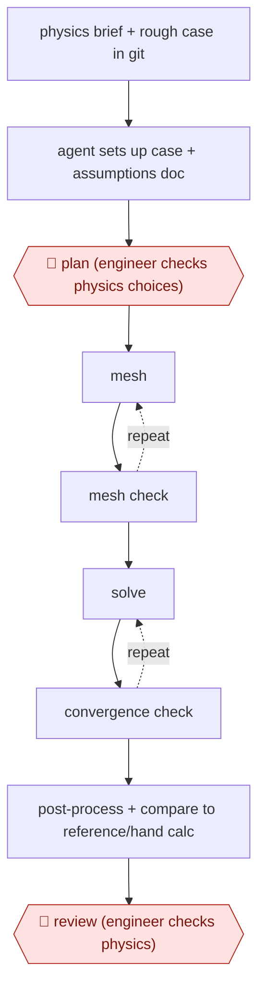

# Engineer-checked CFD run

`TEC › ENG › SIM` · checkpointed · evidence A · **draft: needs a reference example** ([how to add one](../../../../../CONTRIBUTING.md#1-add-an-example-run))

**Shape:** `physics brief + rough case in git → agent sets up case + assumptions doc → 🛑 plan (engineer checks physics choices) → (mesh ⟲ mesh check) → (solve ⟲ convergence check) → post-process + compare to reference/hand calc → 🛑 review (engineer checks physics)`
**Variants:** `openfoam` · `snappyhexmesh` · `gmsh` · `calculix` · `paraview-pvpython`

<!-- shape diagram: generated by scripts/build_diagrams.py from `shape`; don't edit -->

<!-- end shape diagram -->

## Background

Computational fluid dynamics (CFD) answers questions about how air or liquid moves — how much lift a shape produces, whether a part will cool — by dividing the space around the object into millions of small cells and solving the flow equations in each one over time. A simulation engineer sets the case up: the geometry and the region to solve, the equations that describe the fluid, the conditions at the edges of the region, and the mesh of cells. Two things make it slow and easy to get wrong. Getting a converged answer takes many runs: the mesh has to be refined, the solver restarted, and the run watched. And a converged result can still be physically wrong — a boundary condition typed once and never revisited, a turbulence model that does not suit the flow — with nothing in the solver's output saying so. Here the agent sets the case up from a plain-language brief, writes down every equation, assumption and value it used, runs the mesh and solver loops, and compares the result to a published experiment or a hand calculation. The engineer approves the physics choices before any compute is spent and checks the comparison before anyone acts on the number: a design decision made on an unvalidated simulation is the engineer's to defend, not the agent's.

**Terms:**
- **CFD** (computational fluid dynamics): predicting flow by solving the fluid equations numerically.
- **solver**: the program that advances those equations, here OpenFOAM.
- **mesh**: the cells the space is divided into; too coarse and the answer is wrong, too fine and it never finishes.
- **boundary condition**: what the fluid is told at the edges — speed in, pressure out, a wall that spins or does not.
- **turbulence model**: the approximation used instead of resolving every eddy, which has to suit the kind of flow.
- **convergence**: the solver's residuals settling, meaning the numbers stopped changing; it does not mean they are right.
- **residual**: the remaining error in each equation after an iteration.
- **post-processing**: turning the fields into pictures and numbers — lift, drag, pressure plots.
- **validation**: comparing the result with measurement or an independent reference, which is the only evidence that the setup is right.

## Build it with an agent

**Form:** `skill`. One engineer runs one case and stays in the conversation, with two stops; the case scripts and the checklists sit beside the skill in the case's repository.

**You need:** the case in a git repository, with a rough starting case and the geometry; OpenFOAM and a mesher installed where the agent can run them; a plotting route (ParaView's Python interface or matplotlib) that writes images without a screen; the published experiment or reference case to compare against, or the hand calculation; a machine that can be left running. The agent must not be able to plot or write anything into the design record the engineer signs.

| Step | Built as |
|---|---|
| physics brief + rough case in git | The engineer's preparation: repository conventions (units, naming, where results go) in `CLAUDE.md`, so every run is laid out the same way and diffs stay readable. |
| agent sets up case + assumptions doc | The Skill writes the case files and an assumptions document — equations, model choice, boundary values, why each was chosen — as the first commit on a branch. |
| 🛑 plan (engineer checks physics choices) | The Skill stops after the assumptions document and the diff; plan mode, or a `PreToolUse` hook that refuses any solver run until the engineer's approval is recorded in the repository. |
| mesh ⟲ mesh check | A script beside the Skill builds the mesh and runs the mesher's own check; the Skill reads the report, fixes what it can, and loops; a mesh study of several refinements is a script with a parameter. |
| solve ⟲ convergence check | The solver runs from a script in the background; a second script decides convergence from residuals, exit status and divergence markers rather than from a timeout, and the Skill diagnoses and re-runs. |
| post-process + compare to reference/hand calc | A plotting script writes the images and a comparison table; the Skill fills the table with the reference values it was given and flags non-physical results instead of smoothing them. |
| 🛑 review (engineer checks physics) | The Skill stops with the report, the comparison table and the open questions; the engineer signs in their own record, and the agent has no tool that writes to it. |

**Checkpoints:** `plan`: no compute is spent before the engineer has read the assumptions document and the diff, and a hook blocks solver runs until the approval exists, so a plausible-but-wrong turbulence choice cannot quietly produce a full campaign. `review`: the report and the comparison table go to the engineer, who signs outside the repository's agent-writable area; the build gives the agent no tool that publishes or files the report.

**Since the sources:** Sources date from 2026-05 to 2026-08 (one repository, two write-ups); the video source is undated. The GitHub repository was opened this month, the two blogs were not re-opened on this pass. What has changed since: the sources build the checking loop by hand — a mesh study script, a convergence cross-check, a comparison table. Work published since then makes the checks the deciding part rather than the model's opinion: [CFD Forge](https://arxiv.org/abs/2610.14104) (2026-10) registers deterministic acceptance checks per flow type and shows a model accepting faulty states when it judges alone, and [AI CFD Scientist](https://arxiv.org/abs/2605.06607) (2026) adds a vision check on the rendered fields because solver logs miss silent failures. Both fit this entry's build as scripts beside the skill: the acceptance criteria belong in code, and the agent's freedom is in the diagnosis. The engineer's two stops are unchanged, and nothing opened this month replaces validation against measurement.

*A design based on this entry's steps and the tool documentation as of 2026-11, not a reported run.*

## Steps

*As reported by the sources.*

1. Create the CAD and domain as usual. Put a rough OpenFOAM case in a GitHub repo so every change the agent makes can be diffed [[3]](#sources).
2. The agent sets up the case from a plain-language brief: solver choice, turbulence model, inlet turbulence derived from first principles, domain sizing. It writes a document listing the equations, assumptions and values used [[2]](#sources)[[3]](#sources).
3. 🛑 **Plan**: the engineer reads the assumptions document and the git diff before trusting the setup [[3]](#sources). In the tool-based version, a human approves gated actions [[1]](#sources).
4. Mesh and check the mesh. If the solve diverges, the agent inspects and regenerates the mesh. Script a mesh study (for example three snappyHexMesh meshes), run it, and fix errors [[2]](#sources)[[3]](#sources).
5. Solve until convergence. Cross-check the solver's convergence message against clean exit and divergence detection, because timeouts and kills can look like convergence [[1]](#sources). Refine the mesh again if the case does not converge [[3]](#sources).
6. Post-process with scripted ParaView/Python plots. Compare results to a published experiment or reference case, or to a hand calculation in the FEA variant [[1]](#sources)[[4]](#sources). Flag non-physical results such as efficiency above 1 instead of hiding them [[1]](#sources).
7. 🛑 **Review**: the responsible engineer checks the physics and the validation before any design decision. Authors stress the results are unvalidated predictions until checked against experiments [[2]](#sources)[[3]](#sources)[[4]](#sources).

**Output:** A converged case in git, plots and renders, and a report with a validation-vs-reference table. It goes to the engineer who signs the design call.
**Failure modes → guards:** Wrong boundary conditions that still converge (a rotating wall left as noSlip, so the blades never spun) → swirl probe and a human-judgment diagnostic checklist [[1]](#sources). Fake convergence → convergence cross-checks [[1]](#sources). Plausible but wrong turbulence choice → engineer reviews the assumptions document and the comparison to experiment [[2]](#sources)[[3]](#sources).
**How it differs:** None close. SRE and FEAT workflows act on code. This one acts on solver cases, and its acceptance gate is physics validation.

## Public runs

Coverage as of 2026-11-06: **Strong**: a first-hand, detailed run that matches most of the shape. Collected and re-checked in [New workflows for empty categories](../../../../../research/2026-11-new-workflows.md).

- [jwjoo00, myOpenFoamAgent](https://github.com/jwjoo00/myOpenFoamAgent) (2026-08-01). Agent-run propeller MRF case validated against published experiment, with human-approved gated actions. "Kt = 0.1476 vs 0.146 measured". *First-hand: yes; confidence: high.*
- [Fayaz Rasheed, LLM-Orchestrated CFD](https://fayazrasheed.com/blog/llm-orchestrated-cfd-bear-aerodynamics.html) (2026-06). Full mesh-solve-optimise-render study; author flags results as unvalidated. "a reshaped belly brought it down to 0.593, a 9.2% reduction". *First-hand: anon (the engineer is not named); confidence: med.*

## Sources

1. jwjoo00, myOpenFoamAgent (GitHub README), 2026. https://github.com/jwjoo00/myOpenFoamAgent
2. Dr. Fayaz Rasheed, LLM-Orchestrated CFD: How Claude Opus Can Run a Complete Aerodynamics Study, June 2026. https://fayazrasheed.com/blog/llm-orchestrated-cfd-bear-aerodynamics.html
3. Baqer Alkurayşı, If you want free CFD software that is easier to learn and use (LinkedIn), 2026-05-02. https://www.linkedin.com/posts/baqer-alkuray%C5%9F%C4%B1-913b0822a_if-you-want-free-cfd-software-that-is-easier-activity-7456132078947045376-_7a-
4. Shane Chalupa, Claude Code for Finite Element Analysis: My FEA Demo (YouTube). https://www.youtube.com/watch?v=KwWs33y6fG4 (video; the timing claim could not be re-checked)
