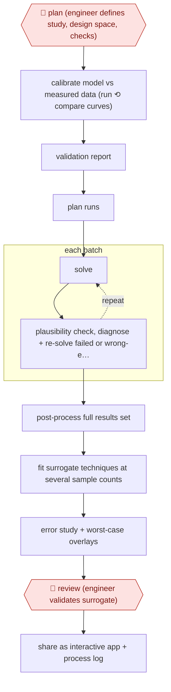

# Unattended simulation campaign

`TEC › ENG › SIM` · checkpointed · evidence B · **draft: needs a reference example** ([how to add one](../../../../../CONTRIBUTING.md#1-add-an-example-run))

**Shape:** `🛑 plan (engineer defines study, design space, checks) → calibrate model vs measured data (run ⟲ compare curves) → validation report → plan runs → each batch: (solve ⟲ plausibility check, diagnose + re-solve failed or wrong-equilibrium runs) → post-process full results set → fit surrogate techniques at several sample counts → error study + worst-case overlays → 🛑 review (engineer validates surrogate) → share as interactive app + process log`
**How it differs:** AWF-0057 Engineer-checked CFD run sets up and solves one case with a physics plan check and a physics review of that case. Here the deliverable is a thousands-of-runs design-of-experiments campaign plus a surrogate model and app; no one checks individual runs, only the study definition and the final surrogate.
**Variants:** `move-platform`

<!-- shape diagram: generated by scripts/build_diagrams.py from `shape`; don't edit -->

<!-- end shape diagram -->

## Steps
1. 🛑 **Plan**: a senior engineer defines the study (parameters, ranges, outputs); the page counts "defining the study" in engineer hands-on time [[1]](#sources).
2. Calibrate the model first: the agent runs the five-link suspension model, compares curves to measured K&C data, finds the bushing stiffnesses explain most of the gap and applies a consistent scaling correction; it writes a validation report [[1]](#sources).
3. Plan the campaign over the design space (38 parameters: 30 hardpoint coordinates within +/-15 mm, seven bushing stiffnesses, spring rate) and run it in batches overnight, locally or on HPC, keeping each result traceable to its inputs [[1]](#sources).
4. Check every result for physical plausibility, catching both non-converged runs and runs that converge to a wrong equilibrium while the solver reports success; work out which parameter combinations break the solver and re-solve [[1]](#sources).
5. Post-process into one results set (kinematic and compliance curves, peak pickup-point loads per configuration) [[1]](#sources).
6. Research candidate surrogate techniques, fit each at different sample counts and quantify error; overlay the six worst predictions on simulated curves [[1]](#sources).
7. 🛑 **Review**: engineer validates the surrogate ("validation" is in the hands-on time) before it is used [[1]](#sources).
8. Package the surrogate as an interactive app for colleagues and keep the agent's documentation of decisions and failures for the next study [[1]](#sources).

**Output:** A results database, a validated surrogate model with an error study, an interactive app, and a documented process the next study starts from.
**Failure modes → guards:** Silently wrong runs (solver reports success at a wrong equilibrium) poison the dataset → per-run plausibility checks [1]. Unvalidated base model makes thousands of wrong answers → calibrate against measurements first [1]. Surrogate weak in some regions → worst-case overlays reviewed [1].

## Public runs

Coverage as of 2026-11-13: **Weak**: only anonymous, vendor-linked or journalist-told accounts. Collected and re-checked in [Third collection pass](../../../../../research/2026-11-third-pass.md).

- [MOVE., AI agents: what it takes to run simulations unattended](https://www.movedot.com/blog/running-unattended-simulations) (2026-07-12). Vendor's own run: calibrated suspension model, overnight multibody campaign, surrogate and app. "the 6,400-run campaign itself finished in 9.7 hours overnight"; engineer-time savings are labelled "Estimate based on comparable published CAE workflows". *First-hand: vendor; confidence: med.*

## Sources

1. Bruno Finco, MOVE., AI agents: what it takes to run simulations unattended, 2026-07-12. https://www.movedot.com/blog/running-unattended-simulations
