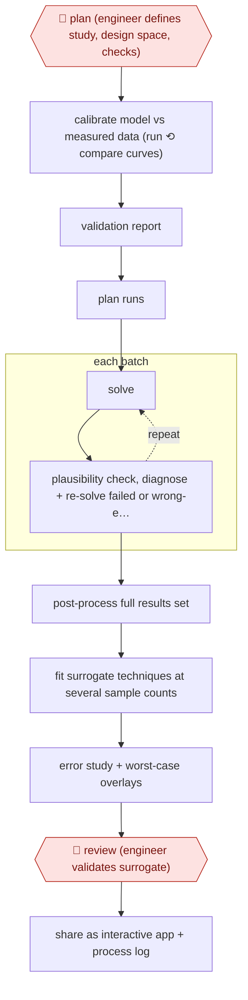

# Unattended simulation campaign

`TEC › ENG › SIM` · checkpointed · evidence B · **draft: needs a reference example** ([how to add one](../../../../../CONTRIBUTING.md#1-add-an-example-run))

**Shape:** `🛑 plan (engineer defines study, design space, checks) → calibrate model vs measured data (run ⟲ compare curves) → validation report → plan runs → each batch: (solve ⟲ plausibility check, diagnose + re-solve failed or wrong-equilibrium runs) → post-process full results set → fit surrogate techniques at several sample counts → error study + worst-case overlays → 🛑 review (engineer validates surrogate) → share as interactive app + process log`
**Variants:** `move-platform`

<!-- shape diagram: generated by scripts/build_diagrams.py from `shape`; don't edit -->

<!-- end shape diagram -->

## Background

An engineering team designing a vehicle's suspension wants to know how it behaves across thousands of combinations: every hardpoint moved a little this way and that, every bushing made softer or stiffer. Rather than building and testing each one, they simulate: a multibody model predicts how the wheels move and what loads the parts see. Running one simulation answers one question; the questions that matter need a design of experiments — a planned sweep over the parameter space — and a surrogate model, which is a fast approximation fitted to the simulated results so that a configuration can be looked up in seconds instead of run for an hour. The bottleneck is not the solver but the person in the middle: setting up runs, watching them, diagnosing the ones that fail, and processing the output by hand. Here an agent runs the campaign overnight on a validated model: it plans the runs, executes them in batches, catches failures including the dangerous ones where the solver reports success at a wrong answer, fits several surrogate techniques at different sample counts, and works out where the approximation is weakest. Nothing about that is safe without two human stops. A senior engineer defines the study and the acceptance checks before a single run is spent, because a campaign on an uncalibrated model produces thousands of confident wrong answers; and the engineer validates the surrogate before anyone designs against it.

**Terms:**
- **multibody simulation**: predicting the motion of connected rigid bodies (links, bushings, springs) under load.
- **K&C** (kinematics and compliance): the measured or simulated relationship between wheel movement and the forces applied, used to check a suspension model against a real one.
- **hardpoint**: a point where a suspension link attaches, given by coordinates the designer can move.
- **bushing stiffness**: how much a rubber or polymer joint deflects under load; it strongly affects the predicted behaviour.
- **design of experiments**: a planned set of runs chosen to cover a parameter space efficiently.
- **surrogate model**: a fast statistical approximation of the simulator, fitted to completed runs.
- **equilibrium**: the settled state a solver converges to; converging to the wrong one looks like success.
- **sample count**: how many simulated runs a surrogate is fitted on, which sets its accuracy.
- **HPC**: a cluster of machines that runs many simulations in parallel.

## Build it with an agent

**Form:** `service`. The campaign runs overnight in batches with nobody at the keyboard; the engineer sees a plan to approve and, at the end, a surrogate to validate, and works the failures from a queue.

**You need:** a solver that can run headless, on the engineer's workstation or an HPC queue, with a licence that allows batch use; the calibrated model and the measured data it is calibrated against; a state store outside the conversation — a database table or a directory of run records — holding the run queue, each run's inputs, status and result path; a compute account the agent can submit jobs with; the engineer's study definition and acceptance checks as a file; the plotting and fitting libraries, scripted. The agent must have no way to publish the surrogate application or to write into the design record.

| Step | Built as |
|---|---|
| 🛑 plan (engineer defines study, design space, checks) | The agent drafts the study file — parameters, ranges, outputs, acceptance checks — and posts it to the engineer's queue; no run is submitted until the approved version is in the state store, and a `PreToolUse` hook refuses submission otherwise. |
| calibrate model vs measured data (run ⟲ compare curves) → validation report | A script runs the model and overlays it on the measured curves; the Skill proposes the correction, re-runs, and writes the validation report beside the model. |
| plan runs | The Skill writes the run list for the approved design of experiments into the queue, with every input recorded, so each result stays traceable to what produced it. |
| each batch: solve ⟲ plausibility check, diagnose + re-solve | An Agent SDK program pulls a batch from the queue and submits it; a checker script applies the physical plausibility and convergence tests to every result; anything that fails goes to a repair queue with the diagnosis attached, and the program re-submits with corrected settings until the batch is clean. |
| post-process full results set | A script reduces the runs into one results set — curves and peak loads per configuration — and records which runs were discarded and why. |
| fit surrogate techniques at several sample counts → error study + worst-case overlays | Scripted fitting over subsets of the results; the Skill compares the techniques, writes the error study, and plots the worst predictions over the simulated curves. |
| 🛑 review (engineer validates surrogate) | The Skill assembles a validation packet — error study, worst-case overlays, discarded runs, open doubts — and puts it in the review queue; the surrogate is not released for use until the engineer signs, and the agent holds no tool that publishes it. |
| share as interactive app + process log | The app is built by a script from the fitted surrogate; publishing it to colleagues is a person's step, and the Skill's own decision log is committed next to the study so the next campaign starts from it. |

**Checkpoints:** `plan`: the run cannot start without an approved study file, and submission is blocked by a hook rather than by an instruction, because a campaign is expensive and irreversible in compute terms. `review`: the validation packet goes to a review queue and the agent has no publish or sign-off tool, so a surrogate nobody has checked cannot reach the designers; discarded runs are listed in the packet, so a silently wrong run cannot disappear from the record.

**Since the sources:** Sources date from 2026-07: one vendor write-up, which is also the entry's public run. Its page was opened this month. The vendor has since published [a second account of the same approach](https://www.movedot.ai/blog/closing-the-loop-between-simulation-driver-in-the-loop-and-real-measurements) (2026-05-29) that extends it to driver-in-the-loop rigs and physical measurement, and in 2026-09 announced [a partnership with HBK and VI-grade](https://www.vi-grade.com/en/about/news/hbk-vi-grade-and-movedot-partner-to-bring-ai-agents-to-simulation-and-physical-testing-3424) to run its agents inside those vendors' simulation and test tools. What that changes for this build: the connector work moves toward commercial toolchains, so the scripts above are the part a team still writes itself, and the study definition and the validation packet are the part that must stay with the engineer. What does not change: the checks that catch a wrong-equilibrium run are gate logic, not model judgement, and the vendor's own figures label engineer-time savings as an estimate rather than a measurement.

*A design based on this entry's steps and the tool documentation as of 2026-11, not a reported run.*

## Steps

*As reported by the sources.*

1. 🛑 **Plan**: a senior engineer defines the study (parameters, ranges, outputs); the page counts "defining the study" in engineer hands-on time [[1]](#sources).
2. Calibrate the model first: the agent runs the five-link suspension model, compares curves to measured K&C data, finds the bushing stiffnesses explain most of the gap and applies a consistent scaling correction; it writes a validation report [[1]](#sources).
3. Plan the campaign over the design space (38 parameters: 30 hardpoint coordinates within +/-15 mm, seven bushing stiffnesses, spring rate) and run it in batches overnight, locally or on HPC, keeping each result traceable to its inputs [[1]](#sources).
4. Check every result for physical plausibility, catching both non-converged runs and runs that converge to a wrong equilibrium while the solver reports success; work out which parameter combinations break the solver and re-solve [[1]](#sources).
5. Post-process into one results set (kinematic and compliance curves, peak pickup-point loads per configuration) [[1]](#sources).
6. Research candidate surrogate techniques, fit each at different sample counts and quantify error; overlay the six worst predictions on simulated curves [[1]](#sources).
7. 🛑 **Review**: engineer validates the surrogate ("validation" is in the hands-on time) before it is used [[1]](#sources).
8. Package the surrogate as an interactive app for colleagues and keep the agent's documentation of decisions and failures for the next study [[1]](#sources).

**Output:** A results database, a validated surrogate model with an error study, an interactive app, and a documented process the next study starts from.
**Failure modes → guards:** Silently wrong runs (solver reports success at a wrong equilibrium) poison the dataset → per-run plausibility checks [1]. Unvalidated base model makes thousands of wrong answers → calibrate against measurements first [1]. Surrogate weak in some regions → worst-case overlays reviewed [1].
**How it differs:** AWF-0057 Engineer-checked CFD run sets up and solves one case with a physics plan check and a physics review of that case. Here the deliverable is a thousands-of-runs design-of-experiments campaign plus a surrogate model and app; no one checks individual runs, only the study definition and the final surrogate.

## Public runs

Coverage as of 2026-11-13: **Weak**: only anonymous, vendor-linked or journalist-told accounts. Collected and re-checked in [Third collection pass](../../../../../research/2026-11-third-pass.md).

- [MOVE., AI agents: what it takes to run simulations unattended](https://www.movedot.com/blog/running-unattended-simulations) (2026-07-12). Vendor's own run: calibrated suspension model, overnight multibody campaign, surrogate and app. "the 6,400-run campaign itself finished in 9.7 hours overnight"; engineer-time savings are labelled "Estimate based on comparable published CAE workflows". *First-hand: vendor; confidence: med.*

## Sources

1. Bruno Finco, MOVE., AI agents: what it takes to run simulations unattended, 2026-07-12. https://www.movedot.com/blog/running-unattended-simulations
