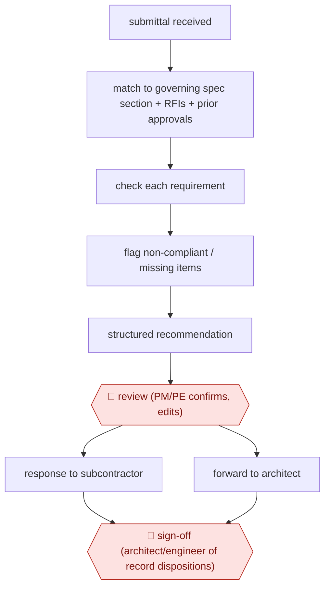

# First-pass submittal review

`TEC › ENG › SUBMITTAL` · checkpointed · evidence B · **draft: needs a reference example** ([how to add one](../../../../../CONTRIBUTING.md#1-add-an-example-run))

**Shape:** `submittal received → match to governing spec section + RFIs + prior approvals → check each requirement → flag non-compliant / missing items → structured recommendation → 🛑 review (PM/PE confirms, edits) → response to subcontractor | forward to architect → 🛑 sign-off (architect/engineer of record dispositions)`
**Variants:** `trunk-tools` · `procore-datagrid` · `buildsync`

<!-- shape diagram: generated by scripts/build_diagrams.py from `shape`; don't edit -->

<!-- end shape diagram -->

## Background

On a construction project the contractor does not install what it likes: for each product, assembly or shop drawing it must show the design team, before anything is ordered or built, that what it proposes meets the specification. That package is a submittal — a catalogue page, a data sheet, a test certificate, a fabrication drawing — and on a mid-size commercial job there are hundreds to a couple of thousand of them, each with a contractual review clock. The contractor's project engineer reads the package against the relevant specification section, the answers already given in requests for information, and what was approved earlier on the project, then either returns it to the subcontractor to fix or forwards it to the architect, who stamps it approved, approved as noted or revise and resubmit. The reading is where the time goes, and a missed deviation surfaces later in the field as a ripped-out installation. Here a check runs the moment a package arrives: it finds the governing specification section, tests each requirement against the submitted documents, and puts a recommendation in the project engineer's queue. The engineer confirms or rewrites it, and the disposition that carries contractual weight is still the architect's or engineer of record's act, in their own system.

**Terms:**
- **submittal**: the documents a contractor sends to show that a product or assembly meets the specification, before buying or building it.
- **specification section**: the numbered part of the project manual that governs one trade or product, following a standard division numbering.
- **shop drawing**: a fabricator's drawing showing how a component will actually be made and installed.
- **RFI** (request for information): a formal question from the contractor, whose answer can change what a submittal must show.
- **disposition**: the reviewer's stamp: approved, approved as noted, or revise and resubmit.
- **revise and resubmit**: the answer that sends a package back for correction, costing a full cycle.
- **PM / PE**: the contractor's project manager and project engineer, who run submittals day to day.
- **engineer of record**: the licensed engineer whose seal makes the design authoritative; only they or the architect can disposition a submittal.

## Build it with an agent

**Form:** `service`. Packages arrive on their own schedule from many subcontractors and the check must run without anyone starting it; the project engineer sees a recommendation per package and answers it from a queue.

**You need:** read access to the project management platform — the submittal log, the current specification set and addenda, the RFI log, and the record of earlier approvals, through an MCP connector; the requirement text for each specification section in a form the check can cite; a place to keep per-package results keyed by package number and revision; the project engineer's queue. The agent must have no tool that returns a package to a subcontractor or applies a disposition stamp: both are contractual acts.

| Step | Built as |
|---|---|
| submittal received | A watch on the platform's submittal module, or a webhook, starts one run per package revision; a resubmittal is a new run that also reads the earlier one. |
| match to governing spec section + RFIs + prior approvals | The package's own spec reference is the starting point; a retrieval step pulls that section, every RFI whose answer touches it, and any earlier approved product in the same section. |
| check each requirement → flag non-compliant / missing items | One Subagent per group of requirements, each given only that group's clauses and the submitted pages, returning compliant, partially compliant or non-compliant with the clause and the page it read. |
| structured recommendation | The Skill assembles the compliance table plus the recommendation and the open questions, and writes it against the package where the engineer will look for it. |
| 🛑 review (PM/PE confirms, edits) → response to subcontractor | The run ends with the table in the engineer's queue; the return-to-subcontractor action is a platform permission the engineer holds and the run does not. |
| forward to architect → 🛑 sign-off (architect/engineer of record dispositions) | The package, with the engineer's edits and the compliance table attached, is forwarded by the engineer; the disposition stamp is applied by the architect or engineer of record in the platform, outside every tool the agent holds. |

**Checkpoints:** `review`: the run cannot send anything. Its output is a table in the engineer's queue, and the two platform actions that matter — returning the package to the subcontractor and forwarding it with a recommendation — are permissions it does not have. `sign-off`: the disposition is a licensed act, so the build gives the agent no tool that stamps, approves or files; it also keeps the compliance table attached to the package so the architect sees what was checked and what was not.

**Since the sources:** Sources date from 2025-09 to 2026-11-02: vendor case studies, two trade-press interviews, and a platform case study. The vendor's 2026 comparison of this software category was opened this month; the individual case studies were not re-opened on this pass. What has changed since: the trigger. The comparison reports that [one product runs its review automatically when a package is uploaded while others start only when a person prompts them](https://trunktools.com/blog/best-construction-submittal-software), and that coverage of submittal types differs widely between products — which matters here, because a service build is only worth running unattended if the trigger is automatic and the covered types include what the project actually submits. The two human acts are unchanged in every account: a person still makes the final call, and the architect still stamps the disposition.

*A design based on this entry's steps and the tool documentation as of 2026-11, not a reported run.*

## Steps

*As reported by the sources.*

1. When a submittal arrives, compare it to project specifications, relevant RFI responses and previously approved submittals [[1]](#sources).
2. Flag non-compliant line items and generate a structured recommendation 'in minutes' [[1]](#sources).
3. 🛑 **Review**: the assistant PM or project engineer acts on the analysis and responds to the subcontractor [[1]](#sources).
4. 🛑 **Sign-off**: approval stays with the reviewer of record; Procore's agents 'require human consent before actions are finalized' [[2]](#sources).

**Output:** Corrected submittal routed to the architect, so it doesn't come back as Revise and Resubmit.
**Failure modes → guards:** Missed non-compliance shows up in the field → requirement-by-requirement check. Superseded specs → reads the current project set from the project-management system.

**How it differs:** AWF-0058 Cited pre-screen checks screens a permit applicant's plan set for code compliance. Here the contractor checks a subcontractor's product data and shop drawings against the project spec. Different deliverable (submittal response) and different approver (PM, then architect of record).
**Recent practice (2026):**
- Check each requirement: label each one compliant, partially compliant or non-compliant so the reviewer works the exceptions (ENR 2026-06-17).
- Response to subcontractor: return the AI report and auto-markups with the reviewer's direction; when forwarding to the architect, attach the compliance table (BuildSync; ENR 2026-06-17). [[5]](#sources)

## Public runs

Coverage as of 2026-11-06: **Partial**: first-hand runs that cover part of the shape or put checkpoints elsewhere. Collected and re-checked in [Second collection pass](../../../../../research/2026-11-second-pass.md). More runs added in [Third collection pass](../../../../../research/2026-11-third-pass.md).

- [Trunk Tools, Cleveland Construction](https://trunktools.com/content/customers/pdfs/cleveland.pdf) (n.d.). Electrical submittal turned around the same day; quotes from the assistant PM. "estimated savings of 790+ hours and $60K+ across four projects". *First-hand: vendor; confidence: med.*
- [ENGtechnica, Procore/Datagrid](https://engtechnica.com/procore-embeds-datagrid-ai-agents-in-construction-workflows/) (2026-05-22). Level 10 Construction built its own submittal agent. "We ran 10 submittal reviews in an hour using our agent, easily saving 12 hours of work". *First-hand: interview; confidence: med.*
- [Bryan Gottlieb, ENR, Trunk Tools Launches Cortex AI Platform](https://www.enr.com/articles/63178-trunk-tools-launches-cortex-ai-platform-to-interpret-construction-drawings) (2026-06-17). Cleveland Construction SVP: submittals routed through AI before staff review; compliance tables sent to architects. "reducing average submittal cycle times from 55 days to 13 days"; "from roughly two hours to less than 10 minutes". *First-hand: interview; confidence: med.*
- [Jeff Yoders, ENR, Gilbane Rolls Out Trunk Tools AI Agents Across Its Jobsites](https://www.enr.com/articles/61435-gilbane-rolls-out-trunk-tools-ai-agents-across-its-jobsites) (2025-09-26). 30 Gilbane projects; most incoming submittals flagged non-compliant before going to architects. "review more than 2,000 submittals"; "72% of submittals received ... were non-compliant, 25% partially compliant, and only 3% fully compliant". *First-hand: no; confidence: med.*
- [Trunk Tools, Torcon case study](https://trunktools.com/customers/case-study-how-torcon-project-team-save-time-reduce-risk/) (2026-03-12). Two-project pilot; submittal compliance reviews for project engineers. "64 submittal reviews completed with ~43.5 minutes saved per review (~46 hours)". *First-hand: vendor; confidence: med.*
- [BuildSync, Monteith Construction: Blueprints to Bedside](https://buildsync.ai/case-studies/blueprints-to-bedside) (n.d.). PM runs AI review on every product-data submittal right after submission, inside Procore. "I spend 70% less time reviewing submittals"; "Our failure rate has dropped by around 50%". *First-hand: vendor; confidence: med.*

## Sources

1. Trunk Tools, Case Study: Cleveland Construction x ACC x Trunk Tools. https://trunktools.com/content/customers/pdfs/cleveland.pdf
2. Joydeep Kar, ENGtechnica, Procore Embeds Datagrid AI Agents in Construction Workflows, 2026-05-22. https://engtechnica.com/procore-embeds-datagrid-ai-agents-in-construction-workflows/
3. Procore, Bernards case study, 2026-11-02. https://www.procore.com/casestudies/bernards-ai
4. Bryan Gottlieb, ENR, Trunk Tools Launches Cortex AI Platform to Interpret Construction Drawings, 2026-06-17. https://www.enr.com/articles/63178-trunk-tools-launches-cortex-ai-platform-to-interpret-construction-drawings
5. BuildSync, Blueprints to Bedside (Monteith Construction), n.d. https://buildsync.ai/case-studies/blueprints-to-bedside
