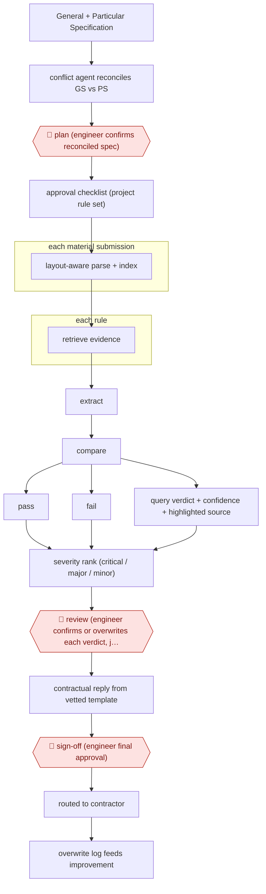

# Rule-set verdict review

`TEC › ENG › SUBMITTAL` · checkpointed · evidence A · **draft: needs a reference example** ([how to add one](../../../../../CONTRIBUTING.md#1-add-an-example-run))

**Shape:** `General + Particular Specification → conflict agent reconciles GS vs PS → 🛑 plan (engineer confirms reconciled spec) → approval checklist (project rule set) → each material submission: layout-aware parse + index → each rule: retrieve evidence → extract → compare → pass | fail | query verdict + confidence + highlighted source → severity rank (critical / major / minor) → 🛑 review (engineer confirms or overwrites each verdict, justification required on overwrite) → contractual reply from vetted template → 🛑 sign-off (engineer final approval) → routed to contractor → overwrite log feeds improvement`
**Variants:** `qwen3-next-80b-on-prem` · `react-multi-agent`

<!-- shape diagram: generated by scripts/build_diagrams.py from `shape`; don't edit -->

<!-- end shape diagram -->

## Background

When a government department or a large owner builds or refits a building, the contractor must get the materials it intends to install approved before they arrive: catalogues, data sheets, third-party test certificates and declarations of conformity, sixty to a hundred pages per package. The reviewer is an engineer on the owner's side, working to the contract's two specification books — the general specification and the particular specification that amends it — and to a checklist of what each material must demonstrate: a fire rating, an ingress-protection class, a temperature range, a statutory certificate. The judgement is small but consequential: a wrong approval puts an uncertified component into a hospital or a station, and the reply that goes back to the contractor is a contractual document. Reviewing one package means finding each threshold in a long spec, finding the matching claim deep inside a PDF, and comparing them; done by hand it takes the better part of an hour per package, and a project has hundreds. Here the machine carries the search, the extraction and the comparison, and returns one verdict per rule with a confidence and the exact place in the PDF it read. The engineer confirms or overwrites each verdict, must write a reason when overwriting, and gives the final approval that turns the verdicts into the contractual reply. Those two acts stay with the engineer because the contract, not the software, is what binds.

**Terms:**
- **General Specification (GS) / Particular Specification (PS)**: the standard specification book for the contract, and the project-specific book that amends it; where they conflict, the contract's order of precedence decides.
- **material submission**: the package a contractor sends to get a product approved: catalogue, data sheet, test certificate, declaration.
- **approval checklist**: the project's own rule set — the requirements each material must meet, one per line, with thresholds.
- **verdict**: the outcome for one rule: pass, fail, or query (the evidence does not settle it).
- **ingress protection (IP) rating**: a two-digit class for how well an enclosure keeps out dust and water; IP54 and IP65 are not interchangeable.
- **severity**: critical, major or minor, by the effect of a non-compliance on safety, installation and statutory duties.
- **override / overwrite**: the engineer's replacement of a machine verdict, which must carry a written reason.
- **contractual reply**: the document sent back to the contractor, whose wording is fixed and legally reviewed.

## Build it with an agent

**Form:** `service`. Submissions arrive from the contractor on their own schedule and the checks run without anyone starting them; the engineer works a queue of verdicts and the final approval releases a contractual reply.

**You need:** both specification books in text form, with the contract's order of precedence written down; the approval checklist as a versioned file, one row per rule, each with its threshold, unit and source clause; the submissions as PDFs, with a parser that keeps tables whole and records a page number and a bounding box for every extracted block; the vetted reply templates, frozen; a queue for verdicts and a log for overwrites. The agent must have no tool that sends to the contractor, no way to edit the templates, and no write access to the approved checklist.

| Step | Built as |
|---|---|
| General + Particular Specification → conflict agent reconciles | One Subagent reads both books and returns a table of conflicts with both clause texts and the precedence rule it applied; it proposes, it does not merge. |
| 🛑 plan (engineer confirms reconciled spec) | The run stops at the conflict table, and the checklist is generated only from a version the engineer has confirmed; a `PreToolUse` hook refuses to build a checklist from an unconfirmed draft. |
| approval checklist (project rule set) | The Skill writes the rule file: one row per requirement, with threshold, unit, source clause and the reply template it maps to. |
| each material submission: layout-aware parse + index | A parser script keeps tables as single blocks and stores page and bounding box with every chunk, so a figure can never be reported without the row of units it came from. |
| each rule: retrieve evidence → extract → compare → verdict | One Subagent per rule, returning JSON only: verdict, confidence, the quoted evidence, and its page and box; a rule it cannot settle returns query rather than a guess. |
| severity rank (critical / major / minor) | A script applies the severity definitions in the rule file, so the ranking is the engineer's policy, not the model's impression. |
| 🛑 review (engineer confirms or overwrites each verdict, justification required on overwrite) | The verdicts arrive in the engineer's queue with the highlighted evidence; the overwrite control exists only there and demands a written reason, which is stored with the engineer's identity and a timestamp. |
| contractual reply from vetted template → 🛑 sign-off | The Skill fills the mapped template with confirmed verdicts and commentary only; the engineer's approval is the act that releases it, and the send tool belongs to the project management platform, not to the run. |
| routed to contractor → overwrite log feeds improvement | Delivery is the engineer's action; overwrites accumulate as diffs against the rule file, proposed for review rather than applied. |

**Checkpoints:** `plan`: no checking starts before the engineer has confirmed the reconciled specification, and the hook enforces it, because every later verdict inherits that reconciliation. `review`: the verdict cannot leave the queue without a person; an overwrite needs a reason, and the reason is stored with who wrote it, so accepting an unread verdict is visible after the fact. `sign-off`: the reply is assembled only from frozen templates and confirmed verdicts, the release is the engineer's approval, and the run has no channel to the contractor — a wrong approval cannot reach the contract without two human acts.

**Since the sources:** Sources date from 2026-08: one peer-reviewed industrial pilot, opened this month through a PDF reader, which is also the entry's public run. Its measured result is the overwrite rate; its precision and recall are estimates built on assumed ratios, and the entry says so. What has changed since: the same shape is now being productised elsewhere. In 2026-10 a Chinese state construction group launched a platform that runs a multi-agent first pass over hazardous-works method statements against 26 categories of work, [gives every comment a clause or rule reference and a full audit trail, and lets a reviewer confirm, reject or add before it generates the standard report](https://www.stdaily.com/web/gdxw/2026-10/09/content_592939.html) — the same confirm-or-overwrite step, reached from a different industry. The build above differs from the paper in one deliberate way: it keeps the rule set as a versioned file the engineer confirmed, so an override is a diff against a rule, which is what makes the overwrite log usable for improvement rather than just an audit trail.

*A design based on this entry's steps and the tool documentation as of 2026-11, not a reported run.*

## Steps

*As reported by the sources.*

1. Load the contract's General Specification (GS) and Particular Specification (PS). A Conflict Agent compares them and proposes how to resolve each mismatch, following the contract's order of precedence [[1]](#sources).
2. 🛑 **Plan**: the engineer reviews the proposed reconciliation and confirms the reconciled specification. The system then turns it into an executable Approval Checklist, which is the project's own rule set [[1]](#sources).
3. Each incoming material submission (catalogues, data sheets, third-party test certificates, compliance declarations; 60–100 pages) goes through a layout-aware parser. Tables stay whole as single chunks, and the page number and bounding box are stored with every chunk [[1]](#sources).
4. For each checklist rule, the Verification Agent runs targeted searches and then reasons in three steps: extract the claim, compare it with the threshold, conclude. It returns a JSON verdict (Pass, Fail or Query) with a confidence score and the location of its evidence, which the UI highlights on the original PDF [[1]](#sources).
5. A severity-ranking skill labels each non-compliant item Critical, Major or Minor, by its impact on the installation, safety and statutory obligations [[1]](#sources).
6. 🛑 **Review**: the engineer confirms or overwrites each verdict. An overwrite needs a free-text justification and is logged with the user's identity, a timestamp and the reason [[1]](#sources).
7. 🛑 **Sign-off**: once the engineer gives final approval, a Synthesis Agent fills fixed, legally vetted templates with the confirmed verdicts and commentary. The document goes back to the contractor through the project management platform [[1]](#sources).
8. Logged overwrites are collected as feedback for improving the system [[1]](#sources).

**Output:** A per-rule compliance report with verdicts, severity and evidence links, plus the formal contractual reply to the contractor, sent through the department's project management platform.
**Failure modes → guards:** GS/PS conflicts resolved wrongly → engineer confirms the reconciled spec before any checking. Tables split from their units, or IP54 confused with IP65 → layout-aware chunking and a domain-adapted embedder. Engineer accepts unread verdicts → highlighted evidence on every verdict, and a written justification for each overwrite. The paper's precision/recall figures are estimates built on assumed ratios; only the 12% overwrite rate was measured.
**How it differs:** Closest is AWF-0151 (first-pass submittal review): a contractor-side recommendation that a PM/PE edits as a whole, then sends to the sub or the architect. Here the reviewing side (owner/consultant engineer) works from an engineer-confirmed project rule set (🛑 plan, absent in 0151). The engineer confirms or overwrites each of about 25 rule verdicts with a logged justification, and the deliverable is a templated contractual reply. AWF-0190 builds a submittal register from specs, not a review of a submission.

## Public runs

Coverage as of 2026-11-13: **Strong**: a first-hand, detailed run that matches most of the shape. Collected and re-checked in [Fourth collection pass](../../../../../research/2026-11-fourth-pass.md).

- [EMSD HKSAR, From Retrieval to Verification (industrial pilot)](https://openaccess-api.cms-conferences.org/articles/download/979-8-950676-12-3_12) (2026-08-25). Pilot on 10 live RMAA E&M projects: 63 material submissions, 1,575 rule-level verdicts reviewed by engineers. "a 70.9% reduction in average review time, from 52.5 minutes under the existing digital workflow to 15.3 minutes"; "human overwrites required in only 12% of verdicts". *First-hand: yes; confidence: high.*

## Sources

1. Lau, Chit, Cheung, Tse, So, Hou (Electrical and Mechanical Services Department, HKSAR Government), From Retrieval to Verification: An Agentic Framework for Rule-Aware Engineering Document Compliance, IHIET 2026 / AHFE Open Access vol. 236, 2026-08-25. https://openaccess-api.cms-conferences.org/articles/download/979-8-950676-12-3_12
