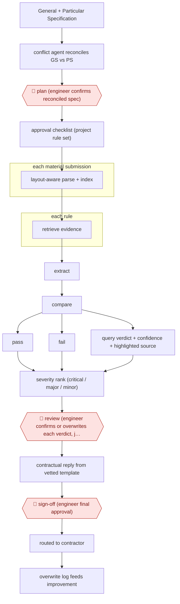

# Rule-set verdict review

`TEC › ENG › SUBMITTAL` · checkpointed · evidence A · **draft: needs a reference example** ([how to add one](../../../../../CONTRIBUTING.md#1-add-an-example-run))

**Shape:** `General + Particular Specification → conflict agent reconciles GS vs PS → 🛑 plan (engineer confirms reconciled spec) → approval checklist (project rule set) → each material submission: layout-aware parse + index → each rule: retrieve evidence → extract → compare → pass | fail | query verdict + confidence + highlighted source → severity rank (critical / major / minor) → 🛑 review (engineer confirms or overwrites each verdict, justification required on overwrite) → contractual reply from vetted template → 🛑 sign-off (engineer final approval) → routed to contractor → overwrite log feeds improvement`
**How it differs:** Closest is AWF-0151 (first-pass submittal review): a contractor-side recommendation that a PM/PE edits as a whole, then sends to the sub or the architect. Here the reviewing side (owner/consultant engineer) works from an engineer-confirmed project rule set (🛑 plan, absent in 0151). The engineer confirms or overwrites each of about 25 rule verdicts with a logged justification, and the deliverable is a templated contractual reply. AWF-0190 builds a submittal register from specs, not a review of a submission.
**Variants:** `qwen3-next-80b-on-prem` · `react-multi-agent`

<!-- shape diagram: generated by scripts/build_diagrams.py from `shape`; don't edit -->

<!-- end shape diagram -->

## Steps
1. Load the contract's General Specification (GS) and Particular Specification (PS). A Conflict Agent compares them and proposes how to resolve each mismatch, following the contract's order of precedence [[1]](#sources).
2. 🛑 **Plan**: the engineer reviews the proposed reconciliation and confirms the reconciled specification. The system then turns it into an executable Approval Checklist, which is the project's own rule set [[1]](#sources).
3. Each incoming material submission (catalogues, data sheets, third-party test certificates, compliance declarations; 60–100 pages) goes through a layout-aware parser. Tables stay whole as single chunks, and the page number and bounding box are stored with every chunk [[1]](#sources).
4. For each checklist rule, the Verification Agent runs targeted searches and then reasons in three steps: extract the claim, compare it with the threshold, conclude. It returns a JSON verdict (Pass, Fail or Query) with a confidence score and the location of its evidence, which the UI highlights on the original PDF [[1]](#sources).
5. A severity-ranking skill labels each non-compliant item Critical, Major or Minor, by its impact on the installation, safety and statutory obligations [[1]](#sources).
6. 🛑 **Review**: the engineer confirms or overwrites each verdict. An overwrite needs a free-text justification and is logged with the user's identity, a timestamp and the reason [[1]](#sources).
7. 🛑 **Sign-off**: once the engineer gives final approval, a Synthesis Agent fills fixed, legally vetted templates with the confirmed verdicts and commentary. The document goes back to the contractor through the project management platform [[1]](#sources).
8. Logged overwrites are collected as feedback for improving the system [[1]](#sources).

**Output:** A per-rule compliance report with verdicts, severity and evidence links, plus the formal contractual reply to the contractor, sent through the department's project management platform.
**Failure modes → guards:** GS/PS conflicts resolved wrongly → engineer confirms the reconciled spec before any checking. Tables split from their units, or IP54 confused with IP65 → layout-aware chunking and a domain-adapted embedder. Engineer accepts unread verdicts → highlighted evidence on every verdict, and a written justification for each overwrite. The paper's precision/recall figures are estimates built on assumed ratios; only the 12% overwrite rate was measured.

## Public runs

Coverage as of 2026-11-13: **Strong**: a first-hand, detailed run that matches most of the shape. Collected and re-checked in [Fourth collection pass](../../../../../research/2026-11-fourth-pass.md).

- [EMSD HKSAR, From Retrieval to Verification (industrial pilot)](https://openaccess-api.cms-conferences.org/articles/download/979-8-950676-12-3_12) (2026-08-25). Pilot on 10 live RMAA E&M projects: 63 material submissions, 1,575 rule-level verdicts reviewed by engineers. "a 70.9% reduction in average review time, from 52.5 minutes under the existing digital workflow to 15.3 minutes"; "human overwrites required in only 12% of verdicts". *First-hand: yes; confidence: high.*

## Sources

1. Lau, Chit, Cheung, Tse, So, Hou (Electrical and Mechanical Services Department, HKSAR Government), From Retrieval to Verification: An Agentic Framework for Rule-Aware Engineering Document Compliance, IHIET 2026 / AHFE Open Access vol. 236, 2026-08-25. https://openaccess-api.cms-conferences.org/articles/download/979-8-950676-12-3_12
