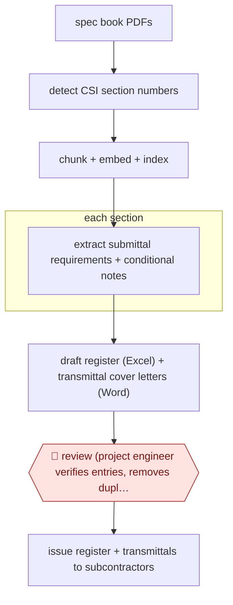

# Spec-to-submittal register

`TEC › ENG › SUBMITTAL` · checkpointed · evidence B · **draft: needs a reference example** ([how to add one](../../../../../CONTRIBUTING.md#1-add-an-example-run))

**Shape:** `spec book PDFs → detect CSI section numbers → chunk + embed + index → each section: extract submittal requirements + conditional notes → draft register (Excel) + transmittal cover letters (Word) → 🛑 review (project engineer verifies entries, removes duplicates, fills gaps) → issue register + transmittals to subcontractors`
**Variants:** `custom-rag-gpt-4o-mini` · `pype-autospecs`

<!-- shape diagram: generated by scripts/build_diagrams.py from `shape`; don't edit -->

<!-- end shape diagram -->

## Background

A construction project's specification is a book of several hundred to over a thousand pages that says, section by section, what every part of the building must be. Buried in it are requirements to submit something for approval: a product data sheet for the sealant, a sample of the brick, a test report for the concrete mix, a certificate for the fire door. At the start of a job someone has to read the whole book and write every one of those obligations into a register — the submittal log — because that log becomes the schedule's dependency list: nothing can be bought or installed until its submittal is approved, and a requirement nobody wrote down is discovered weeks later, when the material is already late. Assembling the log by hand takes an experienced project engineer days, and it is exactly the kind of reading where a clause in the middle of a paragraph gets missed. Here the agent reads the book, splits it by section, extracts the requirement and any condition attached to it, and drafts the register with the cover letters that go to subcontractors. The project engineer then verifies the rows, deletes duplicates, fills what the extraction missed and issues it: the register is a contractual instrument that binds trades to dates, so a person signs it.

**Terms:**
- **specification (spec book)**: the project manual that states the technical requirements for every part of the work.
- **CSI section numbering**: the standard way specification sections are numbered, by division and section, such as 07 21 00 for thermal insulation.
- **submittal register / log**: the list of every item that must be submitted for approval, with its spec section, type and due date.
- **transmittal**: the cover letter that sends a document and records that it was sent.
- **action submittal**: one that needs approval before work proceeds, as opposed to an informational one.
- **conditional note**: a requirement that applies only if something else is true, such as "if the substrate is concrete".
- **long-lead item**: material with a delivery time long enough that its submittal must be approved early.
- **project engineer**: the contractor's engineer who owns the submittal process on site.

## Build it with an agent

**Form:** `skill`. One project engineer runs it once at project start, on one spec set, and verifies the draft in a conversation; the extraction work fans out per section inside that skill.

**You need:** the spec book as PDF, text-based rather than scanned; the project's division list and the register template in the format the team's platform accepts; the transmittal template; past registers from similar projects as a benchmark; the platform's section list so the register can be keyed to it. The agent needs no platform write access: issuing is a person's step.

| Step | Built as |
|---|---|
| spec book PDFs | A script beside the skill extracts text page by page and refuses to guess where a page is a scan, so scanned drawings are left out rather than half-read. |
| detect CSI section numbers | The same script applies number patterns tuned to the standard section format and reports the sections it found, with pages, for the engineer to compare against the book's own table of contents. |
| chunk + embed + index | A local index per project, chunks overlapping so a clause that spans a page break is not cut in two. |
| each section: extract submittal requirements + conditional notes | One Subagent per division, given only that division's chunks, returning rows of section number, requirement, condition and source page — and nothing when the text states no requirement. |
| draft register (Excel) + transmittal cover letters (Word) | A script writes both files from the rows, so the spreadsheet and the letters cannot disagree. |
| 🛑 review (project engineer verifies entries, removes duplicates, fills gaps) | The Skill stops with the draft and a list of the sections where it found nothing, which is where a gap is most likely; the engineer edits the register itself, and the edits are kept as the record for the next project. |
| issue register + transmittals to subcontractors | Outside the agent: the engineer issues through the project platform. |

**Checkpoints:** `review`: the register is a draft until a person has gone through it, and the build makes the review tractable by listing the empty sections alongside the filled ones — the failure that matters is omission, which a spreadsheet of rows cannot show on its own. The agent has no access to the platform, so nothing can be issued from it.

**Since the sources:** Sources date from 2026-01, plus an undated vendor case study. The peer-reviewed field test was not re-opened on this pass; the vendor's product position was checked instead. What has changed since: the tool named in `variants` has moved. Pype AutoSpecs is now an Autodesk product, licensed only inside the Forma for Construction Operations bundle, and two older Pype products (eBinder and SmartPlans) were withdrawn from sale in March 2024; the current product adds [version diffing across spec revisions and suggested missing items drawn from similar projects](https://testedintelligence.com/pype-review). That matters for this entry because a register built once goes stale the moment an addendum lands: the build above should be re-run on the revised spec and diffed against the issued register, rather than maintained by hand.

*A design based on this entry's steps and the tool documentation as of 2026-11, not a reported run.*

## Steps

*As reported by the sources.*

1. Upload the project specification PDFs (800 to 1,500 pages) to the tool; text is extracted page by page [[1]](#sources).
2. Detect and segment specification sections with regular expressions tuned to CSI SectionFormat numbering (e.g. "07 21 00", "072100") so no manual markup is needed [[1]](#sources).
3. Split each section into overlapping chunks, embed them and store them in a vector index; scanned images and drawings are excluded [[1]](#sources).
4. For each section (or a user query such as "List all submittals under 07 21 00"), retrieve the relevant chunks and have the model return structured rows: section number, submittal requirement, conditional notes [[1]](#sources).
5. Export the rows to a transmittal-ready Excel register and Word cover letters [[1]](#sources). Commercial tools do the same step as a one-shot draft log [[2]](#sources).
6. 🛑 **Review**: the project engineer verifies extracted entries and corrects misclassifications and duplicate rows before the log is used; the authors report some entries "required expert review" [[1]](#sources). At Mortenson the time saved on drafting went into "more thorough reviews" [[2]](#sources).
7. Issue the verified register and transmittals to subcontractors; register then drives the submittal review cycle (see AWF-0151).

**Output:** A verified submittal register (Excel) plus transmittal cover letters, issued at project start and used to track every required submittal.
**Failure modes → guards:** Semantic drift creates duplicate entries from similar phrases in adjacent paragraphs; long clauses exceed the context window and drop secondary conditions → smaller chunks, adaptive prompts, and the project engineer's line-by-line review [1].
**How it differs:** AWF-0151 First-pass submittal review checks a submittal a subcontractor has already sent against the spec and ends in architect disposition. This workflow produces the register of required submittals before any arrive; the deliverable is the log, the only checkpoint is the project engineer's verification, and no designer signs off.

## Public runs

Coverage as of 2026-11-13: **Strong**: a first-hand, detailed run that matches most of the shape. Collected and re-checked in [Third collection pass](../../../../../research/2026-11-third-pass.md).

- [Kalasapudi et al., Frontiers in Built Environment](https://www.frontiersin.org/journals/built-environment/articles/10.3389/fbuil.2025.1713342/full) (2026-01-02). Peer-reviewed field test with a civil contractor; benchmark on ten 800–1,500 page specs; human review of entries kept. "Average end-to-end processing time was approximately 6–8 min per document"; "total computational costs under USD 0.10 per file". *First-hand: study; confidence: high.*
- [Pype, Mortenson case study](https://www.casestudies.com/company/pype/case-study/mortenson-scales-accuracy-quality-of-submittal-log-review-with-pype) (n.d.). Large GC drafts submittal log automatically, then reviews it; more submittal items found. "reduced the time spent creating a draft log by 99%, from 34 hours down to under 5 minutes". *First-hand: vendor; confidence: med.*

## Sources

1. Kalasapudi, Seelam, Ganupa, Tofferi (University of North Florida; Petticoat-Schmitt Civil Contractors), The overlooked frontier of AI in construction: conversational, document-native automation for administrative workflows, Frontiers in Built Environment, 2026-01-02. https://www.frontiersin.org/journals/built-environment/articles/10.3389/fbuil.2025.1713342/full
2. CaseStudies.com / Pype, Mortenson achieves 99% faster submittal log review with Pype AutoSpecs, n.d. https://www.casestudies.com/company/pype/case-study/mortenson-scales-accuracy-quality-of-submittal-log-review-with-pype
